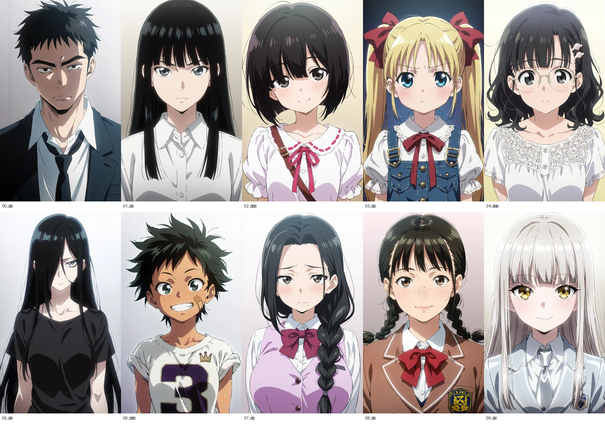

# 立绘基准样例：《我才不会被女孩子欺负呢》

这份目录的第一身份不是「又一份完整输出」，而是**出图的参照系**。

2026-11-20 跑的这本书，10 张立绘里 9 张画风、取景、光照、背景完全同代，是这个 skill 到目前
最整齐的一批。往后每本书出完图，都拿 `人物图/_联系表.webp` 跟这里对一眼：线条粗细、上色方式、
脸部比例、背景灰度是不是一路的；不对就先查 `appearance_prompt`，别去动全局画风。



## 这一批用的参数（可复现）

```bash
python scripts/gen_portraits.py --json <输出目录>/人物数据.json --out <输出目录> \
    --style anime --artist morikura_en --resolution portrait --steps 12
# seed 未加 --seed-salt，即 --seed-mode name + salt 0：按角色名 sha256 派生
```

每张的完整 prompt、seed、artwork_id 都在 [`人物图/_图片索引.json`](人物图/_图片索引.json)，
任何一张都能用 `--only <名> --force` 原样复现。

## 为什么这 10 张看着齐

拆开看，是六件事同时做到了，缺一件就会散：

| 项 | 这批的做法 | 散掉的后果 |
|---|---|---|
| 取景 | 全员 `upper body` + 脚本补的 `portrait` | 有人半身有人全身，拼一起像两个画师 |
| 背景 | 统一 `simple background, gradient background` | 出现教室/街道，注意力被抢，色调也乱 |
| 服装 | 每人**只一套**，写颜色和领型 | 把全书穿过的都列上，模型串成一身怪衣服 |
| 表情 | 每人**一个**，且各不相同：`bright smile` / `stern gaze` / `cold expression` / `bashful expression, blushing` / `timid expression, downcast eyes` | 十张全「微笑看镜头」，像证件照 |
| 发色 | 明确词：`jet black hair` / `blonde hair` / `silver hair` | 只写 `black hair`，出来带绿蓝挑染 |
| 画风词 | `appearance_prompt` 里**一个都没有**，全交给 `morikura_en` + STYLE | 角色自己写 `realistic`，与负向词打架，一张赛璐璐一张写实 |

## prompt 的写法范式

`_图片索引.json` 里 10 条 prompt 是同一个骨架，顺序别乱（越靠前权重越高）：

```
1girl, solo,                      ← 人数（脚本也会补，写了更稳）
short black hair, boyish short hair, long bangs, bangs covering one eye,   ← 头发：色+长+质感+刘海
large dark eyes, watery eyes,     ← 眼睛：大小+瞳色+神态
fair skin, small face, delicate facial features, small lips, light blush,  ← 肤/脸/唇/腮红
cherry red ribbon blouse, short puff sleeves, ribbon bow at collar, round neckline,  ← 服装：主件+袖+领+细节
head tilt, bright smile,          ← 表情与姿态（收尾，权重末端反而最出效果）
```

对照读三个人：

| 角色 | 关键几段 | 出图结果 |
|---|---|---|
| 舒莎 | `jet black hair, long straight hair, waist-length hair, center part` + `serious expression, stern gaze` | 黑长直、板正白衬衫、皱眉——班长那股硬气出来了 |
| 庄妮 | `one eye covered by hair` + `light grey eyes, heavy dark circles under eyes` + `cold expression, faint frown` | 遮眼、黑眼圈、冷脸，病弱感靠这三个 tag 就够 |
| 宫彩彩 | `thin round-framed glasses` + `eyelet floral embroidery` + `bashful expression, blushing` | 圆框眼镜 + 蕾丝刺绣 + 脸红，性格一并给了 |

## 唯一不齐的一张：06 熊瑶月

她跟其余 9 张明显两代：粗线、重阴影、小麦色皮肤、满脸元气，更像少年热血漫。原因是她那串 tag
本身就指向那个方向，叠在一起把画师风格压过去了：

```
wild spiky short hair, wheat-colored tan skin, two small fangs, canine tooth showing,
band-aid on cheek, wide grin, number 3 print on shirt, small crown motif
```

其中 `number 3 print on shirt` / `small crown motif` 这类**衣物印花 tag** 最要命：模型会认真去画
数字和图案，顺手把上色拉粗，还可能画出假字母（另一本书出过「KM'SO」那种东西）。

当时的处理是**保留原文、如实标注画风不统一**，没有为了画面好看把她改成柔光少女——原文写的是
野、是糙，改了就假。往后遇到同类：还原气质优先，印花能省则省；`gen_portraits.py` 现在会对
这类 tag 打 `[warn]` 提醒。

## 文件清单

| 文件 | 看什么 |
|---|---|
| [`人物图/_联系表.webp`](人物图/_联系表.webp) | **出图基准**。1600×1124，10 张一屏对照 |
| [`人物图/`](人物图) | 10 张立绘（限宽 560 的展示副本，原图 920×1536） |
| [`人物图/_图片索引.json`](人物图/_图片索引.json) | 每张的 prompt / seed / artwork_id / 名场面台词 |
| [`我才不会被女孩子欺负呢_书评.md`](我才不会被女孩子欺负呢_书评.md) | 主交付物：8 维评分 → 简介 → 雷点/郁闷点 → 9 位女主 → 分维度点评 |
| [`我才不会被女孩子欺负呢_人物卡.md`](我才不会被女孩子欺负呢_人物卡.md) | 备查卡片：身份、别名、外貌原文、纯洁度四维、名场面 |
| [`我才不会被女孩子欺负呢_人物数据.json`](我才不会被女孩子欺负呢_人物数据.json) | 结构化数据，做视频/知识库直接吃 |
| [`中间产物样例/`](中间产物样例) | 一份角色 JSON（任小芹）、一份分块笔记（块17） |
| [`封面.webp`](封面.webp) | 书评首图（走 `pick_cover.py` 从公开图库挑，不是生成的） |

## 这本书本身的账

废铁行者，461.3 万字 / 1365 章，完结。9 位女主 + 男主叶麟，全书雷点 4 条、郁闷点 38 条，
开放式结局。审计：引文 75/75 命中、外貌 10/10、名场面 10/10、书级 8 维 8/8、成品行号残留 0。
贴吧长图 23 张 / 3 楼 / 30.1MB（长图不进仓库）。
