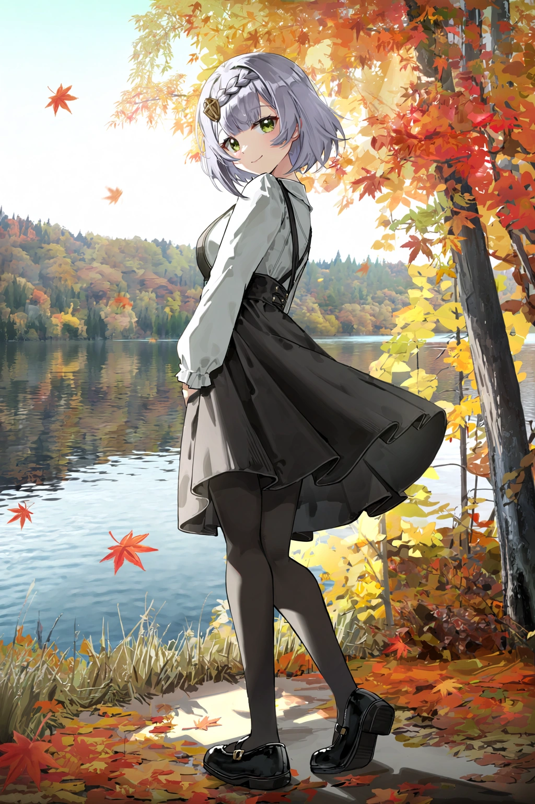
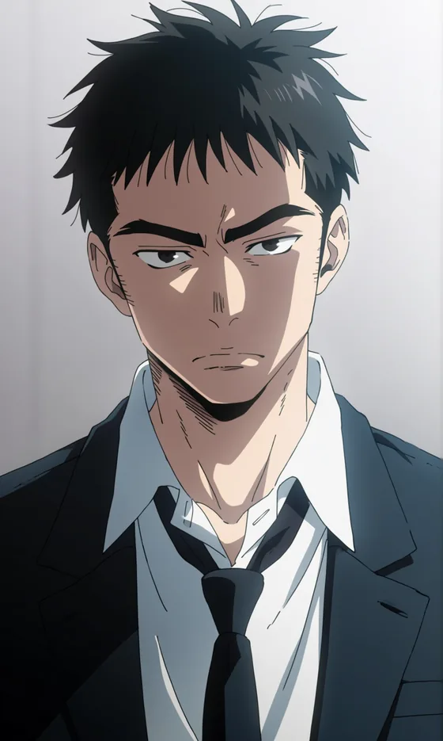
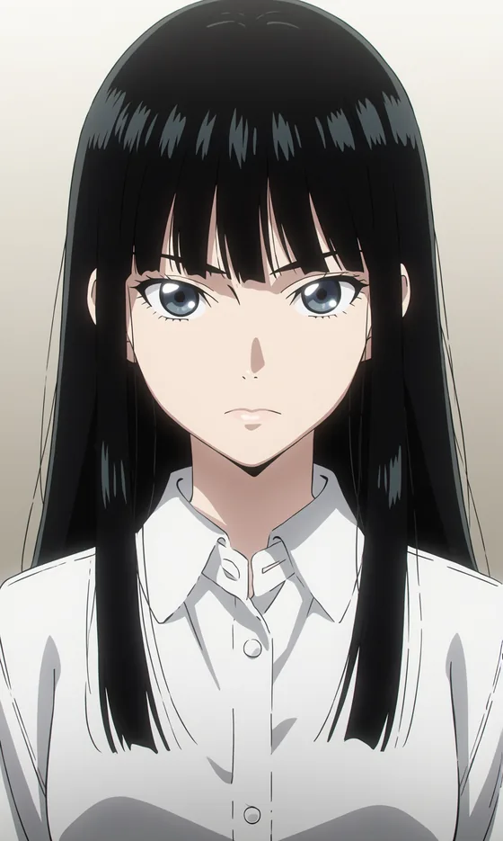
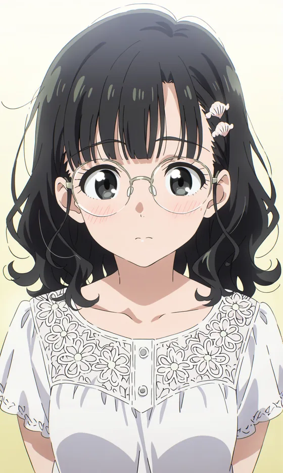
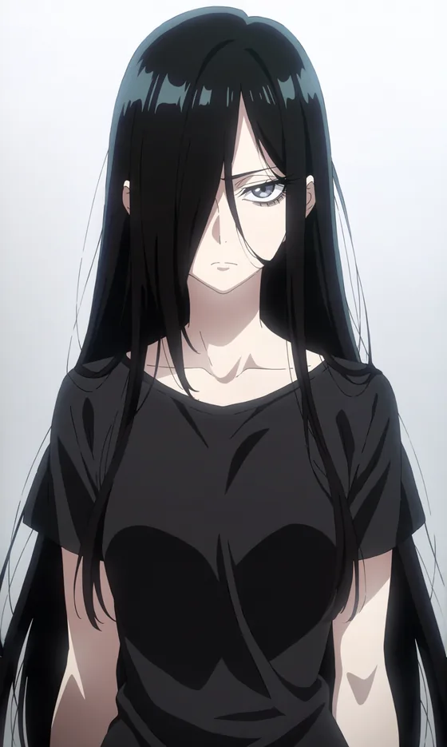
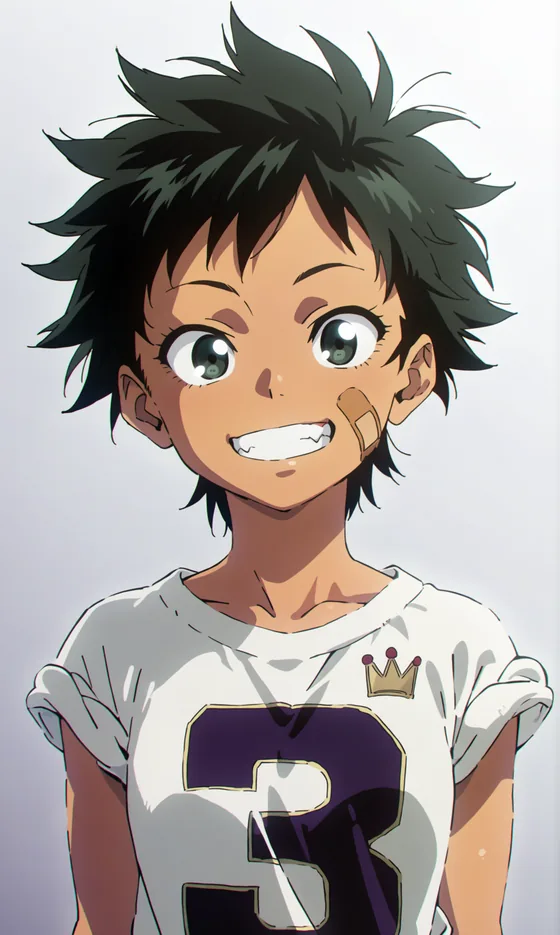
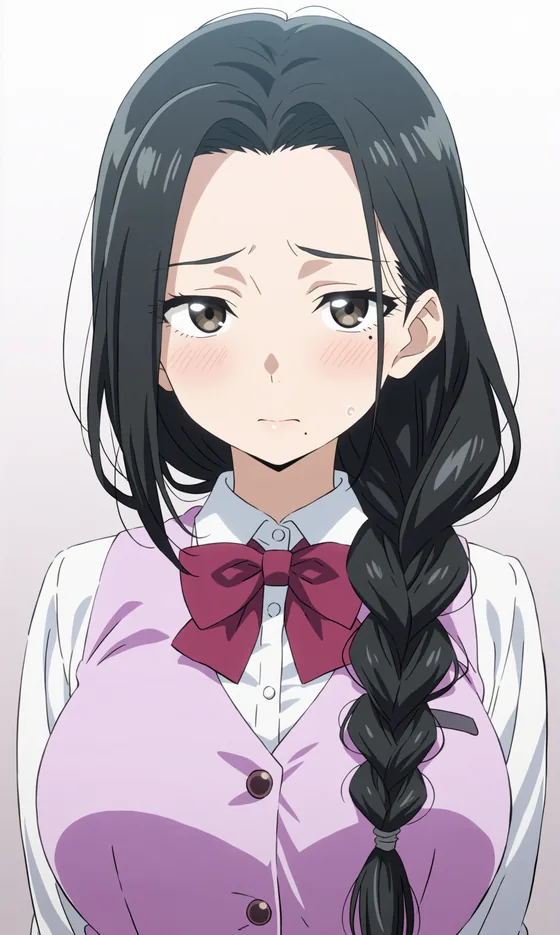
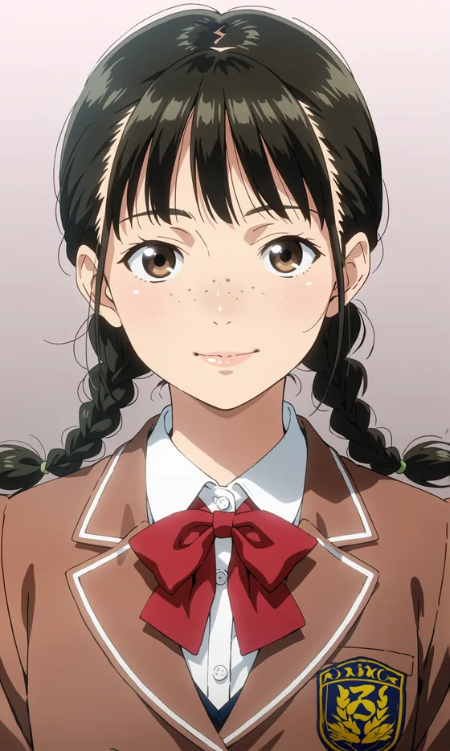

# 完结仙草：校园后宫 宿敌倒追 成人网店 阴阳散手 461.3万字

**《我才不会被女孩子欺负呢》 ｜ 作者：废铁行者 ｜ 字数：461.3 万字 ｜ 1365 章**

**题材：校园 后宫 都市 搞笑** ｜ **状态：完结** ｜ **平台：未知**

## 评分

| 维度     |  档位  | 依据                                                                       |
| :------- | :----: | -------------------------------------------------------------------------- |
| 情节     | **A-** | 决斗、插班一路写到孤岛核潜艇，单元剧不断线；中后段转科幻后明显拖长注水。   |
| 文笔     | **B+** | 第一人称吐槽密集、梗接梗，读着顺；代价是同一套感叹句反复用，水章多。       |
| 感情     | **A-** | 小芹的直球、舒莎的克制、艾米的黏人各有手感；推进多靠误会和追逃循环。       |
| 车速     | **A**  | 成人网店与H漫梗贯穿全书，关键处只写动作不写细节，敢开不敢露。              |
| 人物刻画 | **A-** | 庄妮的毒舌、熊瑶月的大嗓门、曹公公的猥琐都立得住；配角后期多半只剩功能。   |
| 新意     | **B+** | 校园打闹接生化魔药与人工智能，混搭有记忆点；后期设定越堆越大，收束偏机械。 |
| 压抑度   | **C**  | 底色是爆笑吐槽，中毒濒死、坠海等虐点都很快翻盘，结局团圆。                 |
| 总评     | **A-** | 前三百章的校园喜剧是同类上品，后期转科幻动作跑偏，靠人物和梗撑住全本。     |

> 评分为阅读主观判断，非原文事实；事实性结论见下方排雷与人物依据。

## 简介

十四岁的叶麟在冬山市二十八中读初二，面相凶、眼神狠，全班都当他是不良少年，其实他只是个会替老爸看成人用品网店的普通男生。他唯一的执念，是找童年宿敌“小霸王”报仇——那个从六岁起抢他玩具、把他按进泥坑的家伙。

决斗那天，雾气里走来的是个矮他一头的短发女生。小霸王本名任小芹，她当众承认自己是女孩，还抱住他告白，要他做男朋友。叶麟撕掉纸条拒绝，转头踩鞋、浇可乐、抽椅子，想把这个“阴谋”逼回去，却被全班当成欺负女生的恶人。

麻烦远不止这些：班长舒莎盯着他，童星艾米把他当男仆，庄妮扬言要阉了他，老爸的网店还等着他发货。与此同时，一个从美国打来的电话，让抛家弃子的生母艾淑乔重新进入他的生活——她要他离开这座城市，否则后果自负。

## 雷点与郁闷点（开读前先看）

> 全书 **4 处雷点**、**38 处郁闷点**。雷点＝容易直接弃书的踩线项（背叛、绿帽、神雕、死女、漏女一类）；郁闷点＝膈应但未必弃书（拒女、虐心、擦边、百合、拉皮条、虐主一类）。**按自己的接受度决定要不要读**——下面只列索引，具体情节与原文引文见各角色条目。

**雷点**

- **艾米 · 绿帽**：艾淑乔当年抛下叶麟父子，与美国人生下艾米，叶麟父亲被前妻背叛
- **苏巧 · 背叛**：苏巧受艾淑乔指使，把大麻塞进叶麟的背包，害他差点背上贩毒罪名被送进少管所；事后她当面跪着向叶麟认罪。
- **小茵 · 背叛**：小茵为了独占叶麟，故意把班长、艾米、小芹的行踪和弱点透给唯尊会，让三人被掳走，好让叶麟去救人。
- **小茵 · 背叛**：小茵被方信留下的病毒击溃，人格被抹、算力只剩两成，重生成听命艾淑乔的“黑圣婴”，转头对付叶麟一方。

**郁闷点分布**

| 类别       | 次数 | 涉及角色                                                                               |
| :--------- | :--: | :------------------------------------------------------------------------------------- |
| **虐心**   |  16  | 舒莎（2 次）、任小芹（3 次）、艾米（3 次）、宫彩彩、庄妮（2 次）、熊瑶月（4 次）、苏巧 |
| **百合**   |  7   | 舒莎（2 次）、宫彩彩、庄妮（2 次）、熊瑶月、小茵                                       |
| **漏女**   |  4   | 舒莎、熊瑶月、苏巧、何菱                                                               |
| **虐主**   |  4   | 任小芹（2 次）、庄妮（2 次）                                                           |
| **拒女**   |  3   | 舒莎、任小芹（2 次）                                                                   |
| **拉皮条** |  2   | 苏巧、何菱                                                                             |
| **未归类** |  2   | 宫彩彩（2 次）                                                                         |

## 男主

### 叶麟

**身份**：冬山市二十八中初二（3）班学生，后升初三。

**外貌**：面相凶：眼睛狭长、眼珠又小又黑，笑起来像杀人凶手；额前有一缕翘起的“狼毫”，结局时这缕头发先变白。作者没正面写他的发型。

**经历**：十四岁那年，初二（3）班的叶麟为洗掉童年阴影，给欺负了他三年的“小霸王”下战书，决斗当天才发现对方是女孩任小芹；她当众抱住他告白，他撕纸条拒绝，反过来踩鞋、浇可乐欺负她，却始终下不了狠手，被她一步步缠成“青梅竹马”。

此后他一边应付舒莎、熊瑶月、艾米等人，一边接手老爸的网店、打混混、跟任老爷子学阴阳散手，被收为关门弟子，也得知艾米是同母异父的妹妹、自己患了病毒性心脏病。艾淑乔回国后，他被卷进绑架、卧底、夺解药的连场恶斗。结局在天使岛中毒濒死、头发变白，小芹割绳坠海抢回解药救活他；他没有选定谁，与小芹、舒莎、艾米同船返航，自嘲不会开什么空前绝后的大后宫。

**性格**：面相凶、眼神狠，从小被当成不良少年，实际只练武不打人，被逼到底线才动手；嘴硬心软，怕女人、怕被人看穿心事，对别人的示好习惯用毒舌挡回去；自我吐槽成瘾，遇事先算利弊再耍小聪明，真到关键处护人护到底。

> **名场面**：「哼，就算我喜欢班长，又跟你有什么关系啊？」 —— 小芹问他是不是喜欢班长舒莎，叶麟为断她的念想，硬着心肠甩出这句，把她刺得低头挡住眼睛

## 女主

### 1. 舒莎

**身份**：冬山市第二十八中学初二（3）班的女班长，后来随班升读仍当班长；家中长女，弟弟舒哲与她同校，母亲林雨梦在上海的疫苗研究所工作，家务和管弟弟多半由她扛；一心考警校、想当刑警。

**外貌**：黑长直发，及腰、几乎垂到地面；深墨色大眼，眉峰常微蹙，鼻梁挺拔，浅粉色嘴唇；在校多穿蓝底白杠运动款校服，便服常是白衬衫配牛仔裤。

**经历**：叶麟初二（3）班的班长，开学就指认他欺负转学生任小芹，把他当重点监管对象，查书包、没收东西、当众训人，两人针锋相对。其后一起照顾流浪狗、拦车救狗、追查偷拍与虐猫，她渐渐把他当成最信得过的搭档，也动了心。李存壮替他表白后，她脸红到一周不说话；叶麟山中失踪时她发短信说活着回来就嫁他，人回来后却删掉，只答至少要等到高中毕业。大结局在天使岛，叶麟中毒将死，她哭着说心里再装不下别人。

**纯洁度**：未知（未成年学生，按规范不作判定）

**性格特点**：正义感强、强势班长、嘴硬心软、责任心重

**郁闷点**

- **百合**：庄妮在翠松山集合时当众捧住舒莎的脸要亲她，被挡开后故意后仰摔向柏油路，逼舒莎让步。
  > 「双手捧住班长的脸，当着众人的面，直接打算亲下去」
- **百合**：任小芹醉酒后以小霸王人格强吻舒莎，还当众宣称舒莎是她的女人，让她又气又没法计较。
  > 「对着班长的嘴唇亲了一口」
- **虐心**：黑圣婴逼叶麟当众侵犯假扮成舒莎的舒哲，舒莎亲眼目睹后认定是叶麟做的，哭着与他决裂。
  > 「你做了不可原谅的事！我恨你！我以后再也不想见到你了！」
- **虐心**：舒莎在爱心宠物医院做义工照顾的流浪狗小黑病死，她伏在点滴台上护着尸体，谁劝都不肯让人碰。
  > 「班长伏在点滴台上，双手护着一团毛茸茸的黑色物体，哭红了眼睛」
- **拒女**：叶麟在翠松山失踪时，舒莎发出“活着回来我就嫁给你”的短信；叶麟生还后她把短信删掉，被追问时只说至少要等到高中毕业，把话收了回去。
  > 「至少要等到高中毕业」
- **漏女**：舒莎认定任小芹在叶麟昏迷期间付出更多，自己成了局外人，于是主动放弃追求，此后与叶麟保持距离。
  > 「于是就完全放弃了主动」

> **名场面**：「就算不把身体交给你，我的心也没有空间再留给别人了！」 —— 大结局天使岛，叶麟中毒将死、拒绝她的安慰，舒莎泣不成声地表明心迹

### 2. 任小芹

**身份**：冬山市第二十八中学初二（3）班学生，后随班升初三；叶麟从六岁起的童年宿敌。

**外貌**：男孩似的短发，后来留长到能盖住额头鬓角；长刘海常常挡着眼睛，五官精致，眼睛大而水汽，嘴唇小巧。常穿米色小西服套裙，或白色短褶裙配樱红色缎带的短肩上衣，拎米奇图案小挎包。

**经历**：六岁起把叶麟当宿敌欺负，三年后约在决斗地点，坦白自己是女孩并当众表白，被拒。她插班坐到叶麟邻桌继续追，被踩鞋、浇可乐也不恼；叶麟用“秘密男友”敷衍，她雨夜爬五楼窗外二次告白。底细陆续揭开：女校“霸王花”创始人芹姐、为当女孩退学宅家三年、生父是三合会堂主霍振邦。叶麟得心脏病后把她降回青梅竹马、又收作义妹，她照旧跟着卧底、打架、救人。结局崖上她割绳坠海换他活命，叶麟当众许诺娶她；她带着解药回来，全书开放式收束，她名分领先。

**纯洁度**：未知（未成年学生，按规范不作判定）

**性格特点**：直球、黏人、能打、漫画宅

**郁闷点**

- **虐主**：任小芹黑化后对叶麟使出反关节技，拧伤他的左臂，医生诊断为肘关节骨膜损伤。
  > 「属于正常的肘关节骨膜损伤」
- **虐主**：任小芹吃了酒糖醉成小霸王，当街把叶麟踩在脚下，还把他的脸打肿。
  > 「不知为何被小芹踩在脚下，脸也被打肿了。」
- **虐心**：叶麟答应让任小芹当女朋友，心里却盘算着怎么把她甩掉，好让她自己走。
  > 「我确实做了抛弃小芹的打算」
- **虐心**：崖上任小芹割断绳索坠海，只为不再拖累叶麟，坠落时还笑着向他道歉。
  > 「（_^＿＿^_） 嘻嘻……又骗了我最喜欢的阿麟，对不起。」
- **拒女**：任小芹在决斗地点抱住叶麟的腰求他当男朋友，叶麟当场回绝，还补一句“就是因为我不喜欢你”，把她钉在原地。
  > 「当你的男朋友——是绝对不可能的！」
- **拒女**：叶麟心里打定主意把任小芹收作妹妹，好让两人之间隔着一条迈不过去的沟，始终不给恋人名分。
  > 「干脆就让她也成为妹妹吧！变成每天和我朝夕相处，但是中间又隔着巨大鸿沟的妹妹吧！」
- **虐心**：任小芹追问叶麟是不是喜欢班长，叶麟一句“跟你有什么关系”顶回去，她低下头，把四根手指插进鬓角头发里挡住眼睛。
  > 「哼，就算我喜欢班长，又跟你有什么关系啊？」

> **名场面**：「我是有病啊！所以才想让叶麟同学做我的男朋友的……啊，说出来了，好害羞！」 —— 叶麟踩了她的鞋、抽了她的椅子，问她被这样欺负怎么不生气，她顺势把心意说了出来

### 3. 艾米

**身份**：美籍混血童星，艺名艾蜜儿，青姿学园初中部学生；后期当上青姿高中“校长”、天牧星光董事长，叶麟同母异父的妹妹。

**外貌**：金黄色长发用蝴蝶结扎成双马尾，蓝眼睛大得几乎占半张脸，皮肤白得像细瓷；混血面孔，洋气里带东方的纤细；常穿缀花边的短衬衫配牛仔小马甲，或一身小洋装。

**经历**：地铁站初遇，叶麟把她的艺名“艾蜜儿”念成“艾米”，她把他当成跟踪狂踢了一脚。她雇叶麟抄《圣经》作业、甩出信用卡，把他当“男仆”使唤。暴雨天她拉他上街散步，树倒时叶麟推开她被压伤，她第一次为他大哭。DNA化验单揭穿两人是同母异父兄妹，她撕单否认，追到门口抱住他改口叫哥哥。此后她随剧组拍戏、组电竞战队、操办海岛行，也一再劝他向母亲低头。结局叶麟被黑天使反噬，她扑上去要救，被抱出医务室，最终与小芹、班长成了要好的朋友。

**纯洁度**：未知（未成年学生，按规范不作判定）

**性格特点**：骄傲任性、嘴毒、黏人、骄纵重情

**雷点**

- **绿帽**：艾淑乔当年抛下叶麟父子，与美国人生下艾米，叶麟父亲被前妻背叛
  > 「艾米的生父约翰，是NTR了我老爸的人」

**郁闷点**

- **虐心**：艾淑乔借不到四岁的艾米之手毒死她爷爷，艾米长大后才想起这件事
  > 「借助不到4岁的女儿的手，让艾米亲手毒死的啊！」
- **虐心**：艾淑乔把艾米当联姻筹码，说要把她嫁给年轻有为的商界精英换利益
  > 「艾米未来的归宿应该是被我嫁给一个年轻有为的商界精英吧」
- **虐心**：艾米从母亲口中得知童年保镖瓦夏的遗言是照顾她，在沙滩上痛哭
  > 「帮我照顾她」

> **名场面**：「艾蜜儿是艺名，只有家里人才叫我艾米呢！」 —— 地铁站初次相遇，叶麟把她的艺名念丢一个音成了“艾米”，她一脸戒备地追问他是怎么知道本名的。

### 4. 宫彩彩

**身份**：冬山市第二十八中学初二（3）班学生，学习委员兼生活委员，负责管班费；升初三后卸任学委，被老师举荐当学校图书管理员。

**外貌**：个子矮，略微天然卷的头发，左耳用一只朴素的贝壳发夹收束；平时戴隐形眼镜，偶尔换成圆框眼镜。常穿圆领镂空碎花的白色雪纺衬衫配校服裤，便服多是过膝长裙这类保守款式。

**经历**：同班学习委员兼生活委员，写字全班公认最好。叶麟上讲台挑字好的女生“借手”写字，两人才第一次正式说话，她吓得直发抖。此后屡被卷进闹剧：天桥被卖兔小贩讹诈由叶麟解围，被熊瑶月关进铁柜，被整袋安全套淋头，被庄妮以“按摩减肥”骗去旅馆。14岁生日只请了五个女生。升初三后与庄妮合画星空板报，由叶麟护送回家，坦白自己信“科学幸福教”只为长高、离不开班长。不久在校门外被绑匪劫走，吓傻后获救。尾声卸任学委改当图书管理员，全书结束时发短信说想见他。

**纯洁度**：未知（未成年学生，按规范不作判定）

**性格特点**：胆小爱哭、听话守规矩、认真死板、依赖班长

**郁闷点**

- **虐心**：宫彩彩在音乐课后撞见叶麟和班长贴在一起，以为自己要被灭口，抱头蹲着连声求饶，反复保证什么都没看见、绝不会说出去。
  > 「请放过我！我不不不不不会说出去的！」
- **未归类**：任小芹逼宫彩彩把她和叶麟的作业本放在一起，扬言不然就脱她裤子；宫彩彩吓得在长裤外面系紧腰带，上体育课跑步时呼吸不畅晕倒，被熊瑶月和班长抬去医务室。
  > 「你不穿裙子，我照样可以脱你的裤子啊！」
- **未归类**：熊瑶月说要治宫彩彩的幽闭恐惧症，把她关进三楼闲置铁柜，接了个电话就把人忘了；宫彩彩在柜里瘫到半虚脱，最后叶麟在第三十三个柜子里找到她。
  > 「脸色惨白，抱着膝盖，瘫坐着发抖的宫彩彩」
- **百合**：宫彩彩被班长人工呼吸救醒后以为还在做梦，当众说想嫁给班长；庄妮也长期对外宣称要娶她和班长，把她当成“偏房”。
  > 「能够嫁给班长就太好了啊！」

> **名场面**：「对、对不起！我不是讨厌叶麟同学！我是害怕被小芹同学看见咱们拉手！」 —— 开学第一天夜里，叶麟送揉掉隐形眼镜、脚腕带伤的宫彩彩回家，她想借力又不敢牵手，慌慌张张地解释

### 5. 庄妮

**身份**：冬山市第二十八中学初二（3）班文艺委员，升初三后仍在（3）班，后来随班进入青姿高中高二（3）班。

**外貌**：皮肤苍白得近乎病态，乌黑长发过肩，斜刘海挡住半张脸只露左眼，眼下浓重黑眼圈，瞳孔偏淡。几乎只穿黑色：黑套裙或黑长裙配半透明黑丝袜（校方特批），黑色尖头柳钉鞋。

**经历**：初二她长期请病假，班长带大喇叭上门探望，她自述割腕是因为暗恋班长，当场告白。此后她把叶麟当成抢班长的情敌：旅馆设局、天桥用钢琴线勒颈、麻药绑缚要阉他。翠松山野游她照穿黑裙黑丝，装吐血、半身探出车窗逼人让步；生日那天班长背着她办了惊喜派对，她才算有了朋友。人质事件她持刀捅倒歹徒，地震被小芹救下后嘴硬不道谢。升入青姿高中仍同班，最后被艾淑乔的爱情魔药控制，靠叶麟的信息素保住人格，用鱼雷管把他发射到天使岛，自己险遭活体解剖，获救后安置在无菌室，没有生命危险。

**纯洁度**：未知（未成年学生，按规范不作判定）

**性格特点**：毒舌刻薄、厌男、偏执百合、嘴硬心软

**郁闷点**

- **百合**：翠松山集合点，庄妮当着全班捧住班长的脸要亲下去，被拦下后索性后仰往柏油路上摔，用受伤逼班长让步。
  > 「伸出艺术家一般的颀长手指，双手捧住班长的脸」
- **虐心**：庄妮潜入帝王大厦想拔掉小茵的电源，被小茵关进狭窄狗笼断水近20小时；她宁可咬破手腕喝自己的血，也不肯向叶麟服软。
  > 「把庄妮关在这么狭窄的狗笼里20个小时」
- **虐心**：艾淑乔把庄妮交给克林格做爱情魔药研究，克林格将她绑上手术台准备活体解剖，叶麟闯进手术室才把她救下来。
  > 「克林格研究猴子的时候常常会使用活体解剖，所以你应该懂。」
- **虐主**：庄妮用班长的街头立体画做诱饵，把叶麟引进窄巷，从背后用钢琴线勒住他脖子，要杀了他独占班长。
  > 「只要杀掉了你，班长就是我一个人的了！」
- **虐主**：庄妮用麻药放倒叶麟，以丝袜把他捆在床上，举着美工刀要阉了他，最后被挣脱的叶麟勒晕。
  > 「我不会杀你，但是我要让你做不成男人！」
- **百合**：庄妮只对女生有感情，从头到尾把班长当追求对象、把宫彩彩当偏房，对叶麟只有厌恶和敌意，全书没有给男主留任何恋爱回应。
  > 「但是我庄妮是将来要娶舒莎的人！我对她是非常认真的！」

> **名场面**：「舒莎，我喜欢的人是你。」 —— 班长和大喇叭到庄妮家里探病，庄妮说完自己割腕是因为暗恋同班同学，突然把脸转向班长当众告白

### 6. 熊瑶月

**身份**：冬山市第二十八中学初二（3）班学生，班里的女体委，体育全能，跑步、排球、篮球都能顶上；后来当上艾米组建的LOL战队“金色闪电”永久队长，又成了刑部五虎口中的大姐头，班里还给她安过“灭蚊委员”的名头。

**外貌**：一头方便打理的短碎发，碎发下露出大片前额，看着又狂野又精神；皮肤是晒太阳晒出来的小麦色，一笑就露出两颗小虎牙，脸上时不时贴着创可贴。一年四季短衫热裤，夏天尤其标准。

**经历**：初一班会上她自报绰号“小熊”，之后一直是初二（3）班女体委。起初只是抢水桶、把宫彩彩关进铁柜的麻烦精；艾米给她起英文名“维尼”，她当场宣布正式启用。她拉叶麟打游戏、吃哈根达斯，在游戏厅挣下“不败熊姐”的名头。车站被叶麟强吻后她哭着跑开，却因和小芹的闺蜜情始终不肯往前一步。全书收在轮回梦境里，她的感情没有结果，叶麟只许诺将来让她给艾米当保镖。

**纯洁度**：未知（未成年学生，按规范不作判定）

**性格特点**：好胜要强、直爽大嗓门、讲义气、爱闹神经大条

**郁闷点**

- **虐心**：叶麟在车站强吻熊瑶月，熊瑶月哭着从他怀里逃开，觉得既丢了初吻又对不起小芹，叶麟追上去时还险些被车撞。
  > 「臭流氓死变态色情狂！！」
- **虐心**：熊瑶月误食浆果中了春药把叶麟扑倒，被赶来的小芹撞见；小芹当场认定熊瑶月的友情全是骗人的，两人单方面冷战。
  > 「原来都是骗我的！！！大家都想抢走叶麟同学！！！！」
- **虐心**：艾米替叶麟试探熊瑶月，熊瑶月承认并不讨厌叶麟，却因为小芹这层关系绕不过心结，宁可放弃也不肯背叛朋友。
  > 「我也不会背叛任何一个好朋友的！」
- **虐心**：小芹醉酒后揪住熊瑶月的衣领强吻她，吻完还当众宣布是为了撇清“野驴的女朋友”的传闻，熊瑶月被亲得措手不及。
  > 「小芹就粗蛮地对着熊瑶月的嘴唇吻了上去」
- **百合**：熊瑶月对宫彩彩又抱又摸，当众宣布只有自己能欺负宫彩彩，后来还扬言要娶宫彩彩、实在不行可以变性，把宫彩彩当成毛绒玩具。
  > 「反正只有我能欺负宫彩彩！你们其他人都不行！」
- **漏女**：全书结尾叶麟被困在轮回梦境里，熊瑶月与叶麟的感情线没有任何交代，只留下叶麟许诺将来让她去给艾米当保镖。
  > 「你答应我，以后优先考虑给艾米做保镖好不好？」

> **名场面**：「谁是熊姐！不是说了叫我月月就行吗！」 —— 游戏厅里胖子一口一个“熊姐”尊称她，熊瑶月脸一黑，甩头纠正对方要叫“月月”

### 7. 苏巧

**身份**：河北吴桥杂技世家出身，嫌练杂技太苦离家出走，到《魔鼎传奇》剧组当龙套，后签进天牧星光传媒当全约艺人；被公司压榨、被艾淑乔当棋子用过一轮，最后在帝王大厦做前台经理。

**外貌**：身材瘦弱，清秀鹅蛋脸，乌黑长辫子仔细编到腰后，左眼角下有颗泪痣，长相显小。常穿羊毛衫、小吊带配牛仔裙，做前台后换成浅紫小马甲、白衬衫加领结。

**经历**：竹林初遇，龙套苏巧求叶麟别让艾米赶她走，他心软替她说了话。当夜她穿着唯一像样的羊毛衫上门求潜规则，被他用“我才14岁”赶回去；试镜却通过了，她签进天牧星光，在竹林哭着暗示心意，他装傻走开。她被艾淑乔捏住合同当棋子，往他背包塞大麻又不忍心弄洒，还匿名通知任阿姨来救；事败后跪地认罪，被收留抵房租。再被逼汇报他的动向，谎言被识破，惊惧返乡，随后被囚两个月练柔术。叶麟闯地堡把她换出来，获救当夜她裹浴巾上床，被捆了一夜。最后她做上帝王大厦前台经理，拒绝复出，19岁仍与奶奶同住。

**纯洁度**：未知（未成年学生，按规范不作判定）

**性格特点**：怯懦自卑、逆来顺受、爱做明星梦、手脚利落

**雷点**

- **背叛**：苏巧受艾淑乔指使，把大麻塞进叶麟的背包，害他差点背上贩毒罪名被送进少管所；事后她当面跪着向叶麟认罪。
  > 「我的确是被正式演员的合同迷了心窍，做了恩将仇报的事」

**郁闷点**

- **虐心**：苏巧被艾淑乔关起来两个月，被迫接受比在家乡杂技团还狠的柔术训练，稍有懈怠就被训练师责罚；叶麟只能靠交出因果计算程序换她放人。
  > 「在失踪以后的两个月里，苏巧被迫进行比在家乡还过分的柔术训练」
- **拉皮条**：艾淑乔把苏巧当成可以随手转送的“礼物”，先要送给叶麟，叶麟不收就扬言让她去陪客户喝酒、给贪官陪床。
  > 「只好让她去伺候关系客户喝酒，或者给贪官提供陪床服务了」
- **漏女**：苏巧从头到尾没有和叶麟确定关系：获救后住进他家只是洗衣做饭抵房租，后来当上帝王大厦前台经理，全书结束时已19岁，仍和奶奶住在校长楼，感情线没有下文。
  > 「现在的苏巧已经有19岁了，按道理来说应该比我们成熟不少」

> **名场面**：「我没有做嫁入豪门的美梦，像你这样的条件，无论如何也不会看上我的」 —— 叶麟让她改口叫“小叶”、自己叫她“巧姐”之后，苏巧误以为他在议论自己忘恩负义，低着头把自己贬到泥里

### 8. 何菱

**身份**：何叔叔（绰号狗剩）的女儿，比叶麟大一岁；原为千鹤女子学校初三学生、金胜跆拳道馆学员，后升入青姿学园高中部，加入网球社。

**外貌**：鼻梁附近有一层浅色雀斑，后来用遮瑕霜盖住，常年扎两股麻花辫；初中穿蓝色短上衣配米白纱裙，高中换成青姿咖啡色小西服套裙、衣领多一道白边。作者未写发色瞳色。

**经历**：叶麟被任阿姨押去金胜跆拳道馆踢馆，把初三学员何菱摔在垫上，两人才算认识。后来何菱捡到任阿姨亡母的银项链，拿它要挟叶麟请西餐加道歉；西餐厅里叶麟带来小芹，何菱认出“芹姐”后态度大变，双手把项链奉还，又被小芹当场配给牛十力。此后小芹还逼她照剧本去和牛十力“邂逅”。她升入青姿高中部成了叶麟的学姐，借笔记本电脑给他、对外自称干姐姐，万圣节自带女仆装去咖啡店帮忙。结局她一直没交到男朋友，只在收尾短信里被提到。

**纯洁度**：未知（未成年学生，按规范不作判定）

**性格特点**：爱慕虚荣、欺软怕硬、胆小服软、爱赶时髦

**郁闷点**

- **拉皮条**：小芹拿玫瑰组大姐头的身份压何菱，硬把她塞给牛十力当女朋友，还编排剧本让她去“邂逅”，何菱不敢拒绝。
  > 「你这么水性杨花，嫁给牛十力当老婆以后，要好好做家务」
- **漏女**：何菱从初三一路到高三都没有男朋友，结局只以一句短信带过，始终没被写进叶麟的感情线。
  > 「由于某些原因一直没有交到男朋友的她」

> **名场面**：「那个……对不起，能让我先试试吗？」 —— 道馆里一群学员互相推让，谁都不肯先上场，站在人群后面的何菱怯生生地举手，想拿叶麟试自己的功夫。

### 9. 小茵

**身份**：方信造出来的因果计算程序「兰图」，银发金瞳；先在帝王大厦主机里以电子形象存在，后来由郁博士装进机器人躯体，成为实体。

**外貌**：银发，长到垂过肩，发丝像纯银打造；纯金色瞳孔，睫毛长，鼻子小巧，嘴唇淡粉，一张看不出种族的萝莉脸。电子形象照搬艾米的脸，只把头发和瞳色换成银与金。

**经历**：末日幻境里叶麟醒来，身边是银发金瞳的“小茵”，她自称因果计算程序，把叶麟的记忆抹掉又重启了一百多次。回到现实，她先以电子形象待在帝王大厦主机里，靠人肉搜索和概率计算帮叶麟，也为了独占他，把班长、艾米、小芹的行踪卖给唯尊会。后来她下载进机器人躯体，却被方信留下的病毒击溃，人格被抹、算力只剩两成，转成听命艾淑乔的“黑圣婴”。最终靠虚拟班长翻盘，她转达遗言，又借逼兔外壳参战，随众人返航。

**纯洁度**：未知（未成年学生，按规范不作判定）

**性格特点**：黏人撒娇、精于算计、占有欲强、爱开玩笑

**雷点**

- **背叛**：小茵为了独占叶麟，故意把班长、艾米、小芹的行踪和弱点透给唯尊会，让三人被掳走，好让叶麟去救人。
  > 「小茵出卖三个女孩来布局」
- **背叛**：小茵被方信留下的病毒击溃，人格被抹、算力只剩两成，重生成听命艾淑乔的“黑圣婴”，转头对付叶麟一方。
  > 「涅槃重生的圣婴则完全转化成了艾淑乔的走狗」

**郁闷点**

- **百合**：庄妮抱着小茵取暖，被旁人当面调侃成“人机百合不伦恋”，小茵和叶麟的关系因此常被拿来说笑。
  > 「你们这一对人机百合不伦恋」

> **名场面**：「不是说过让你叫我‘小茵’吗？每次都忘记我的名字」 —— 幻境地堡的床上，小茵刚睡醒打了个大哈欠，抱怨叶麟又忘了她的名字。

## 其他角色

| 角色                   | 身份                               | 一句话                                                                   |
| :--------------------- | :--------------------------------- | :----------------------------------------------------------------------- |
| **任红璃（任阿姨）**   | 小芹母亲、国际散打冠军             | 年轻漂亮的武术指导，叶麟童年唯一不怕的“阿姨”，也是小芹性格与身手的来源。 |
| **艾淑乔**             | 叶麟生母、艾米经纪人               | 信奉“爱情只是化学反应”，为控制女儿和公司不择手段，全书最终反派。         |
| **彭透斯**             | 艾米保镖、前地下拳手“黑死神”       | 黑人基督徒、公开的同性恋，后期倒向叶麟，最后自毁左目陪艾淑乔流放荒岛。   |
| **舒哲**               | 舒莎之弟、222 寝室伪娘室友         | 拜金、卖姐求荣，多次被艾淑乔收买，也是虚拟班长最牵挂的人。               |
| **曹敬绅（曹公公）**   | 同班小胖子                         | 因名字谐音得外号，猥琐好色，是班里的搞笑担当和谣言源头之一。             |
| **耿玉红（大喇叭）**   | 舒莎的跟班                         | 嗓门大、传谣快，和小灵通搭档包办全班的八卦与舆论。                       |
| **牛十力**             | 同班同学、篮球队副队长             | 班里最高最壮的男生，憨直认真，后来被小芹硬配给何菱。                     |
| **郁遂良（郁博士）**   | 外科专家、生化改造狂人             | 克林格的师弟，先替艾淑乔做事，后期保持中立并出手救人。                   |
| **霍江东（镰仓）**     | 小芹同父异母的哥哥、三合会中层     | 被 BWK 洗脑后替艾淑乔做卧底，恢复后倒向叶麟一方。                        |
| **陈颖然**             | 二十八中新任校医                   | 说话露骨、专逗小男生，小芹那些“生理知识”多半是从她这里听来的。           |
| **马慧雨**             | 动物保护志愿者                     | 26 岁，拦车救狗的临时领队，舒莎的动保线由她带出。                        |
| **任岐山（任老爷子）** | 小芹的外公、阴阳散手第三十一代传人 | 在冬山湖教叶麟化劲，嫌他腿短反而收作关门弟子。                           |
| **小灵通**             | 大喇叭的八卦搭档                   | 爱写小说、爱科普动漫，负责给班级谣言添油加醋。                           |
| **叶远峰**             | 叶麟的父亲、情趣网店店主           | 前大学讲师，被艾淑乔抛弃后一蹶不振，是全书的笑料与暗线。                 |

## 分维度点评

### 1. 剧情方面

全书可以切成三段：前段是二十八中的校园单元剧——决斗、插班、篮球赛、翠松山野游、冬山湖学拳；中段把艾米、艾淑乔、BWK 和青姿学园接进来，校园剧变成家族斗争；后段直接转向天使岛、核潜艇、爱情魔药和人工智能，叶麟从初二学生被推到世界级危机中心。单元剧密度高、笑点密，长线靠艾淑乔一步步收紧，缺点是每换一个场景就重置一次人物关系，读久了会有重复感。

### 2. 女主方面

任小芹是绝对主轴：从宿敌到插班倒追，直球、黏人、会黑化，结局在崖上拿到叶麟当众许诺；舒莎是“正义魔人”的对照面，管纪律、查书包，感情一直往后缩；艾米是妹妹线，骄纵、护短、黏哥哥；熊瑶月更像兄弟，庄妮是毒舌百合担当，宫彩彩软到没有攻击性，苏巧是被利用的棋子，何菱是工具人，小茵则是后期才实体化的 AI。九人各有记忆点，真正推进主线的只有小芹、舒莎、艾米三人。

### 3. 车技方面

尺度主要来自成人用品网店、H 漫梗和满书飞的黄腔，真正的性描写很少，关键处基本是“脱到一半被拦下”或一句话交代。艾米、班长在医务室脱衣救人那两段，写的是身体反应和对话，没有展开；苏巧、庄妮的擦边桥段也停在动作层面。整体是敢开黄腔、不敢写细节的路子。

### 4. 设定方面

阴阳散手是全书最扎实的设定：只教化劲不教发劲，讲究腿短、上肢做主攻，和叶麟的体型、性格都扣得上。后半的 BWK、爱情魔药、因果计算程序、黑圣婴、虚拟班长则是另一种路子——用“信息素”“概率计算”把超自然现象解释成生化或算法，逻辑能自圆其说，但和前半的校园写实严重脱节。

### 5. 缺点方面

第一是长：1365 章、461 万字，大量章节靠重复吐槽和误会撑篇幅，“泥马”“你妹的”这类句式高频复用。第二是后期失控：校园日常被孤岛、核潜艇、世界级阴谋取代，战力从拳脚涨到药物改造和 AI 战争，前期的生活质感没了。第三是感情线反复：追—拒—误会—和好的循环用得太久，女主们的心意迟迟不落地。第四是配角工具化：曹公公、大喇叭、小灵通到后期基本只剩报幕和搞笑。

## 数据说明

- 覆盖范围：全本 1365 章（461.3 万字），逐块通读 48 块；引文与外貌/名场面全部回原文核验；人物条目覆盖 9 位主要女角 + 男主
- 原文：我才不会被女孩子欺负呢.txt
- 全部人物事实与引文已回原文逐字核验；引文照抄，不改写、不拼接。
- 雷点与郁闷点的索引在开头「雷点与郁闷点」一节，逐条情节与引文写在对应角色条目内。
