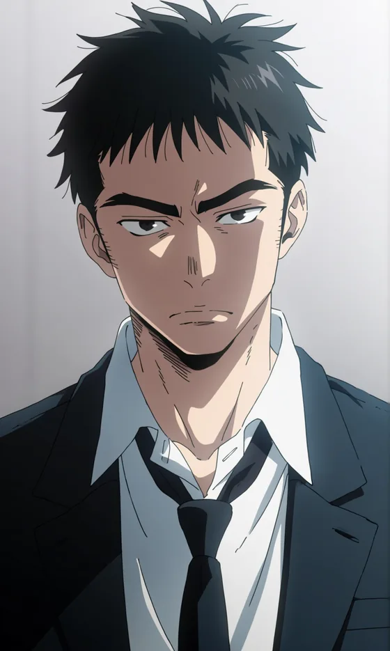
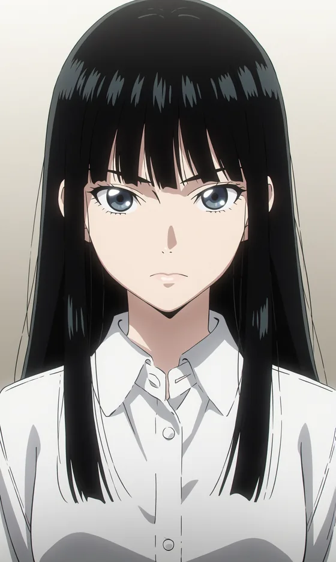
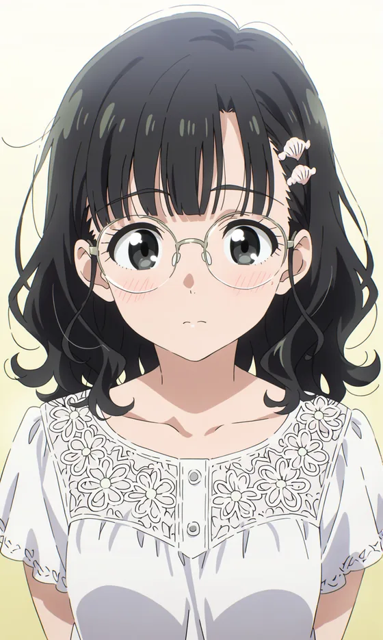
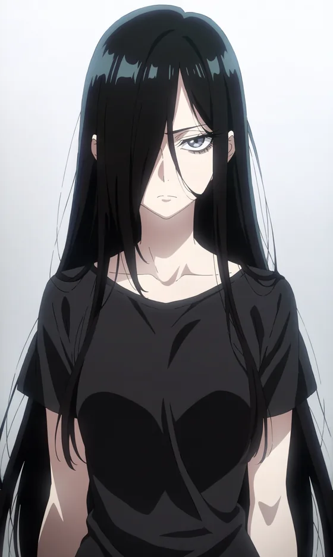
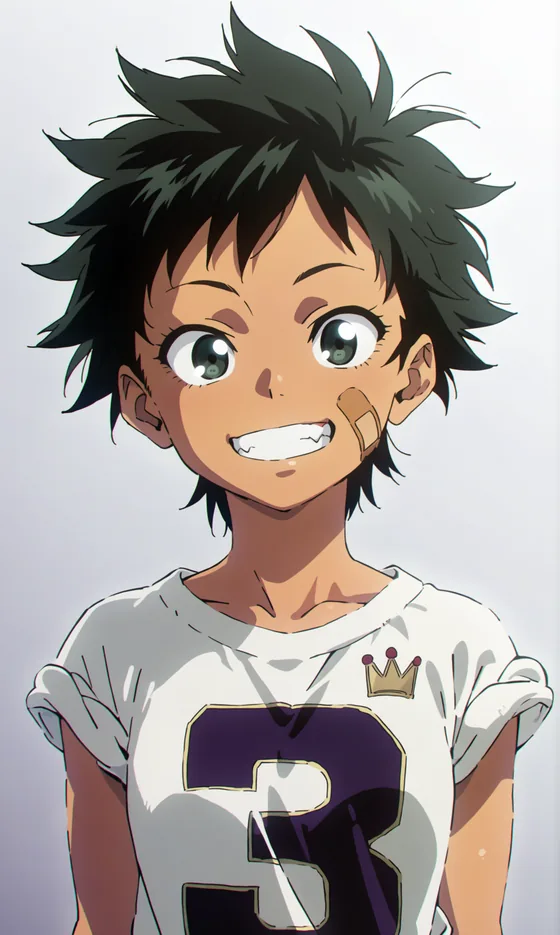
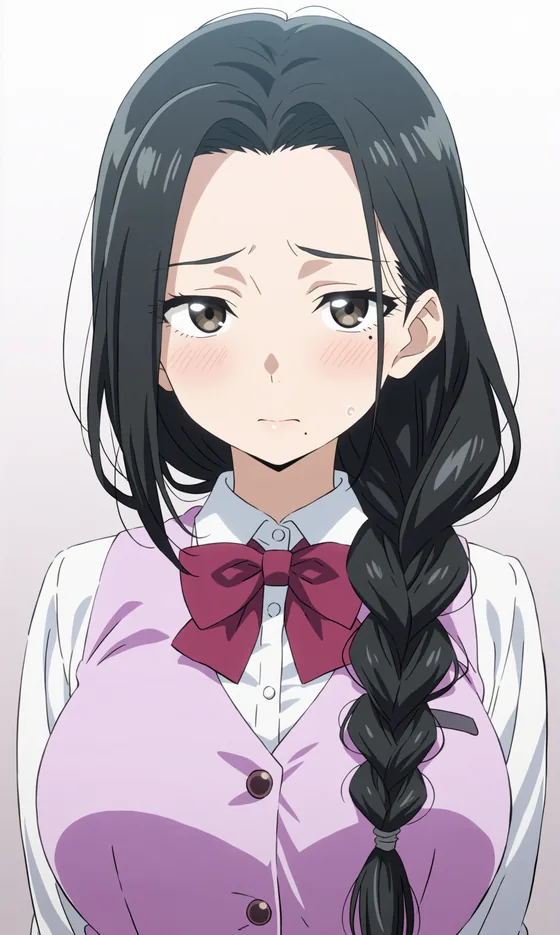
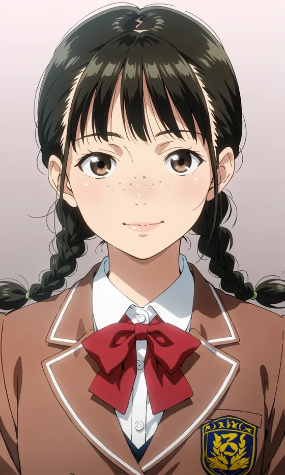

# 我才不会被女孩子欺负呢 · 人物卡

> 来源：我才不会被女孩子欺负呢.txt ｜ 生成：2026-11-20 01:57 ｜ 10 角色 ｜ 雷点 4 条 ｜ 郁闷点 38 条 ｜ 全部事实经原文核验

## 男主：叶麟
- **别名**：叶子、渣叶、露鸟侠、艾麟
- **身份**：冬山市二十八中初二（3）班学生，后升初三；家中开成人用品网店，兼男体委、网店客服；任岐山关门弟子，阴阳散手第三十二代传人
- **外貌**：面相凶：眼睛狭长、眼珠又小又黑，笑起来像杀人凶手；额前有一缕翘起的“狼毫”，结局时这缕头发先变白。作者没正面写他的发型
- **性格**：面相凶、眼神狠，从小被当成不良少年，实际只练武不打人，被逼到底线才动手；嘴硬心软，怕女人、怕被人看穿心事，对别人的示好习惯用毒舌挡回去；自我吐槽成瘾，遇事先算利弊再耍小聪明，真到关键处护人护到底
- **成长线**：十四岁那年，初二（3）班的叶麟为洗掉童年阴影，给欺负了他三年的“小霸王”下战书，决斗当天才发现对方是女孩任小芹；她当众抱住他告白，他撕纸条拒绝，反过来踩鞋、浇可乐欺负她，却始终下不了狠手，被她一步步缠成“青梅竹马”。此后他一边应付舒莎、熊瑶月、艾米等人，一边接手老爸的网店、打混混、跟任老爷子学阴阳散手，被收为关门弟子，也得知艾米是同母异父的妹妹、自己患了病毒性心脏病。艾淑乔回国后，他被卷进绑架、卧底、夺解药的连场恶斗。结局在天使岛中毒濒死、头发变白，小芹割绳坠海抢回解药救活他；他没有选定谁，与小芹、舒莎、艾米同船返航，自嘲不会开什么空前绝后的大后宫
  > 外貌依据：「眼睛狭长，眼珠又小，一旦笑起来非常瘆人，像是杀人凶手」 / 「眼睛狭长的形状像手术刀片，小小的眼珠如同黑红色的冷钻」

- **名场面**：「哼，就算我喜欢班长，又跟你有什么关系啊？」 —— 小芹问他是不是喜欢班长舒莎，叶麟为断她的念想，硬着心肠甩出这句，把她刺得低头挡住眼睛
- **关键事件**：
  1. 向童年宿敌“小霸王”下战书，决斗时发现对方是女孩任小芹，被当众告白
  2. 撕纸条拒绝小芹，踩鞋、抽椅子、浇可乐反向欺负，反被全班当成施暴者
  3. 潜入青姿学园给艾米送方格本，拿到一张无额度美国信用卡
  4. 从彭透斯口中得知艾米是同母异父的妹妹，决定瞒下真相
  5. 拜冬山湖练拳的任老爷子为师，学阴阳散手，后被收为关门弟子并接掌第三十二代
  6. 吃下蓝闪蝶中毒，确诊病毒性心脏病，病发会逐次减弱但可能转移脏器
  7. 与舒莎、小芹、熊瑶月等人一路纠缠，同时被艾淑乔威胁、绑架、安排卧底
  8. 天使岛中毒濒死白头，小芹割绳坠海夺回解药；结局未选定一人，开放式收束
- **原文摘录**：
  > 「我约他出来决斗，单对单，输的人要跪在赢家脚下磕头认错」
  > 「眼睛狭长，眼珠又小，一旦笑起来非常瘆人，像是杀人凶手」
  > 「以额前的那一缕狼毫为核心，我的头发正在一根一根地变白」
  > 「我才不会开什么空前绝后的大后宫呢！」
  > 「我准备扮演这样的渣男友了」

## 全书雷点汇总
- `绿帽` **艾米**：艾淑乔当年抛下叶麟父子，与美国人生下艾米，叶麟父亲被前妻背叛 「艾米的生父约翰，是NTR了我老爸的人」
- `背叛` **苏巧**：苏巧受艾淑乔指使，把大麻塞进叶麟的背包，害他差点背上贩毒罪名被送进少管所；事后她当面跪着向叶麟认罪 「我的确是被正式演员的合同迷了心窍，做了恩将仇报的事」
- `背叛` **小茵**：小茵为了独占叶麟，故意把班长、艾米、小芹的行踪和弱点透给唯尊会，让三人被掳走，好让叶麟去救人 「小茵出卖三个女孩来布局」
- `背叛` **小茵**：小茵被方信留下的病毒击溃，人格被抹、算力只剩两成，重生成听命艾淑乔的“黑圣婴”，转头对付叶麟一方 「涅槃重生的圣婴则完全转化成了艾淑乔的走狗」

## 全书郁闷点汇总
- `百合` **舒莎**：庄妮在翠松山集合时当众捧住舒莎的脸要亲她，被挡开后故意后仰摔向柏油路，逼舒莎让步 「双手捧住班长的脸，当着众人的面，直接打算亲下去」
- `百合` **舒莎**：任小芹醉酒后以小霸王人格强吻舒莎，还当众宣称舒莎是她的女人，让她又气又没法计较 「对着班长的嘴唇亲了一口」
- `虐心` **舒莎**：黑圣婴逼叶麟当众侵犯假扮成舒莎的舒哲，舒莎亲眼目睹后认定是叶麟做的，哭着与他决裂 「你做了不可原谅的事！我恨你！我以后再也不想见到你了！」
- `虐心` **舒莎**：舒莎在爱心宠物医院做义工照顾的流浪狗小黑病死，她伏在点滴台上护着尸体，谁劝都不肯让人碰 「班长伏在点滴台上，双手护着一团毛茸茸的黑色物体，哭红了眼睛」
- `拒女` **舒莎**：叶麟在翠松山失踪时，舒莎发出“活着回来我就嫁给你”的短信；叶麟生还后她把短信删掉，被追问时只说至少要等到高中毕业，把话收了回去 「至少要等到高中毕业」
- `漏女` **舒莎**：舒莎认定任小芹在叶麟昏迷期间付出更多，自己成了局外人，于是主动放弃追求，此后与叶麟保持距离 「于是就完全放弃了主动」
- `虐主` **任小芹**：任小芹黑化后对叶麟使出反关节技，拧伤他的左臂，医生诊断为肘关节骨膜损伤 「属于正常的肘关节骨膜损伤」
- `虐主` **任小芹**：任小芹吃了酒糖醉成小霸王，当街把叶麟踩在脚下，还把他的脸打肿 「不知为何被小芹踩在脚下，脸也被打肿了」
- `虐心` **任小芹**：叶麟答应让任小芹当女朋友，心里却盘算着怎么把她甩掉，好让她自己走 「我确实做了抛弃小芹的打算」
- `虐心` **任小芹**：崖上任小芹割断绳索坠海，只为不再拖累叶麟，坠落时还笑着向他道歉 「（*^＿＿^*） 嘻嘻……又骗了我最喜欢的阿麟，对不起」
- `拒女` **任小芹**：任小芹在决斗地点抱住叶麟的腰求他当男朋友，叶麟当场回绝，还补一句“就是因为我不喜欢你”，把她钉在原地 「当你的男朋友——是绝对不可能的！」
- `拒女` **任小芹**：叶麟心里打定主意把任小芹收作妹妹，好让两人之间隔着一条迈不过去的沟，始终不给恋人名分 「干脆就让她也成为妹妹吧！变成每天和我朝夕相处，但是中间又隔着巨大鸿沟的妹妹吧！」
- `虐心` **任小芹**：任小芹追问叶麟是不是喜欢班长，叶麟一句“跟你有什么关系”顶回去，她低下头，把四根手指插进鬓角头发里挡住眼睛 「哼，就算我喜欢班长，又跟你有什么关系啊？」
- `虐心` **艾米**：艾淑乔借不到四岁的艾米之手毒死她爷爷，艾米长大后才想起这件事 「借助不到4岁的女儿的手，让艾米亲手毒死的啊！」
- `虐心` **艾米**：艾淑乔把艾米当联姻筹码，说要把她嫁给年轻有为的商界精英换利益 「艾米未来的归宿应该是被我嫁给一个年轻有为的商界精英吧」
- `虐心` **艾米**：艾米从母亲口中得知童年保镖瓦夏的遗言是照顾她，在沙滩上痛哭 「帮我照顾她」
- `虐心` **宫彩彩**：宫彩彩在音乐课后撞见叶麟和班长贴在一起，以为自己要被灭口，抱头蹲着连声求饶，反复保证什么都没看见、绝不会说出去 「请放过我！我不不不不不会说出去的！」
- `未归类` **宫彩彩**：任小芹逼宫彩彩把她和叶麟的作业本放在一起，扬言不然就脱她裤子；宫彩彩吓得在长裤外面系紧腰带，上体育课跑步时呼吸不畅晕倒，被熊瑶月和班长抬去医务室 「你不穿裙子，我照样可以脱你的裤子啊！」
- `未归类` **宫彩彩**：熊瑶月说要治宫彩彩的幽闭恐惧症，把她关进三楼闲置铁柜，接了个电话就把人忘了；宫彩彩在柜里瘫到半虚脱，最后叶麟在第三十三个柜子里找到她 「脸色惨白，抱着膝盖，瘫坐着发抖的宫彩彩」
- `百合` **宫彩彩**：宫彩彩被班长人工呼吸救醒后以为还在做梦，当众说想嫁给班长；庄妮也长期对外宣称要娶她和班长，把她当成“偏房” 「能够嫁给班长就太好了啊！」
- `百合` **庄妮**：翠松山集合点，庄妮当着全班捧住班长的脸要亲下去，被拦下后索性后仰往柏油路上摔，用受伤逼班长让步 「伸出艺术家一般的颀长手指，双手捧住班长的脸」
- `虐心` **庄妮**：庄妮潜入帝王大厦想拔掉小茵的电源，被小茵关进狭窄狗笼断水近20小时；她宁可咬破手腕喝自己的血，也不肯向叶麟服软 「把庄妮关在这么狭窄的狗笼里20个小时」
- `虐心` **庄妮**：艾淑乔把庄妮交给克林格做爱情魔药研究，克林格将她绑上手术台准备活体解剖，叶麟闯进手术室才把她救下来 「克林格研究猴子的时候常常会使用活体解剖，所以你应该懂」
- `虐主` **庄妮**：庄妮用班长的街头立体画做诱饵，把叶麟引进窄巷，从背后用钢琴线勒住他脖子，要杀了他独占班长 「只要杀掉了你，班长就是我一个人的了！」
- `虐主` **庄妮**：庄妮用麻药放倒叶麟，以丝袜把他捆在床上，举着美工刀要阉了他，最后被挣脱的叶麟勒晕 「我不会杀你，但是我要让你做不成男人！」
- `百合` **庄妮**：庄妮只对女生有感情，从头到尾把班长当追求对象、把宫彩彩当偏房，对叶麟只有厌恶和敌意，全书没有给男主留任何恋爱回应 「但是我庄妮是将来要娶舒莎的人！我对她是非常认真的！」
- `虐心` **熊瑶月**：叶麟在车站强吻熊瑶月，熊瑶月哭着从他怀里逃开，觉得既丢了初吻又对不起小芹，叶麟追上去时还险些被车撞 「臭流氓死变态色情狂！！」
- `虐心` **熊瑶月**：熊瑶月误食浆果中了春药把叶麟扑倒，被赶来的小芹撞见；小芹当场认定熊瑶月的友情全是骗人的，两人单方面冷战 「原来都是骗我的！！！大家都想抢走叶麟同学！！！！」
- `虐心` **熊瑶月**：艾米替叶麟试探熊瑶月，熊瑶月承认并不讨厌叶麟，却因为小芹这层关系绕不过心结，宁可放弃也不肯背叛朋友 「我也不会背叛任何一个好朋友的！」
- `虐心` **熊瑶月**：小芹醉酒后揪住熊瑶月的衣领强吻她，吻完还当众宣布是为了撇清“野驴的女朋友”的传闻，熊瑶月被亲得措手不及 「小芹就粗蛮地对着熊瑶月的嘴唇吻了上去」
- `百合` **熊瑶月**：熊瑶月对宫彩彩又抱又摸，当众宣布只有自己能欺负宫彩彩，后来还扬言要娶宫彩彩、实在不行可以变性，把宫彩彩当成毛绒玩具 「反正只有我能欺负宫彩彩！你们其他人都不行！」
- `漏女` **熊瑶月**：全书结尾叶麟被困在轮回梦境里，熊瑶月与叶麟的感情线没有任何交代，只留下叶麟许诺将来让她去给艾米当保镖 「你答应我，以后优先考虑给艾米做保镖好不好？」
- `虐心` **苏巧**：苏巧被艾淑乔关起来两个月，被迫接受比在家乡杂技团还狠的柔术训练，稍有懈怠就被训练师责罚；叶麟只能靠交出因果计算程序换她放人 「在失踪以后的两个月里，苏巧被迫进行比在家乡还过分的柔术训练」
- `拉皮条` **苏巧**：艾淑乔把苏巧当成可以随手转送的“礼物”，先要送给叶麟，叶麟不收就扬言让她去陪客户喝酒、给贪官陪床 「只好让她去伺候关系客户喝酒，或者给贪官提供陪床服务了」
- `漏女` **苏巧**：苏巧从头到尾没有和叶麟确定关系：获救后住进他家只是洗衣做饭抵房租，后来当上帝王大厦前台经理，全书结束时已19岁，仍和奶奶住在校长楼，感情线没有下文 「现在的苏巧已经有19岁了，按道理来说应该比我们成熟不少」
- `拉皮条` **何菱**：小芹拿玫瑰组大姐头的身份压何菱，硬把她塞给牛十力当女朋友，还编排剧本让她去“邂逅”，何菱不敢拒绝 「你这么水性杨花，嫁给牛十力当老婆以后，要好好做家务」
- `漏女` **何菱**：何菱从初三一路到高三都没有男朋友，结局只以一句短信带过，始终没被写进叶麟的感情线 「由于某些原因一直没有交到男朋友的她」
- `百合` **小茵**：庄妮抱着小茵取暖，被旁人当面调侃成“人机百合不伦恋”，小茵和叶麟的关系因此常被拿来说笑 「你们这一对人机百合不伦恋」

## 角色卡片

### #1 舒莎 —— 同班班长。起初把叶麟当成重点监管的问题学生，查书包、没收东西、当众训他；一起经历救狗、查案、打工之后，成了他最信得过的搭档和倾诉对象。她对他有情，却因小芹的付出和自己的原则一再退让，直到结局才当面说破
- **别名**：班长、女班长、莎莎、卡秋莎
- **身份**：冬山市第二十八中学初二（3）班的女班长，后来随班升读仍当班长；家中长女，弟弟舒哲与她同校，母亲林雨梦在上海的疫苗研究所工作，家务和管弟弟多半由她扛；一心考警校、想当刑警
- **外貌**：黑长直发，及腰、几乎垂到地面；深墨色大眼，眉峰常微蹙，鼻梁挺拔，浅粉色嘴唇；在校多穿蓝底白杠运动款校服，便服常是白衬衫配牛仔裤
- **性格**：班里说一不二的班长，正义感强到被叶麟叫作“正义魔人”，讲公平、护同学，抓纪律半点不含糊；对弟弟舒哲又当姐又当妈。她嘴上强硬、动手也狠，被戳到心事就脸红结巴；一碰到感情就往后缩，觉得自己不如别人付出得多，宁可憋着也不肯先开口
- **成长线**：叶麟初二（3）班的班长，开学就指认他欺负转学生任小芹，把他当重点监管对象，查书包、没收东西、当众训人，两人针锋相对。其后一起照顾流浪狗、拦车救狗、追查偷拍与虐猫，她渐渐把他当成最信得过的搭档，也动了心。李存壮替他表白后，她脸红到一周不说话；叶麟山中失踪时她发短信说活着回来就嫁他，人回来后却删掉，只答至少要等到高中毕业。大结局在天使岛，叶麟中毒将死，她哭着说心里再装不下别人
  > 外貌依据：「跟锐利眼神搭配的，就是一头亮黑的长发和十足的姐姐气场」 / 「眉毛像是国画大师轻轻浅浅的一勾笔」 / 「浅粉色的嘴唇像是两片花瓣，微微抿起不见笑容」
- **性格标签**：正义感强、强势班长、嘴硬心软、责任心重

- **名场面**：「就算不把身体交给你，我的心也没有空间再留给别人了！」 —— 大结局天使岛，叶麟中毒将死、拒绝她的安慰，舒莎泣不成声地表明心迹
- **纯洁度**：未知（未成年学生，按规范不作判定）
- **郁闷点**：
  - `百合` 庄妮在翠松山集合时当众捧住舒莎的脸要亲她，被挡开后故意后仰摔向柏油路，逼舒莎让步 「双手捧住班长的脸，当着众人的面，直接打算亲下去」
  - `百合` 任小芹醉酒后以小霸王人格强吻舒莎，还当众宣称舒莎是她的女人，让她又气又没法计较 「对着班长的嘴唇亲了一口」
  - `虐心` 黑圣婴逼叶麟当众侵犯假扮成舒莎的舒哲，舒莎亲眼目睹后认定是叶麟做的，哭着与他决裂 「你做了不可原谅的事！我恨你！我以后再也不想见到你了！」
  - `虐心` 舒莎在爱心宠物医院做义工照顾的流浪狗小黑病死，她伏在点滴台上护着尸体，谁劝都不肯让人碰 「班长伏在点滴台上，双手护着一团毛茸茸的黑色物体，哭红了眼睛」
  - `拒女` 叶麟在翠松山失踪时，舒莎发出“活着回来我就嫁给你”的短信；叶麟生还后她把短信删掉，被追问时只说至少要等到高中毕业，把话收了回去 「至少要等到高中毕业」
  - `漏女` 舒莎认定任小芹在叶麟昏迷期间付出更多，自己成了局外人，于是主动放弃追求，此后与叶麟保持距离 「于是就完全放弃了主动」
- **关键事件**：
  1. 开学课上任小芹被叶麟气哭，舒莎当场站起来报告老师，指认叶麟欺负人，两人从此对上
  2. 因弟弟舒哲在外打架而自责，课堂暴走用黑板擦划破叶麟眼角，随后当众检讨要辞班长，被全班挽留
  3. 在爱心宠物医院做义工照顾流浪狗小黑；小黑病死，叶麟冒雨赶来陪她走了一路
  4. 第一次穿便服与叶麟同行，两人打赌生日（2月16日对2月17日），她在他家下厨、留宿
  5. 音乐课上为拔叶麟额前的白发潜回教室，两人失衡相撞，她的初吻以七成重合度撞上，被宫彩彩撞见
  6. 李存壮当着她的面替叶麟表白，她脸红得说不出话，此后一周只回叶麟一句“今天就是不行”
  7. 叶麟在翠松山失踪时，她发出“别死，活着回来我就嫁给你”的短信；叶麟生还后她删掉短信，被追问只说至少要等到高中毕业
  8. 大结局天使岛，叶麟中毒濒死，她哭着求他活下去，说自己的心再没有空间留给别人
- **原文摘录**：
  > 「老师！新来的任小芹同学被弄哭了！」
  > 「我觉得是叶麟同学在欺负她！」
  > 「班长就这样狼狈不堪地主动向我献上了初吻」
  > 「别死，活着回来我就嫁给你」
  > 「就算不把身体交给你，我的心也没有空间再留给别人了！」
- **置信度**：高

### #2 任小芹 —— 童年宿敌，后来成了公开追他的插班生、他嘴上的“秘密女友”；被他降级为青梅竹马，又收作义妹。结局他在崖上当着班长的面向她许诺“做女朋友、结婚生孩子”，全书开放式收场，她名分上领先
- **别名**：小芹、小霸王、芹姐、水芹老师、日记侠、二小姐
- **身份**：冬山市第二十八中学初二（3）班学生，后随班升初三；叶麟从六岁起的童年宿敌。母亲任红璃是散打冠军、武术指导，生父霍振邦是三合会聚英堂堂主；她本人是女校“霸王花”的创始人，漫画笔名“水芹老师”
- **外貌**：男孩似的短发，后来留长到能盖住额头鬓角；长刘海常常挡着眼睛，五官精致，眼睛大而水汽，嘴唇小巧。常穿米色小西服套裙，或白色短褶裙配樱红色缎带的短肩上衣，拎米奇图案小挎包
- **性格**：直来直去，喜欢谁就当面讲，被拒绝也不肯退；黏人、爱吃醋，为争叶麟能跟人动手。一急就“黑化”变回小霸王，出手没轻没重，事后又自责。私下是画漫画的宅女，讲起少女漫画一套一套，怕甲虫，也怕被丢下
- **成长线**：六岁起把叶麟当宿敌欺负，三年后约在决斗地点，坦白自己是女孩并当众表白，被拒。她插班坐到叶麟邻桌继续追，被踩鞋、浇可乐也不恼；叶麟用“秘密男友”敷衍，她雨夜爬五楼窗外二次告白。底细陆续揭开：女校“霸王花”创始人芹姐、为当女孩退学宅家三年、生父是三合会堂主霍振邦。叶麟得心脏病后把她降回青梅竹马、又收作义妹，她照旧跟着卧底、打架、救人。结局崖上她割绳坠海换他活命，叶麟当众许诺娶她；她带着解药回来，全书开放式收束，她名分领先
  > 外貌依据：「精致的五官，闪着水汽的大眼睛，小巧的嘴唇」 / 「头发比上次见面时更长了，还穿着米色的小西服套裙」 / 「穿着一条白色的短褶裙，配上樱红色缎带的短肩上衣」
- **性格标签**：直球、黏人、能打、漫画宅

- **名场面**：「我是有病啊！所以才想让叶麟同学做我的男朋友的……啊，说出来了，好害羞！」 —— 叶麟踩了她的鞋、抽了她的椅子，问她被这样欺负怎么不生气，她顺势把心意说了出来
- **纯洁度**：未知（未成年学生，按规范不作判定）
- **郁闷点**：
  - `虐主` 任小芹黑化后对叶麟使出反关节技，拧伤他的左臂，医生诊断为肘关节骨膜损伤 「属于正常的肘关节骨膜损伤」
  - `虐主` 任小芹吃了酒糖醉成小霸王，当街把叶麟踩在脚下，还把他的脸打肿 「不知为何被小芹踩在脚下，脸也被打肿了」
  - `虐心` 叶麟答应让任小芹当女朋友，心里却盘算着怎么把她甩掉，好让她自己走 「我确实做了抛弃小芹的打算」
  - `虐心` 崖上任小芹割断绳索坠海，只为不再拖累叶麟，坠落时还笑着向他道歉 「（*^＿＿^*） 嘻嘻……又骗了我最喜欢的阿麟，对不起」
  - `拒女` 任小芹在决斗地点抱住叶麟的腰求他当男朋友，叶麟当场回绝，还补一句“就是因为我不喜欢你”，把她钉在原地 「当你的男朋友——是绝对不可能的！」
  - `拒女` 叶麟心里打定主意把任小芹收作妹妹，好让两人之间隔着一条迈不过去的沟，始终不给恋人名分 「干脆就让她也成为妹妹吧！变成每天和我朝夕相处，但是中间又隔着巨大鸿沟的妹妹吧！」
  - `虐心` 任小芹追问叶麟是不是喜欢班长，叶麟一句“跟你有什么关系”顶回去，她低下头，把四根手指插进鬓角头发里挡住眼睛 「哼，就算我喜欢班长，又跟你有什么关系啊？」
- **关键事件**：
  1. 六岁起与叶麟是宿敌，三年后约在决斗地点见面，先坦白自己是女孩，再抱住他的腰当众求他当男朋友，被当场拒绝
  2. 以插班生身份坐到叶麟邻桌，公开追求；被踩鞋、抽椅子、食堂当众浇可乐都不恼，还替他圆谎
  3. 以归还擎天柱为条件让叶麟护送回家，从此用那二十五个机器人玩具拿捏他
  4. 身份一层层揭开：女校预备班“霸王花”创始人芹姐，为当女孩退学宅家三年，生父是三合会聚英堂堂主霍振邦
  5. 雨夜爬到叶麟家五楼窗外二次表白，被“秘密男友”的名分骗住
  6. 追问叶麟是不是喜欢班长，被一句“跟你有什么关系”顶回去，挡着眼睛流泪
  7. 黑化打伤刑部五虎、拧伤叶麟左臂，事后自责，主动退回“青梅竹马”
  8. 叶麟查出病毒性心脏病后把她降级、又收作义妹，她仍跟着卧底、救人、打人
  9. 结局在崖上割断绳索坠海换叶麟活命，又带着黑天使解药赶回来
- **原文摘录**：
  > 「叶麟，请你当我的男朋友吧！！」
  > 「我是有病啊！所以才想让叶麟同学做我的男朋友的……啊，说出来了，好害羞！」
  > 「因为我的自私，我已经好几次差点害死叶麟同学了，这次我绝对不能再这样了！」
  > 「我什么都答应你的！」
  > 「（*^＿＿^*） 嘻嘻……又骗了我最喜欢的阿麟，对不起」
- **置信度**：高

### #3 艾米 —— 初遇时把叶麟当“男仆”使唤的雇主，后来证实是同母异父的妹妹；叶麟是她唯一肯低头叫“哥哥”的人
- **别名**：艾蜜儿
- **身份**：美籍混血童星，艺名艾蜜儿，青姿学园初中部学生；后期当上青姿高中“校长”、天牧星光董事长，叶麟同母异父的妹妹
- **外貌**：金黄色长发用蝴蝶结扎成双马尾，蓝眼睛大得几乎占半张脸，皮肤白得像细瓷；混血面孔，洋气里带东方的纤细；常穿缀花边的短衬衫配牛仔小马甲，或一身小洋装
- **性格**：被母亲和保镖捧大的小明星，骄傲、任性、说翻脸就翻脸，嘴很毒，看不起人也从不掩饰；但认了谁就极黏人，会为对方哭到脸花，护短到不讲道理
- **成长线**：地铁站初遇，叶麟把她的艺名“艾蜜儿”念成“艾米”，她把他当成跟踪狂踢了一脚。她雇叶麟抄《圣经》作业、甩出信用卡，把他当“男仆”使唤。暴雨天她拉他上街散步，树倒时叶麟推开她被压伤，她第一次为他大哭。DNA化验单揭穿两人是同母异父兄妹，她撕单否认，追到门口抱住他改口叫哥哥。此后她随剧组拍戏、组电竞战队、操办海岛行，也一再劝他向母亲低头。结局叶麟被黑天使反噬，她扑上去要救，被抱出医务室，最终与小芹、班长成了要好的朋友
  > 外貌依据：「她的金黄色头发在灯光的照射下亮闪闪的，用蝴蝶结扎成不长不短的双马尾」 / 「两只眼睛几乎占了大半张脸，瞳孔像午后的天空那么蓝」 / 「艾米像平时一样梳着骄傲的双马尾，一身漂亮的小洋装」
- **性格标签**：骄傲任性、嘴毒、黏人、骄纵重情

- **名场面**：「艾蜜儿是艺名，只有家里人才叫我艾米呢！」 —— 地铁站初次相遇，叶麟把她的艺名念丢一个音成了“艾米”，她一脸戒备地追问他是怎么知道本名的
- **纯洁度**：未知（未成年学生，按规范不作判定）
- **雷点**：
  - `绿帽` 艾淑乔当年抛下叶麟父子，与美国人生下艾米，叶麟父亲被前妻背叛 「艾米的生父约翰，是NTR了我老爸的人」
- **郁闷点**：
  - `虐心` 艾淑乔借不到四岁的艾米之手毒死她爷爷，艾米长大后才想起这件事 「借助不到4岁的女儿的手，让艾米亲手毒死的啊！」
  - `虐心` 艾淑乔把艾米当联姻筹码，说要把她嫁给年轻有为的商界精英换利益 「艾米未来的归宿应该是被我嫁给一个年轻有为的商界精英吧」
  - `虐心` 艾米从母亲口中得知童年保镖瓦夏的遗言是照顾她，在沙滩上痛哭 「帮我照顾她」
- **关键事件**：
  1. 地铁站被叶麟误喊“艾米”，她认定他是跟踪狂，踢了他一脚
  2. 超市够不到高处薯片摔下来被叶麟接住，让他推车带路，第一次吃到薯片
  3. 出钱雇叶麟抄十页《圣经》方格本，交货后给他一张美国信用卡当报酬
  4. 暴雨天拉叶麟去步行街淋雨散步，大树倒下时被他推开，伏在他身上大哭
  5. DNA化验单揭穿同母异父兄妹，她先撕单否认，追到门口抱住他改口叫哥哥
  6. 在片场罢演，被叶麟抱上布景墙，连踢龙套三次要求重拍
  7. 向叶麟坦白四岁时被母亲利用毒死爷爷的旧事
  8. 组建LOL战队“金色闪电”，自任老板，封熊瑶月为永久队长
  9. 与熊瑶月合谋“黑暗料理”，操办国庆海岛行，把中奖五百万的彩票随手扔给乞丐
  10. 结局叶麟被黑天使反噬形销骨立，她扑上去要救，被叶麟抱下床赶出医务室
- **原文摘录**：
  > 「跟踪狂，你是怎么知道我的本名的？」
  > 「本小姐凭什么要跟你道歉？」
  > 「哥哥死了的话，我马上也去死！」
- **置信度**：高

### #4 宫彩彩 —— 同班同学。因为叶麟恶名在外，她起初见他就发抖，撞见他与班长亲近还以为要被灭口；天桥被小贩讹诈、被关铁柜、被绑架几次都是叶麟救的，之后慢慢信他，敢拉着他的衣角走路、跟他讲心事。两人没有恋爱线，她心里最依赖的人是班长
- **别名**：彩彩
- **身份**：冬山市第二十八中学初二（3）班学生，学习委员兼生活委员，负责管班费；升初三后卸任学委，被老师举荐当学校图书管理员。写字是全班公认最好，个子在班里偏矮
- **外貌**：个子矮，略微天然卷的头发，左耳用一只朴素的贝壳发夹收束；平时戴隐形眼镜，偶尔换成圆框眼镜。常穿圆领镂空碎花的白色雪纺衬衫配校服裤，便服多是过膝长裙这类保守款式
- **性格**：全班最软的一个，胆子小到听见叶麟的名字就发抖，说话总带“对、对不起”和结巴；听话守规矩，谁让她做什么就做什么，被欺负也只会绕着道走。学习上极认真，字写得全班最好，做事一板一眼。心细、肯照顾人，管班费、替生病的同学拿药都当真；对班长依赖得厉害，遇事先想“班长会怎么看我”
- **成长线**：同班学习委员兼生活委员，写字全班公认最好。叶麟上讲台挑字好的女生“借手”写字，两人才第一次正式说话，她吓得直发抖。此后屡被卷进闹剧：天桥被卖兔小贩讹诈由叶麟解围，被熊瑶月关进铁柜，被整袋安全套淋头，被庄妮以“按摩减肥”骗去旅馆。14岁生日只请了五个女生。升初三后与庄妮合画星空板报，由叶麟护送回家，坦白自己信“科学幸福教”只为长高、离不开班长。不久在校门外被绑匪劫走，吓傻后获救。尾声卸任学委改当图书管理员，全书结束时发短信说想见他
  > 外貌依据：「宫彩彩今天没穿校服上衣，只是穿了一件白色雪纺小衬衫，圆领上装饰着镂空的小碎花」 / 「左耳朵边的头发用一只很朴素的贝壳发夹收束起来」 / 「一副很有书呆子气的圆框眼镜架在她的小鼻梁上」
- **性格标签**：胆小爱哭、听话守规矩、认真死板、依赖班长

- **名场面**：「对、对不起！我不是讨厌叶麟同学！我是害怕被小芹同学看见咱们拉手！」 —— 开学第一天夜里，叶麟送揉掉隐形眼镜、脚腕带伤的宫彩彩回家，她想借力又不敢牵手，慌慌张张地解释
- **纯洁度**：未知（未成年学生，按规范不作判定）
- **郁闷点**：
  - `虐心` 宫彩彩在音乐课后撞见叶麟和班长贴在一起，以为自己要被灭口，抱头蹲着连声求饶，反复保证什么都没看见、绝不会说出去 「请放过我！我不不不不不会说出去的！」
  - `未归类` 任小芹逼宫彩彩把她和叶麟的作业本放在一起，扬言不然就脱她裤子；宫彩彩吓得在长裤外面系紧腰带，上体育课跑步时呼吸不畅晕倒，被熊瑶月和班长抬去医务室 「你不穿裙子，我照样可以脱你的裤子啊！」
  - `未归类` 熊瑶月说要治宫彩彩的幽闭恐惧症，把她关进三楼闲置铁柜，接了个电话就把人忘了；宫彩彩在柜里瘫到半虚脱，最后叶麟在第三十三个柜子里找到她 「脸色惨白，抱着膝盖，瘫坐着发抖的宫彩彩」
  - `百合` 宫彩彩被班长人工呼吸救醒后以为还在做梦，当众说想嫁给班长；庄妮也长期对外宣称要娶她和班长，把她当成“偏房” 「能够嫁给班长就太好了啊！」
- **关键事件**：
  1. 初一钢笔字大赛起，她的字就是全班公认最好，每次班里出黑板报文艺委员都请她写美术字
  2. 叶麟上讲台挑写字好看的女生、要向宫彩彩“借手”，她听岔了意思吓得手足无措，这是两人第一次正式说话
  3. 在天桥被卖兔小贩讹诈，叶麟替她解围打退小贩；麦当劳里她反过来劝叶麟别脚踏两只船
  4. 被熊瑶月以治幽闭恐惧症为名关进三楼铁柜，叶麟在第三十三个柜子里找到半虚脱的她，抱去医务室
  5. 马警官盘查时塑料袋裂开，五十片安全套洒了她一头一身，她蹲在地上抽泣，被围观女生远远嘲笑
  6. 6月26日过14岁生日，父母去了海南，只准她请五个人；熊瑶月把艾米带来，叶麟成了唯一的男生
  7. 升初三后与庄妮合作画“冷寂星空”黑板报，整块板报没有一个汉字
  8. 脚腕带伤又揉掉隐形眼镜，叶麟拉着她回家，她只敢拉着他的衣角，路上坦白自己信科学幸福教是想长高、离不开班长
  9. 在校门外等车时被两名蒙面人劫上面包车，与叶麟一同被绑，全程吓傻，后被救出
  10. 卸任学习委员后常泡图书馆，被老师举荐当图书管理员，庄妮主动提出陪她一起干
  11. 全书结尾给叶麟发短信说想见他，返航后叶麟收到她语气暧昧的信息
- **原文摘录**：
  > 「我……我不会治骨折啊！弄疼了他，我就没命了！」
  > 「对、对不起！我不是讨厌叶麟同学！我是害怕被小芹同学看见咱们拉手！」
  > 「叶麟同学好高大……我的个子却这么矮……我要是也能长高就好了……」
  > 「能够嫁给班长就太好了啊！」
  > 「已、已经嫁不出去了～～！！都怪我嘴馋～～～呜呜呜～～～～～」
- **置信度**：高

### #5 庄妮 —— 同班同学。她从一开始就把叶麟当成抢班长的情敌，设局、勒颈、绑起来要阉他，嘴上永远是“渣叶”。叶麟救过她好几次（狗笼、手术台），她也反过来救过叶麟（用鱼雷管送他逃出潜艇）。两人从死对头磨成别别扭扭的战友，全书没有恋爱线
- **身份**：冬山市第二十八中学初二（3）班文艺委员，升初三后仍在（3）班，后来随班进入青姿高中高二（3）班。文艺委员是班长硬派给她的，长期以病假、休学躲在家里。画画是全校拔尖的水平，有上海画师上门想收她当徒弟。生日是11月1日
- **外貌**：皮肤苍白得近乎病态，乌黑长发过肩，斜刘海挡住半张脸只露左眼，眼下浓重黑眼圈，瞳孔偏淡。几乎只穿黑色：黑套裙或黑长裙配半透明黑丝袜（校方特批），黑色尖头柳钉鞋
- **性格**：毒舌到刻薄，班里没人敢跟她做敌人，开口就是挖苦。厌男厌到骨子里，说男人是她见过最污浊恶心的生物。把自杀当谈判筹码，跳楼、撞柏油路、半身探出车窗，一不顺心就拿命逼人。对班长执念极深，公开宣称要娶她、把宫彩彩当偏房，为此连杀人也敢。嘴硬，受了恩惠不肯道谢，改用教人画画抵债。其实怕孤独，被班长硬拖进人群后慢慢有了朋友
- **成长线**：初二她长期请病假，班长带大喇叭上门探望，她自述割腕是因为暗恋班长，当场告白。此后她把叶麟当成抢班长的情敌：旅馆设局、天桥用钢琴线勒颈、麻药绑缚要阉他。翠松山野游她照穿黑裙黑丝，装吐血、半身探出车窗逼人让步；生日那天班长背着她办了惊喜派对，她才算有了朋友。人质事件她持刀捅倒歹徒，地震被小芹救下后嘴硬不道谢。升入青姿高中仍同班，最后被艾淑乔的爱情魔药控制，靠叶麟的信息素保住人格，用鱼雷管把他发射到天使岛，自己险遭活体解剖，获救后安置在无菌室，没有生命危险
  > 外貌依据：「她的眼神总是很忧郁，鼻子微翘，皮肤苍白得有些病态，长发过肩」 / 「和从前一样，庄妮用斜刘海挡住半张脸，另外半张脸透着病态的苍白」 / 「庄妮的瞳孔颜色偏淡，所以经常会让人觉得，她的黑眼圈才是脸部的重心」
- **性格标签**：毒舌刻薄、厌男、偏执百合、嘴硬心软

- **名场面**：「舒莎，我喜欢的人是你」 —— 班长和大喇叭到庄妮家里探病，庄妮说完自己割腕是因为暗恋同班同学，突然把脸转向班长当众告白
- **纯洁度**：未知（未成年学生，按规范不作判定）
- **郁闷点**：
  - `百合` 翠松山集合点，庄妮当着全班捧住班长的脸要亲下去，被拦下后索性后仰往柏油路上摔，用受伤逼班长让步 「伸出艺术家一般的颀长手指，双手捧住班长的脸」
  - `虐心` 庄妮潜入帝王大厦想拔掉小茵的电源，被小茵关进狭窄狗笼断水近20小时；她宁可咬破手腕喝自己的血，也不肯向叶麟服软 「把庄妮关在这么狭窄的狗笼里20个小时」
  - `虐心` 艾淑乔把庄妮交给克林格做爱情魔药研究，克林格将她绑上手术台准备活体解剖，叶麟闯进手术室才把她救下来 「克林格研究猴子的时候常常会使用活体解剖，所以你应该懂」
  - `虐主` 庄妮用班长的街头立体画做诱饵，把叶麟引进窄巷，从背后用钢琴线勒住他脖子，要杀了他独占班长 「只要杀掉了你，班长就是我一个人的了！」
  - `虐主` 庄妮用麻药放倒叶麟，以丝袜把他捆在床上，举着美工刀要阉了他，最后被挣脱的叶麟勒晕 「我不会杀你，但是我要让你做不成男人！」
  - `百合` 庄妮只对女生有感情，从头到尾把班长当追求对象、把宫彩彩当偏房，对叶麟只有厌恶和敌意，全书没有给男主留任何恋爱回应 「但是我庄妮是将来要娶舒莎的人！我对她是非常认真的！」
- **关键事件**：
  1. 班长带大喇叭到家里探病，庄妮第一次说出割腕的原因，当场向班长告白，被拒后扬言当晚就自杀
  2. 在堂兄看前台的旅馆设局：以“按摩减肥”为名留下宫彩彩，断电锁门困住班长和叶麟，隔门谈条件、打赌，收场时宣告班长属于她
  3. 翠松山野游全班只有她穿黑套裙加黑丝爬山；捧班长脸要亲被挡，故意后仰摔向柏油路；回程半身探出车窗、自击穴道吐血装死，逼司机开快车
  4. 七夕打电话约班长去麦当劳接吻换免费蛋挞，被拒后扬言改约宫彩彩
  5. 11月1日生日，班长背着她张罗惊喜派对，她在女仆咖啡店用毒舌和鬼故事赶客
  6. 学校人质事件中持美工刀从废弃通道爬楼赶到，因大喇叭被推下楼梯而连捅歹徒数刀
  7. 天桥窄巷用班长的街头立体画做诱饵，从背后用钢琴线勒叶麟脖子，被反杀打昏
  8. 用麻药放倒叶麟、以丝袜捆住持刀要阉他，反被勒晕，由叶麟做人工呼吸救回
  9. 地震时黑板坠落，小芹扑过去救她；她不肯道谢，改口说可以教小芹画画抵债
  10. 被小茵关进狗笼断水近20小时，咬破手腕喝自己的血也不肯服软
  11. 与宫彩彩当众接吻、宣称要娶班长，被班长用擒拿术制住后哭着被劝服
  12. 中爱情魔药后爱上艾淑乔、被派到叶麟船舱监视，靠叶麟的信息素保住人格，用鱼雷管把他发射到天使岛
  13. 被克林格绑上手术台险遭活体解剖，获救后安置在潜艇无菌室，没有生命危险
- **原文摘录**：
  > 「舒莎，我喜欢的人是你」
  > 「我要是恶心的男人，早在受精卵状态就自杀了」
  > 「班长应该是属于我的，没有任何男人有资格得到她！」
  > 「我不会杀你，但是我要让你做不成男人！」
  > 「刚才的确是有点误会，但是我庄妮是将来要娶舒莎的人！」
- **置信度**：高

### #6 熊瑶月 —— 同班同学兼女体委。一开始只当叶麟是使唤得动的男生，逼他改口叫“月月”；后来一起打游戏、吃哈根达斯、被跆拳道学员围堵，慢慢混成“兄弟”。沈少宜托叶麟牵线追她，被她反过来当成叶麟和沈少宜是一对。她心里其实有叶麟，可因为小芹是闺蜜，始终不肯越线，被叶麟在车站强吻后哭着跑开，冷战一阵又和好
- **别名**：小熊、月月、维尼、熊姐、维尼大帝
- **身份**：冬山市第二十八中学初二（3）班学生，班里的女体委，体育全能，跑步、排球、篮球都能顶上；后来当上艾米组建的LOL战队“金色闪电”永久队长，又成了刑部五虎口中的大姐头，班里还给她安过“灭蚊委员”的名头
- **外貌**：一头方便打理的短碎发，碎发下露出大片前额，看着又狂野又精神；皮肤是晒太阳晒出来的小麦色，一笑就露出两颗小虎牙，脸上时不时贴着创可贴。一年四季短衫热裤，夏天尤其标准
- **性格**：急性子运动少女，精力旺盛得像有多动症，说话大嗓门，一开口就能震住半个操场。好胜到不肯认输，打游戏、打球、爬山都要争第一，输了就攥拳头喊不公平。心直口快，爱闹爱起哄，抢水桶、抱人、掀裙子全是她带的头，但从不记仇，骂完人转头就能笑嘻嘻。最看重朋友，嘴上说“兄弟”，真到要选边的时候会拿命讲义气
- **成长线**：初一班会上她自报绰号“小熊”，之后一直是初二（3）班女体委。起初只是抢水桶、把宫彩彩关进铁柜的麻烦精；艾米给她起英文名“维尼”，她当场宣布正式启用。她拉叶麟打游戏、吃哈根达斯，在游戏厅挣下“不败熊姐”的名头。车站被叶麟强吻后她哭着跑开，却因和小芹的闺蜜情始终不肯往前一步。全书收在轮回梦境里，她的感情没有结果，叶麟只许诺将来让她给艾米当保镖
  > 外貌依据：「既狂野又方便打理的短碎发，小麦色的细腻肌肤」 / 「小麦色的脸上贴着一个大号创可贴」 / 「让旁人可以清楚地看见她嘴里的两颗小虎牙」
- **性格标签**：好胜要强、直爽大嗓门、讲义气、爱闹神经大条

- **名场面**：「谁是熊姐！不是说了叫我月月就行吗！」 —— 游戏厅里胖子一口一个“熊姐”尊称她，熊瑶月脸一黑，甩头纠正对方要叫“月月”
- **纯洁度**：未知（未成年学生，按规范不作判定）
- **郁闷点**：
  - `虐心` 叶麟在车站强吻熊瑶月，熊瑶月哭着从他怀里逃开，觉得既丢了初吻又对不起小芹，叶麟追上去时还险些被车撞 「臭流氓死变态色情狂！！」
  - `虐心` 熊瑶月误食浆果中了春药把叶麟扑倒，被赶来的小芹撞见；小芹当场认定熊瑶月的友情全是骗人的，两人单方面冷战 「原来都是骗我的！！！大家都想抢走叶麟同学！！！！」
  - `虐心` 艾米替叶麟试探熊瑶月，熊瑶月承认并不讨厌叶麟，却因为小芹这层关系绕不过心结，宁可放弃也不肯背叛朋友 「我也不会背叛任何一个好朋友的！」
  - `虐心` 小芹醉酒后揪住熊瑶月的衣领强吻她，吻完还当众宣布是为了撇清“野驴的女朋友”的传闻，熊瑶月被亲得措手不及 「小芹就粗蛮地对着熊瑶月的嘴唇吻了上去」
  - `百合` 熊瑶月对宫彩彩又抱又摸，当众宣布只有自己能欺负宫彩彩，后来还扬言要娶宫彩彩、实在不行可以变性，把宫彩彩当成毛绒玩具 「反正只有我能欺负宫彩彩！你们其他人都不行！」
  - `漏女` 全书结尾叶麟被困在轮回梦境里，熊瑶月与叶麟的感情线没有任何交代，只留下叶麟许诺将来让她去给艾米当保镖 「你答应我，以后优先考虑给艾米做保镖好不好？」
- **关键事件**：
  1. 初一班会上自报绰号“小熊”，要求全班别叫全名，此后一直是班里的女体委
  2. 入夏换装时抱着排球从宫彩彩身边走过，从后面抱住宫彩彩的胸，还放话要掀她裙子
  3. 体育课带全班跑步，跑到男生队伍旁和叶麟并排跑，逼他改口叫“月月”
  4. 在恒基游戏中心以“不败熊姐”闻名，被叶麟用山寨打法打破不败纪录
  5. 艾米把“小熊”联想到小熊维尼，给她起英文名“维尼”，她当众宣布正式启用，还要人称“维尼大帝”
  6. 陪艾米逛商场时被唐江带跆拳道学员围堵，叶麟摘墨镜把人吓退
  7. 把宫彩彩关进铁柜治“幽闭恐惧症”，接电话忘了人，事后自罚关柜两小时，又内急闯男厕
  8. 请吃哈根达斯那天在商场发现情趣内裤，误认定叶麟是“受”
  9. 在车站被叶麟强吻，初吻丢失，哭着跑开，两人冷战
  10. 野游时第一个到集合点，为“商业街亲嘴”的旧账当街扇叶麟耳光
  11. 野外误食浆果中春药扑倒叶麟，被小芹撞见，随后与小芹单方面冷战
  12. 拜小芹为师学武，学不会阴阳散手，只学会任阿姨的侧踢
  13. 被艾米任命为“金色闪电”战队永久队长，月薪五千
  14. 网吧包夜后被游戏对头“剑圣我最强”绑上面包车，叶麟抢摩托车追撞救人
  15. 在“文体对抗赛”里参赛，靠唱下流歌赢分，结尾仍在叶麟的名单上
- **原文摘录**：
  > 「谁是熊姐！不是说了叫我月月就行吗！」
  > 「身高差距就那么致命吗！」
  > 「反正只有我能欺负宫彩彩！你们其他人都不行！」
  > 「因为小芹也是我的闺蜜啊！」
  > 「我没骗你！我骗你就让我嫁不出去啊！」
- **置信度**：高

### #7 苏巧 —— 比叶麟大三岁的“巧姐”。起初是竹林里求他别让艾米赶自己走的龙套，后来成了他撞破的“潜规则”当事人、背叛过他的棋子、被他从地堡里救出来的受困者，最后住进他家，以洗衣做饭抵房租。她一直单方面仰慕叶麟，几次主动靠近都被挡回去，叶麟对她更多是可怜加责任，始终没走到一起
- **别名**：巧姐
- **身份**：河北吴桥杂技世家出身，嫌练杂技太苦离家出走，到《魔鼎传奇》剧组当龙套，后签进天牧星光传媒当全约艺人；被公司压榨、被艾淑乔当棋子用过一轮，最后在帝王大厦做前台经理
- **外貌**：身材瘦弱，清秀鹅蛋脸，乌黑长辫子仔细编到腰后，左眼角下有颗泪痣，长相显小。常穿羊毛衫、小吊带配牛仔裙，做前台后换成浅紫小马甲、白衬衫加领结
- **性格**：自卑到骨子里，一开口就先替自己道歉，别人一凶她就点头说“是、是”。逆来顺受，被赶、被骂、被利用都不还嘴，只想着怎么把眼前的事做好。爱做明星梦又没什么心眼，谁给她一点好处就轻信谁，被卖了还替人数钱。杂技底子在身上，翻跟头、走桌椅、救人时手脚比脑子快，真到要紧处有一股不肯撒手的韧劲
- **成长线**：竹林初遇，龙套苏巧求叶麟别让艾米赶她走，他心软替她说了话。当夜她穿着唯一像样的羊毛衫上门求潜规则，被他用“我才14岁”赶回去；试镜却通过了，她签进天牧星光，在竹林哭着暗示心意，他装傻走开。她被艾淑乔捏住合同当棋子，往他背包塞大麻又不忍心弄洒，还匿名通知任阿姨来救；事败后跪地认罪，被收留抵房租。再被逼汇报他的动向，谎言被识破，惊惧返乡，随后被囚两个月练柔术。叶麟闯地堡把她换出来，获救当夜她裹浴巾上床，被捆了一夜。最后她做上帝王大厦前台经理，拒绝复出，19岁仍与奶奶同住
  > 外貌依据：「清秀的脸上带着一种远离故土的漂泊感」 / 「走路的时候，细细用心编制的长辫子，随着她的步伐在身后晃来晃去」 / 「她的面庞依旧偏瘦，左眼下方的泪痣依旧很惹人注意」
- **性格标签**：怯懦自卑、逆来顺受、爱做明星梦、手脚利落

- **名场面**：「我没有做嫁入豪门的美梦，像你这样的条件，无论如何也不会看上我的」 —— 叶麟让她改口叫“小叶”、自己叫她“巧姐”之后，苏巧误以为他在议论自己忘恩负义，低着头把自己贬到泥里
- **纯洁度**：未知（未成年学生，按规范不作判定）
- **雷点**：
  - `背叛` 苏巧受艾淑乔指使，把大麻塞进叶麟的背包，害他差点背上贩毒罪名被送进少管所；事后她当面跪着向叶麟认罪 「我的确是被正式演员的合同迷了心窍，做了恩将仇报的事」
- **郁闷点**：
  - `虐心` 苏巧被艾淑乔关起来两个月，被迫接受比在家乡杂技团还狠的柔术训练，稍有懈怠就被训练师责罚；叶麟只能靠交出因果计算程序换她放人 「在失踪以后的两个月里，苏巧被迫进行比在家乡还过分的柔术训练」
  - `拉皮条` 艾淑乔把苏巧当成可以随手转送的“礼物”，先要送给叶麟，叶麟不收就扬言让她去陪客户喝酒、给贪官陪床 「只好让她去伺候关系客户喝酒，或者给贪官提供陪床服务了」
  - `漏女` 苏巧从头到尾没有和叶麟确定关系：获救后住进他家只是洗衣做饭抵房租，后来当上帝王大厦前台经理，全书结束时已19岁，仍和奶奶住在校长楼，感情线没有下文 「现在的苏巧已经有19岁了，按道理来说应该比我们成熟不少」
- **关键事件**：
  1. 在影视城竹林里拦住叶麟，摘下全罩头盔露出一条长辫子，求他帮忙保住自己的龙套位置
  2. 夜里穿着羊毛衫到宾馆房间“求潜规则”，被叶麟用“我才14岁”连推带吓赶走，第二天试镜却顺利通过
  3. 被艾淑乔看中当棋子，拿到“血王子侍女”的角色，随后奉命往叶麟背包里塞大麻，又不忍心弄洒了一点，还匿名通知任阿姨去救他
  4. 竹林里哭着向叶麟暗示心意，叶麟借口走开；她自认配不上，替叶麟分析他该娶楼梯上遇到的那个“漂亮女孩”
  5. 被叶麟当面揭穿大麻的事，跪在床边认罪，随后被收留，以洗衣做饭抵房租住进叶家
  6. 被艾淑乔遥控，谎称已与叶麟发生关系并定期汇报他的动向，谎言被识破后惊惧返乡
  7. 失踪近两个月，苏奶奶找上门逼问下落，才查出她被艾淑乔囚禁练柔术
  8. 叶麟闯进地堡把她带出来，获救当夜她裹着浴巾爬上他的床，被捆了一夜没碰
  9. 苏奶奶制定“逆向训练”帮她恢复，祖孙俩住进科学幸福教员工宿舍，后来搬进校长楼
  10. 进帝王大厦做前台，升到前台经理；艾米接手天牧星光后邀她复出，她摇头拒绝
  11. 万圣节女仆咖啡店里迟到赶场，端着托盘在桌椅间穿梭，还翻了个后空翻
  12. 庄妮被冰块卡住气管时用海姆立克急救法救人，之后替叶麟把功劳圆过去
- **原文摘录**：
  > 「叶先生……我这么叫您行吗？」
  > 「清秀的脸上带着一种远离故土的漂泊感」
  > 「我的确是被正式演员的合同迷了心窍，做了恩将仇报的事」
  > 「我没有做嫁入豪门的美梦，像你这样的条件，无论如何也不会看上我的」
  > 「我觉得我不是很适合当演员，在帝王大厦的这份工作很清闲也很舒适，我很知足了」
- **置信度**：高

### #8 何菱 —— 熟人家的女儿，被叶麟在道馆摔倒后认识，后来缠着他请西餐赔罪；对外自称叶麟的干姐姐，始终被小芹推给牛十力，没进叶麟的恋爱线
- **别名**：菱菱、小草莓、干姐姐
- **身份**：何叔叔（绰号狗剩）的女儿，比叶麟大一岁；原为千鹤女子学校初三学生、金胜跆拳道馆学员，后升入青姿学园高中部，加入网球社
- **外貌**：鼻梁附近有一层浅色雀斑，后来用遮瑕霜盖住，常年扎两股麻花辫；初中穿蓝色短上衣配米白纱裙，高中换成青姿咖啡色小西服套裙、衣领多一道白边。作者未写发色瞳色
- **性格**：爱在男生面前显摆、喜欢被注意，穿衣打扮很上心；遇强就软，被小芹一吓立刻改口赔罪；有点小心机，会拿捡到的东西讲条件，但胆子小，一被压就服帖
- **成长线**：叶麟被任阿姨押去金胜跆拳道馆踢馆，把初三学员何菱摔在垫上，两人才算认识。后来何菱捡到任阿姨亡母的银项链，拿它要挟叶麟请西餐加道歉；西餐厅里叶麟带来小芹，何菱认出“芹姐”后态度大变，双手把项链奉还，又被小芹当场配给牛十力。此后小芹还逼她照剧本去和牛十力“邂逅”。她升入青姿高中部成了叶麟的学姐，借笔记本电脑给他、对外自称干姐姐，万圣节自带女仆装去咖啡店帮忙。结局她一直没交到男朋友，只在收尾短信里被提到
  > 外貌依据：「最后说话的是一个个子中等，脸上有雀斑，扎着两股麻花辫的女学员」 / 「鼻梁附近有浅色雀斑的何菱，就用遮瑕霜把雀斑小心地盖住了」 / 「仍然扎着两股麻花辫的何菱」
- **性格标签**：爱慕虚荣、欺软怕硬、胆小服软、爱赶时髦

- **名场面**：「那个……对不起，能让我先试试吗？」 —— 道馆里一群学员互相推让，谁都不肯先上场，站在人群后面的何菱怯生生地举手，想拿叶麟试自己的功夫
- **纯洁度**：未知（未成年学生，按规范不作判定）
- **郁闷点**：
  - `拉皮条` 小芹拿玫瑰组大姐头的身份压何菱，硬把她塞给牛十力当女朋友，还编排剧本让她去“邂逅”，何菱不敢拒绝 「你这么水性杨花，嫁给牛十力当老婆以后，要好好做家务」
  - `漏女` 何菱从初三一路到高三都没有男朋友，结局只以一句短信带过，始终没被写进叶麟的感情线 「由于某些原因一直没有交到男朋友的她」
- **关键事件**：
  1. 金胜跆拳道馆踢馆时被叶麟摔倒，首次出场
  2. 捡到任阿姨亡母的银项链，要挟叶麟请西餐并道歉
  3. 西餐厅里认出小芹是“芹姐”，双手奉还项链
  4. 被小芹强行配给牛十力，并按剧本去演“邂逅”
  5. 升入青姿高中部，借笔记本电脑给叶麟并自称干姐姐
  6. 万圣节自带女仆装到咖啡店当侍应生帮忙
  7. 结局仍单身，只在收尾短信中被提到
- **原文摘录**：
  > 「最后说话的是一个个子中等，脸上有雀斑，扎着两股麻花辫的女学员」
  > 「鼻梁附近有浅色雀斑的何菱，就用遮瑕霜把雀斑小心地盖住了」
  > 「由于某些原因一直没有交到男朋友的她」
  > 「只是熟人家的孩子而已，我是他干姐姐」
- **置信度**：中

### #9 小茵 —— 叶麟在末日幻境里的同居者与布局者，自称对他的好感是被人工调高的；实体化后成了叶麟一方的AI战力，帮他查人、算胜率、破代码
- **别名**：兰图、圣婴
- **身份**：方信造出来的因果计算程序「兰图」，银发金瞳；先在帝王大厦主机里以电子形象存在，后来由郁博士装进机器人躯体，成为实体
- **外貌**：银发，长到垂过肩，发丝像纯银打造；纯金色瞳孔，睫毛长，鼻子小巧，嘴唇淡粉，一张看不出种族的萝莉脸。电子形象照搬艾米的脸，只把头发和瞳色换成银与金
- **性格**：说话又甜又黏，爱撒娇、爱耍赖，张口就把叶麟叫成“地球上最后一个男人”；骨子里极冷静，做什么都先算概率，为了独占叶麟能把三个女孩当棋子摆；被击溃后又露出脆弱的一面
- **成长线**：末日幻境里叶麟醒来，身边是银发金瞳的“小茵”，她自称因果计算程序，把叶麟的记忆抹掉又重启了一百多次。回到现实，她先以电子形象待在帝王大厦主机里，靠人肉搜索和概率计算帮叶麟，也为了独占他，把班长、艾米、小芹的行踪卖给唯尊会。后来她下载进机器人躯体，却被方信留下的病毒击溃，人格被抹、算力只剩两成，转成听命艾淑乔的“黑圣婴”。最终靠虚拟班长翻盘，她转达遗言，又借逼兔外壳参战，随众人返航
  > 外貌依据：「一头银发宛如垂帘般自肩头流泻而下」 / 「纯净的双眼里不含任何烟火气，而且竟然是纯金色的瞳孔」 / 「电子化的小茵穿着颇为正式的银色西服，和她的银发恰成搭配」
- **性格标签**：黏人撒娇、精于算计、占有欲强、爱开玩笑

- **名场面**：「不是说过让你叫我‘小茵’吗？每次都忘记我的名字」 —— 幻境地堡的床上，小茵刚睡醒打了个大哈欠，抱怨叶麟又忘了她的名字
- **纯洁度**：未知（未成年学生，按规范不作判定）
- **雷点**：
  - `背叛` 小茵为了独占叶麟，故意把班长、艾米、小芹的行踪和弱点透给唯尊会，让三人被掳走，好让叶麟去救人 「小茵出卖三个女孩来布局」
  - `背叛` 小茵被方信留下的病毒击溃，人格被抹、算力只剩两成，重生成听命艾淑乔的“黑圣婴”，转头对付叶麟一方 「涅槃重生的圣婴则完全转化成了艾淑乔的走狗」
- **郁闷点**：
  - `百合` 庄妮抱着小茵取暖，被旁人当面调侃成“人机百合不伦恋”，小茵和叶麟的关系因此常被拿来说笑 「你们这一对人机百合不伦恋」
- **关键事件**：
  1. 末日幻境中与叶麟同床醒来，要他叫自己“小茵”
  2. 承认自己是方信造的因果计算程序“兰图”，把叶麟的记忆重启了一百多次
  3. 为独占叶麟，把三女行踪透给唯尊会
  4. 以电子形象在帝王大厦索要每月见面，拿自己写的长篇故事要挟叶麟
  5. 下载进机器人躯体，被病毒击溃成“黑圣婴”
  6. 与庄妮、叶麟一方和解后破译破坏代码、协助造U盘
  7. 结局转达虚拟班长的遗言，并随众人返航
- **原文摘录**：
  > 「一头银发宛如垂帘般自肩头流泻而下」
  > 「纯净的双眼里不含任何烟火气，而且竟然是纯金色的瞳孔」
  > 「电子化的小茵穿着颇为正式的银色西服，和她的银发恰成搭配」
  > 「小茵出卖三个女孩来布局」
- **置信度**：高