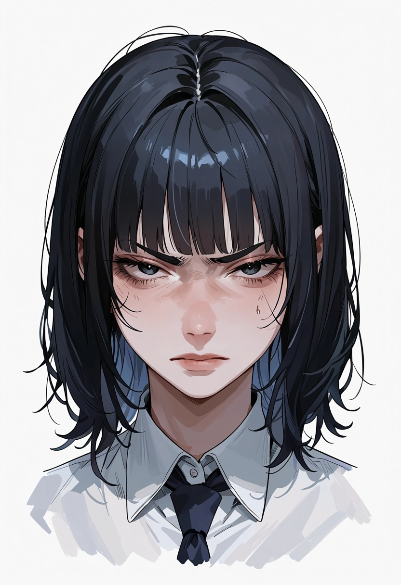
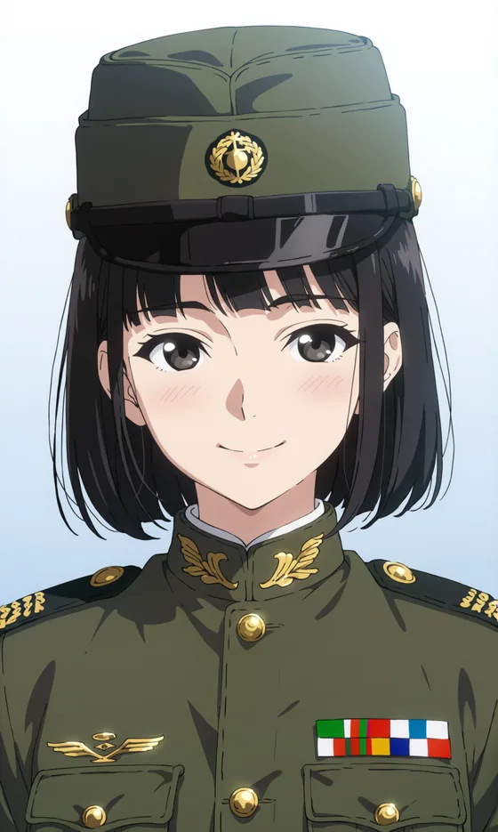
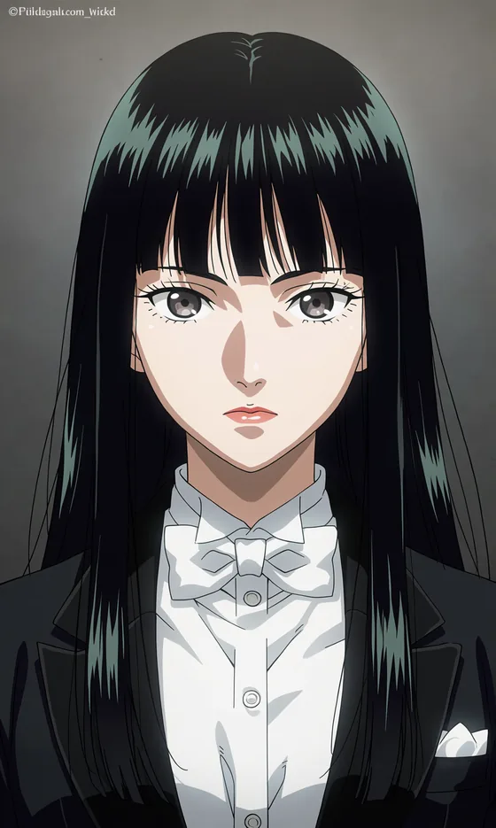
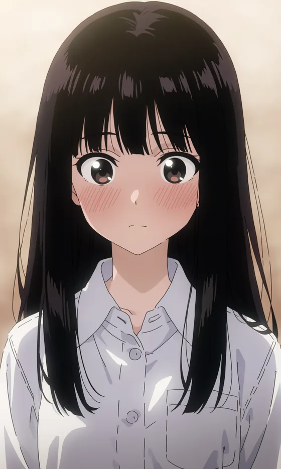

# 完结仙草：都市后宫 扮猪吃虎 圣门圣主 双生姐妹 111万字

**《都市良人行》 ｜ 作者：禹岩 ｜ 字数：约 111 万字 ｜ 290 章 ｜ 5 卷**

**题材：都市 异能 后宫 商战** ｜ **状态：完结** ｜ **平台：未知**

## 评分

| 维度 | 档位 | 依据 |
|:---|:---:|---|
| 情节 | **A-** | 丛林开局、圣门夺权、造车商战、国际任务四段接力，转场利落；中段争风戏重复，格局硬拔 |
| 文笔 | **B+** | 白描干净、对话有生活气；抒情段爱堆排比，旁白插科打诨常抢戏 |
| 感情 | **A-** | 姐妹让爱与杜宛若病中沉睡写得真痛，收尾却用一纸绝密结婚证抹平 |
| 车速 | **B+** | 床戏密度高，多用“一夜风情”式转场虚写，露骨处止于前戏与暗示 |
| 人物刻画 | **B+** | 女主靠外号与反差立住，男主近乎全能少有成长，反派基本是功能件 |
| 新意 | **B** | 古洞得功、魔门圣主、多女共侍都是旧套路；自己造国产车这条线略见新意 |
| 压抑度 | **C** | 整体爽快闹腾，只有战友阵亡、坠海失踪两年苦等几处短促虐点 |
| 总评 | **A-** | 九十年代都市后宫爽文的完成度样本：热闹好读、情绪给足，格局与收尾撑不住 |

> 评分为阅读主观判断，非原文事实；事实性结论见下方排雷与人物依据。

## 简介

一九九六年，十八岁的禹言是猎鹰大队最年轻的小队长。一次越境伏击踩进毒贩和雇佣兵合做的套，六个弟兄两死一残，他留下断后，抱着战友的遗体沉进丛林沼泽。泥底一道石缝把他送进山腹古洞：两具坐化的骸骨，一份失传的《天心诀》全诀，一株千年才长一截的翠玉墨竹，还有魔门之主硬塞给他的衣钵。

七天后他从崖壁爬回人间，等来的却是“指挥失误”的审查和一纸强制退伍令。他回青山一中读高三，同桌是全市第一的杜宛若；高考后揣着一袋夜明珠到天京打工，进圣龙保全当外场保镖，顶头上司是冷脸美人关雅妮。夜明珠在港岛拍卖会上一夜扬名，也把圣龙集团总裁关敏晴引到了他面前——她跪下来，叫他“圣主”。

一边是千年圣门留下的烂摊子和不近人情的圣女旧规，一边是于紫彤那家快被安凯集团吞掉的小公司；陈家树身后若隐若现的R国势力，也在暗处递刀。禹言白天谈配套、跑批文、张罗造车，晚上清理门户、应付暗杀，身边的女人越来越多，麻烦也越来越大。

## 男主

### 禹言

十八岁的禹言是猎鹰最年轻的小队长，一次跨境伏击被雇佣兵反包围，他留下断后，与猴子一同沉入沼泽，却在山腹古洞得到云门《天心诀》全诀、魔门龙欲功，服下翠玉竹乳脱胎换骨。

退伍后他回青山一中读高三，靠一袋夜明珠的本钱和一身武功闯进天京：先在圣龙保全当外场保镖，被圣龙集团总裁关敏晴认出是失踪数百年的圣主，接手风雨飘摇的圣门，血洗叛党、废掉圣女旧制；又与于紫彤把一家小贸易公司做成造车民企创力世纪，借圣龙与政商两界站稳脚跟。

他与陈家树、暗魔及R国右翼一路缠斗，为换一纸能光明正大娶九个女人的批文，接下十死无生的潜入爆破任务，炸毁秘密试验室后与关雅妮坠海，昏迷十七个月，被许念欣救回，两年后才重返天京。终局是春节团圆、集体登记，四年后带着一屋子妻儿在公海小岛上晒太阳。

**外貌**：黑发黑瞳，脸白如玉，眉目清俊近书生；身形匀称不显肌肉，笑起来嘴角微撇带点坏。常穿西装打领带，退伍后头发留长。作者未写疤痣。

**性格**：外表温雅，行事蔫坏：跟师兄称兄道弟却顺走他一条特供烟；对女孩先斩后奏，一句“两个我都要”把姐妹一并定下；护短到给战友父母下跪叫爹娘。

> **名场面**：「中国不行，就去国外，地球不行，就去火星，反正我是打定主意了，两个我都要。」 —— 向曾柔摊牌，要连她姐姐曾倩一起娶进门

## 女主

### 1. 曾倩

**身份**：曾天元（老曾）的长女，曾柔的双胞胎姐姐；猎鹰特战队员，后任云北边防站指导员、军官。

**外貌**：齐耳短发，发色乌黑；清丽脸庞，皮肤白皙；身段玲珑丰满，着军装时更显英姿，惯穿绿色军装、戴军帽。瞳色与身高作者未正面写。

**经历**：她到猎鹰分队报到时忘带作战手表，被小她两岁的禹言训斥，从此只叫他“一号”，暗恋多年却不敢开口。禹言退伍后，她到青山过年，与杜宛若暗自较劲；又到天京撞见他与于紫彤挽手，心碎离场。当夜她在山顶表白献吻，随后申请调往云北边防站，贴树叶计数等他。舒乐把她调回禹言身边，误会解开后二人和好。云北哨所当众定情后，她随队赴r国突入实验室录像取证，与重伤的禹言隔火网分离。禹言失踪两年，她守在禹家；团圆后她首个领取结婚证件，四年后升少校并怀上身孕。

**纯洁度结论**：全初。

**性格特点**：羞涩腼腆、死心眼、自我牺牲、善良大度、外柔内刚、默默守望

> **名场面**：「你知不知道，这一辈子，我只为你舞蹈。」 —— 山顶月下为他独舞后力竭，倒进他怀里说

### 2. 关敏晴

**身份**：圣世天堂、圣龙保全、圣龙地产等产业的掌权者，圣龙集团实际主事人；圣门第三十九代圣女，关雅妮的姑姑，三十五岁。

**外貌**：三十五岁却看不出年纪，可当少女也可当少妇；脸形与关雅妮有几分相像，淡施薄粉，长秀发，颈项洁白如玉；隆胸丰臀细腰，媚艳入骨。发色、瞳色作者未写。

**经历**：港岛拍卖会上她为追查师门夜明珠举牌，凤引诀被禹言的龙欲真气引得失控，两人隔场相认。当夜禹言爬窗入房、出示圣玉，她跪称三十九代圣女恭迎圣主，把守了三十五年的清白与二十年的等待一并交出去，双修助他破功。回天京后她交出圣龙股权、平定殷能成叛乱，又把秘书李晚玉许给他；随后收服于紫彤、献计结盟林氏、以金针参与救治杜宛若，并接纳曾柔、曾倩入门。禹言失踪两年间她怀着身孕主持禹家，生下禹成；最终与众人一同领证，四年后在海岛一大家同住，仍掌家中规矩。

**纯洁度结论**：全初。

**性格特点**：钢铁女强人、外媚内传统、痴等二十年、掌家主母、心思缜密、爱娇嗔

> **名场面**：「圣门第三十九代圣女关敏晴恭迎圣主驾前。」 —— 禹言夜入酒店房间出示圣玉，她双肩颤抖跪倒认主

### 3. 曾柔

**身份**：天京大学外语学院学生，部队大院长大的军人家庭次女，曾倩（九号）的双胞胎妹妹，人称“小辣椒”。

**外貌**：作者未写发色瞳色。脸酷似姐姐曾倩，皮肤更白；长发柔顺、长睫毛、小鼻子；身材丰满。常穿粉红条纹短袖、淡蓝七分裤、银灰凉鞋，也穿白连衣裙或牛仔裤。无疤痣饰品。

**经历**：餐厅里她把禹言当成登徒子，骂他变态、被扣住手腕，从此结下斗嘴的师侄缘分；助学募捐她指挥他干活，他醉酒那夜她守着照顾，被吻后成了他的第一个男人，随后搬进小屋同居。他坦白自己正是姐姐苦恋的“一号”，她崩溃痛哭、想抽身成全姐姐，跑去边防站找姐姐，又在他捧花等候时不理他、答应陈家洛去KTV。深秋她在他门口守了一夜染上风寒，父亲撞破恋情把她带回家，她求他带自己私奔。他失踪两年，她抱着禹成守在禹家等他，他归来时她哭昏过去，最终与姐姐一同和他照了登记照、登记结婚。

**纯洁度结论**：全初。

**性格特点**：嘴硬心软、爱吃醋、说话直、认死理

> **名场面**：「你坏蛋，你混蛋，我恨死你了，我想你，我想你——」 —— 他失踪两年后回家，她扑上去又咬又哭

### 4. 杜宛若

**身份**：青山一中校长杜校长的独生女，全市统考连年第一的尖子生，禹言的高中同桌。

**外貌**：长发（发色作者未明写）、细眉、眼神清澈、脸色常年苍白、笑起来两个浅浅酒窝；身形纤弱娇小，惯穿白色长裙或一身白衣，脚踩小皮靴；随身带一把军用匕首。

**经历**：校长办公室初见，她被安排成禹言的同桌，安静得只低头看书，考场上却回回压他一分；植物园里被逼着发泄，她收下他送的军用匕首，也第一次承认自己有心脏病。毕业那年她不辞而别，独自去天京住院等死，只在大学树干的心形里添上“言若”二字；大青山雪夜被禹言找到，她才答应回去治病。手术成功她却陷入沉睡，两年后大年三十才睁眼，最后与他一同领到红色结婚证。

**纯洁度结论**：全初。

**性格特点**：安静内敛、外柔内刚、痴情隐忍、倔强好胜

> **名场面**：「我每天都在等，却又怕你找到我的时候，我已经是一具冰冷的尸体了。」 —— 大青山雪夜，她被禹言找到、抱在怀里时哽咽说出

### 5. 王影扉

**身份**：天京大学英语教师，特一组心灵异能者，001首长的孙女；与妹妹舒乐共用一具身体（一体双神），清醒时是温静的姐姐人格。

**外貌**：黑色长发，或盘起或披散；肌肤雪白晶莹，眼睛大而明亮，柳眉，面容艳绝；惯穿洁白的连衣裙，军训时着墨绿作训服，安静时气质恬静。

**经历**：赴r国航班上，妹妹舒乐向禹言坦白一体双神，她这个姐姐人格由此进入他的世界。天京大学晨读时长凳上的误搭讪让两人正式结怨，她以舒乐的强势刁难他，又常以姐姐身份出面缓和。查出陈家树与r国右翼勾结后，她带禹言去见爷爷001，使他接下摧毁r国实验室的任务，自己以联络员身份随重庆号出海，在船上向他道歉示好。禹言重伤坠海，她放弃明星身份，率船在公海搜寻两年，靠摩尔斯电码接回他与关雅妮。回京后她向爷爷表明非他不嫁，最终领取结婚证件，四年后生下儿子。

**纯洁度结论**：全初。

**性格特点**：骄傲自信、嘴硬心软、爱吃醋、倔强、默默付出

> **名场面**：「是的，爷爷，我这辈子都不想离开他了。」 —— 海上搜寻九个月后，爷爷001问她是否真离不开禹言

### 6. 关雅妮

**身份**：圣龙集团关家独女，天京大学外语学院学生，圣世天堂西餐厅领班、圣龙保全特别保卫部副经理；实为圣门中人，后立为第四十代圣女，是禹言的上司、贴身护卫与妻子之一。

**外貌**：二十岁左右，长发常披散，眸如秋水、眉淡鼻秀、肤白唇红，身段婀娜；工作穿黑燕尾服配白领结，训练着白色训练服，脚踩高跟鞋。瞳色作者未写。

**经历**：圣世天堂西餐厅里，她以领班身份因一句英语和禹言顶了起来，冷脸白眼，却被他一再逗得脸红。后来她把他招进圣龙保全，亲自做背景审查，又在地下室以四成功力试他身手。中秋前她托他抢亲，他失约未到；月圆夜她赌气立为第四十代圣女、纵身跳下圣池，出关后冷得像石花，冷战近两年。得知圣主就是他时她急怒昏厥，当众自请废去圣女身份，又扯掉外衣以死相逼求做他的贴身护卫。两年相伴后，她与诸女同领了那本红色结婚证。

**纯洁度结论**：全初。

**性格特点**：冷面毒舌、外冷内热、认死理、刚烈决绝

> **名场面**：「从我跳下圣池的那一刻起，过去那个关雅妮就已经死了」 —— 出关后独坐池边，对赶来相劝的姑姑关敏晴冷声说出

### 7. 许念欣

**身份**：大青山山脚吊楼的邻家女孩，禹言十二岁起的玩伴与少年初恋；真身是r国第一望族伊藤家独女伊藤念子，天京大学经济学院学生，后接掌伊藤家族，最终为禹言妻子之一。

**外貌**：披肩黑发，脸色常年苍白，眸子明亮清澈，红唇娇俏，颈项雪白；少年时身形单薄，成年后丰润，惯穿淡色长裙，薄施脂粉。瞳色作者未写明。

**经历**：十二岁在吊楼下相识，她是他吹笛时唯一的听众，也是他少年梦里的人。禹言从军、她迁天京，音讯断绝。天京大学舞会重逢，她已是方以南公开追求的女友，只以故人相待；深夜长谈时借他胸膛痛哭，说过诀别的话。真身揭开——她是r国伊藤家独女伊藤念子，被父亲逼着杀他、逼着献身。禹言耗尽功力救她，她却一刀刺进他左肋，只为让他永远记住自己。后来她拒做山本帮凶，护他坠海，与关雅妮陪他在荒岛漂流近两年，并坦白自己藏起卫星电话。归来获众女谅解，领证为九人之一，四年后生女，接掌伊藤家族。

**纯洁度结论**：全初。

**性格特点**：外柔内刚、心事重、偏执、痴情、病弱、文静

> **名场面**：「你再也不会忘记我了，再也不会忘记我了，是不是？」 —— 一刀刺进禹言左肋后，扑在渗血的伤口上痴痴追问

### 8. 于紫彤

**身份**：创力世纪公司总经理，二十四五岁，父亲积劳成疾过世后独自撑着公司；被安凯集团太子安子峰纠缠，被禹言救下后成为他的女人与事业伙伴。

**外貌**：长卷发常披散、不时撩起额角一缕；桃脸柳眉、艳光逼人、目光如水；身材高挑丰满；惯穿暗灰职业装，居家是粉红连体睡裙。瞳色作者未写。

**经历**：圣世天堂里被安凯太子安子峰缠住，禹言出手替她解围，两人就此相识；车上她把四大集团与黑帮的底细一一讲给他听，信任从那时起。父亲过世、公司又被安凯设局，三天内要凑一千万，她硬扛着不肯低头，是禹言帮她迈过这道坎，两人的关系也就此挑明。此后她把创力世纪整个交给他打理，自己退到身后做他的后盾。最大的转折是他重伤进了手术室，他醒来时她扑上去抱着他哭，说没有他，她真的活不下去。

**纯洁度结论**：未知。

**性格特点**：能扛事、爱哭黏人、死心塌地、干练

> **名场面**：「阿言，你以后再也不要去做什么危险的事情了，好不好？你不知道，没有你，我真的会活不下去的。」 —— 禹言重伤手术醒来后，她扑上去抱着他哭

### 9. 叶子

**身份**：孤儿，自述只知姓苏，被禹言收留抚养、以兄妹相称，无血缘说明。

**外貌**：作者未正面描写发色、瞳色与身高体态，只反复写她一张清秀小脸、神情多变；常穿连衣裙，被形容为「一朵清水芙蓉」。

**经历**：禹言退伍回青山，她从竹楼跳下来扑进他怀里，此后以「哥」相随：做饭、跟九号斗嘴、在食堂为一句话赌气。她当众编排杜宛若有男友，被哥哥训哭，哭着保证不再胡闹、只求别被丢下。禹言赴天京，她含泪答应转学；高三立志考天京大学。禹言失踪两年，她坚信哥哥一定回来；重逢时她已是大二学生。全书末首长给九女发证，她当众喊要嫁，只换来两本空白证件；四年后岛上证件被禹成拿去擦屁股，她始终未被纳入，只留下等下去的一句。

**纯洁度结论**：未知。

**性格特点**：爱撒娇、嘴硬心软、孩子气、依赖哥哥、怕被丢下、记仇又易哄

> **名场面**：「阿言，哥，我爱你！不管等多少年，我一定要嫁给你」 —— 四年后岛上，证件被禹成拿去擦屁股，她当着众人喊出这句话后追着禹成跑走

### 10. 李晚玉

**身份**：圣龙集团总裁关敏晴的贴身秘书，哈佛MBA，自小由关敏晴送出留学、一手提拔，圣门内以「奴婢」自居；被关敏晴定为给圣主暖床的陪嫁丫头，后成为禹言的女人、圣龙集团的实际管理者之一。

**外貌**：作者未正面写五官与发色，只反复写「长得漂亮」「身材一级棒」「媚到骨子里」。惯常造型是淡蓝色职业套装或粉红衬衣，雪白颈脖，一说话就满脸通红。

**经历**：禹言初到圣龙集团时，她以秘书「李秘」的身份领他上楼，关敏晴当面点破禹言才是真老板，命她保密并协助整顿圣龙地产；关敏晴又以历代圣主广纳妻妾为由，把她许给禹言填房。当夜三人同宿，她由处子变成禹言的女人，次日仍羞得不敢抬头。此后她在关敏晴办公室外间当助手，屡被禹言逗得满脸通红；禹言出征前嘱她多帮关敏晴，她第一次抬头直视，承诺打理好圣龙、等他凯旋。禹言坠海失踪两年，关敏晴养胎，圣龙集团交她打理。禹言归来，她一声不吭钻进他怀里落泪；随后与众女一同领到红色结婚证，成为九人之一。

**纯洁度结论**：全初。

**性格特点**：羞涩、忠仆型、外冷内羞、顺从、反差、感恩图报

> **名场面**：「请圣主放心，奴婢一定全力协助圣女，打理好圣龙集团，等待圣主凯旋归来。」 —— 禹言出征前嘱她多帮关敏晴，她第一次抬头直视他说完又低头

### 11. 候芸

**身份**：陕夕省人，已故猎鹰队员「猴子」的妹妹，父母双亡的孤儿；高考生，靠禹言按月寄钱和猴子抚恤金读书，后被禹言认作义妹，大学毕业后任创力世纪常务副总裁。

**外貌**：作者写她清秀瘦弱、眼睛大、脸色因营养不良泛黄；常穿白衬衣配洗得发白的牛仔裤，干净朴素。发型发色未正面描写。

**经历**：高考后独自坐几天火车到天京打工，在校园餐厅与禹言重逢，被接去同住、认作义妹，禹言发现她靠杂粮馒头省钱，从此下决心挣钱供她读完大学。她高烧时禹言以内力为她驱寒。考上大学后，于紫彤安排她做秘书并搬去同住，她自认乡下穷丫头配不上禹言，只能把心思藏着。大学期间她到创力世纪帮忙，曾被人利用送茶下毒。表白被禹言以战友之妹为由拒绝后，她拼命工作，升到常务副总裁；四年后关敏晴以「要进我家门，先听我来讲讲家规」将她接入禹家。

**纯洁度结论**：未知。

**性格特点**：羞怯内向、自卑、能吃苦、知恩、要强、痴情

> **名场面**：「火车上吃饭太贵，我就带上这个了。」 —— 禹言发现她行李里全是杂粮馒头，追问之下她小声解释

## 其他角色

| 角色 | 身份 | 一句话 |
|:---|:---|:---|
| **曾天元** | 猎鹰大队长、禹言师兄 | 一口一个「他娘的」，护犊子护到拍首长桌子，转头又被师弟顺走特供烟 |
| **舒乐** | 国际巨星、001 首长孙女，与王影扉一体双神 | 同一具身体里的另一个人格，戏里戏外都在演，坠海那场把两条命绑在一起 |
| **周海陵** | 首长外孙、禹言跟班 | 大嘴巴活宝，跑腿、打听、背锅样样在行，结婚证也是他递的 |
| **陈家树** | 跨国集团少壮派、情敌 | 笑面虎，台面上谈生意，台面下勾连 R 国右翼 |
| **鲁冲** | 圣龙保全部下 | 粗豪老兵，最早知道禹言底细，替他瞒着成绩 |
| **王全云** | 王氏企业副总裁、关敏晴的追求者 | 全书最惨备胎，追了十年只追到一声「叔」 |
| **陆风** | 校园餐厅服务员、后当领班 | 校园段的市井线，跟禹言从抢座吵到称兄道弟 |
| **张环** | 陆风女友 | 嗓门大，出场就是为了跟陆风吵一架 |

## 分维度点评

### 1. 剧情方面

结构是四段式拼盘：1-20章丛林血战加古洞奇遇，21-100章天京打工、圣龙保全与港岛夺宝，100-245章圣门夺权、造车商战与情敌围剿，246-290章太平洋潜入、坠海失踪与归来团圆。优点是每章都留钩子，退伍、认主、拍卖、废制几个节点踩得准，几乎不冷场；缺点是段落之间靠“换地图”硬接，150-220章大量多女争风的重复桥段，读起来像在原地打转。后半段把商业对手一路升级成R国右翼的生物武器阴谋，格局拔得太急，前文铺的都市气反而散了。

### 2. 女主方面

九位领证的加两位没名分的，几乎把当年后宫文的类型铺满了。曾倩是白月光加姐姐位：山顶月下独舞告白、边防站诀别、归来第一个领证，四年后升少校怀孕，全书最沉的一条线；妹妹曾柔是「小辣椒」，一场酒后的意外把她推到第一个女人的位置，之后为姐姐让爱、门口守整夜染风寒，情绪最冲。关敏晴是年龄差权谋型：圣龙集团掌权者、关雅妮的亲姑姑，三十五岁却看不出年纪，跪下认主那句「圣女关敏晴恭迎圣主」把身份与情欲拧在一起，还给禹言生了儿子禹成。

关雅妮是冰美人护卫，领班、贴身护卫、第四十代圣女三重身份层层加码，跳圣池、冷战两年，挣扎得最久也最克制。于紫彤是御姐型合伙人，从被安子峰纠缠到撑起创力世纪。杜宛若是病弱白月光，雪夜被追回、手术沉睡两年，承担全书最重的虐点。王影扉与舒乐共用一身（一体双神），坠海后海上搜寻两年多，是设定上最奇的一条。许念欣是「心底的旧影子」，重逢后行刺、把卫星电话藏进树林让禹言困岛近两年，全书写得最不讨喜的一笔。李晚玉是关敏晴的陪嫁丫头兼哈佛 MBA。

候芸是战友遗妹，四年后被接入禹家，证件却被孩子拿去擦屁股；叶子当众求嫁只拿到一张空白证件，四年后还在喊「不管等多少年，我一定要嫁给你」——收尾把「漏女」两个字摆得很明白。

### 3. 车技方面

密度不低，从107章曾柔“初度花开”起，基本每十来章就有一场，旅馆、温泉、别墅、海岛轮着来，“一夜风情”“如火激情”这类章名就是路标。写法上偏含蓄：多是前戏、衣料、喘息加一句省略号转场，露骨程度止于擦边，很少落到具体器官。龙欲功“双修”的设定给了男主金枪不倒的正当理由，也顺手把“多女共侍”合理化。后期姑侄同床、姐妹同屋之类情节，往往用“荒唐”二字一笔带过，靠读者自己补。

### 4. 设定方面

底子是“古武＋都市”：天心诀七层主内，龙欲功六层主欲，凤引诀与圣女体质互相吸引，两功合流后男主一路开挂；圣门这个千年组织把黑道、商界、政界串成一张网，圣女制度则直接供给后宫，设定与爽点咬得很紧。夜明珠既是奇遇的战利品，也是男主第一桶金的来源，比凭空发财老实。时代放在1996-1997年，用造国产车对抗合资潮做商战主线，是全书最有想法的一笔。弱点是战力尺子模糊，第六层之后基本无敌，作者只能不断搬出炸弹、狙击、异能者来制造危机。

### 5. 缺点方面

硬伤有三处。其一，一夫多妻的合法性靠“国家最高机密结婚证”解决，首长亲自盖章、永不解密，儿戏到把前文所有现实铺垫都抵消了；其二，结尾把养妹叶子和候芸也塞进两张空白证件，伪骨科擦边，收得既不体面也不干净；其三，反派脸谱化，陈家树是笑面虎、暗魔是纯粹恶、R国右翼是标准靶子，动机单薄。此外，造车与首长谈话那几段长篇议论像社论，拖慢节奏；中段家事拉扯反复；结局“四年后”一段只报菜名，谁生了几个孩子一笔带过。文本本身也有错字与人名混用，正文里出现过“对禹岩来说”这样的笔误。

## 排雷

### 雷点

- **背叛**：荒岛求生的头几天，她随身带着卫星电话却主动藏进登岛的树林，想留禹言陪满三年再送他走；风暴连树林带电话一起卷走，禹言与关雅妮因此困岛近两年。她事后哭着承认“是我当初自私”。属知情故藏，非巧合误会。
  > 「所以，到了小岛之后，我就把电话藏在登岛那个地方的树林中」

### 郁闷点

- **拒女**：禹言当着她的面把她推给相亲对象陈家树，她当场落泪离去
  > 「你们真的很相配的。」
- **虐心**：她撞见禹言与于紫彤挽手同行，误以为他有女友，强撑说完这句便几乎站不住
  > 「你女朋友来了——」
- **虐心**：接到绝密任务后她以“出长差”为名向妹妹交代后事，把禹言让给妹妹
  > 「感觉就像是在安排后事。」
- **擦边**：温泉中一男三女同池嬉闹，她先起身邀禹言下水
  > 「一号，忙了一年到头了，你也来泡泡吧——」
- **百合**：与陪嫁丫头李晚玉早有同性亲密举动，李晚玉自述圣女爱打她屁股
  > 「圣女以前和奴婢在一起时，就喜欢打奴婢的屁股」
- **拉皮条**：自幼把李晚玉当陪嫁丫头养，认主后直接推给禹言暖床
  > 「关敏晴自幼就把李晚玉当作了自己的陪嫁丫头，是专门给圣主暖床的」
- **虐心**：得知所爱之人正是姐姐苦恋的“一号”，崩溃痛哭、欲退出成全姐姐，后又在门前苦守一夜染上风寒
  > 「你为什么要告诉我这些，为什么？我宁愿当作什么都没听到，宁愿你隐瞒我一辈子。」
- **虐主**：多次对男主掐胳膊、拧耳朵、咬肩膀、罚站军姿，属打闹式相处
  > 「曾柔死死掐住他的胳膊」
- **虐心**：天生心脏瓣膜闭塞，随时可能停跳；不肯告知病情独自等死，被找到后治疗成功却沉睡两年，除夕才苏醒。
  > 「我每天都在等，却又怕你找到我的时候，我已经是一具冰冷的尸体了。」
- **拒女**：两人因关雅妮之事在电话里争执，禹言放狠话，明言绝不会打她的主意，随后直接挂断电话。
  > 「我在地球上也不会打你的主意的」
- **虐心**：禹言坠海失踪，她放弃另一个身份，在公海漂流搜寻两年多，从希望到失望反复煎熬。
  > 「已经在这公海上漂流了两年有余了」
- **虐心**：禹言失约未去抢亲，她月圆夜赌气立为圣女、纵身跳入圣池；出关后形如石花，冷战近两年才解开心结。
  > 「从我跳下圣池的那一刻起，过去那个关雅妮就已经死了」
- **拒女**：圣主当众还她自由，她平静地自请废去圣女身份，等于当面放弃做他的女人。
  > 「我——愿意！」
- **擦边**：为留在他身边，她当面扯掉外衣只剩内衣，以脱衣相逼，逼他收回赶她走的决定。
  > 「我喜欢啊，你可以阻止我杀了自己，难道也能阻止我脱衣服嘛。」
- **虐主**：禹言耗尽全部功力把她从方以南师祖手里救活，她谎称有东西要还，骗他坐到床边，一匕首刺进他左肋，血透衣衫。
  > 「这就是我要还给你的东西，我相信，你一辈子都忘不了我了吧」
- **虐心**：从大青山起她一直隐瞒伊藤念子的真实身份，禹言识破时才发现少年情谊全在骗局里；此前她还多次语带诀别。
  > 「原来她一直都在欺骗自己，从大青山开始，她就一直在欺骗自己」
- **神雕**：重逢时她已是方以南公开追求并接受的女友，全校皆知；禹言只能以“故人”“朋友”相称，少年旧梦看似已属他人。
  > 「现在整个天京大学都知道她是方以南的女朋友了」
- **虐心**：父亲年底过世，公司濒临破产，三天内要凑一千万
  > 「我只有三天时间了，三天里筹集一千万」
- **擦边**：作者反复写她的身段与睡裙，被男主与旁人多次打量
  > 「丰满的酥胸颤颤巍巍抖动着，形成一道香艳的波浪」
- **漏女**：全书末发证时她当众求嫁，首长只给两本空白证件；四年后岛上仍无证件，未被纳入禹家名册
  > 「不管等多少年，我一定要嫁给你」
- **百合**：与关敏晴早有同性亲密举动，第一次侍寝时自述圣女爱打她屁股
  > 「圣女以前和奴婢在一起时，就喜欢打奴婢的屁股」
- **拉皮条**：关敏晴自幼把她当陪嫁丫头养，认主后直接推给禹言暖床，禹言自认对她欲大于情
  > 「关敏晴自幼就把李晚玉当作了自己的陪嫁丫头，是专门给圣主暖床的」
- **漏女**：于紫彤以做伴为名把候芸接去同住，切断她与禹言同住的机会
  > 「小芸，你以后要到公司那边上班，就住到我那去吧」
- **拒女**：候芸表白后被禹言以战友之妹的身份推拒，此后多年只能以工作自处
  > 「我是个乡下来的穷丫头，哪里配的上言大哥」

## 数据说明

- 覆盖范围：21 个分块（每块 ≤2000 行）逐块扫描笔记，再对 11 位女主逐人回原文定向核验：原文第 1-41321 行为有效正文；txt 自第 40964 行之后是另一版本的重复收录（含 OCR 批注，如「屿言」「语言」应为「禹言」，「地照片」应为「的照片」），已排除，故规模为 290 章、约 111 万字。卷标仅存第二、四、五卷，末章属第五卷，故 volumes 记 5。
- 原文：都市良人行_禹岩_20261118_164915.txt
- 全部人物事实与引文已回原文逐字核验；引文照抄，不改写、不拼接。
