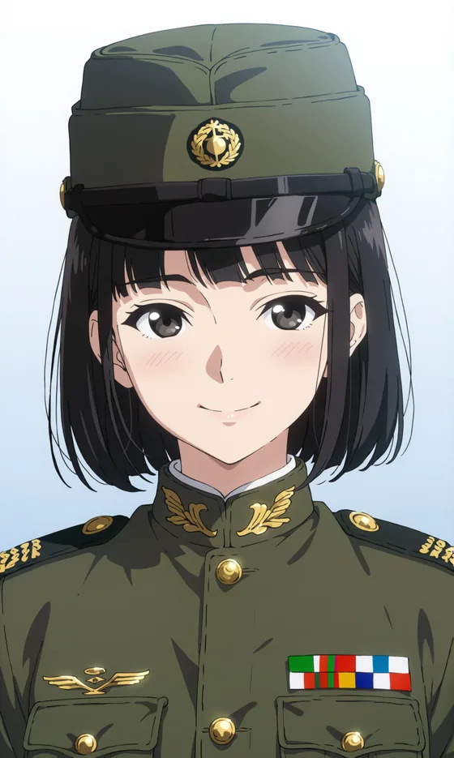
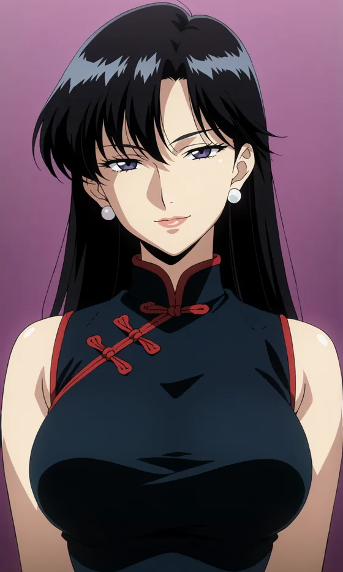
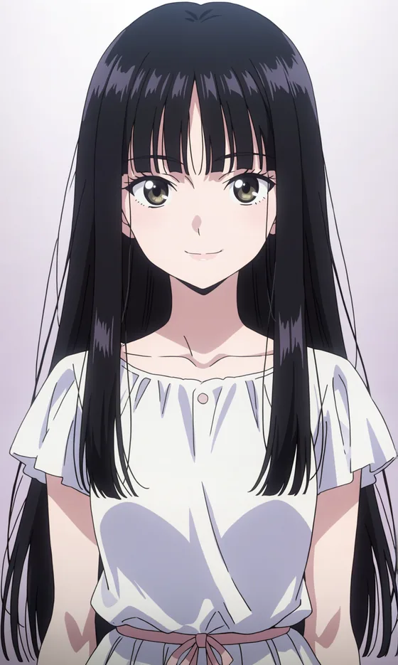
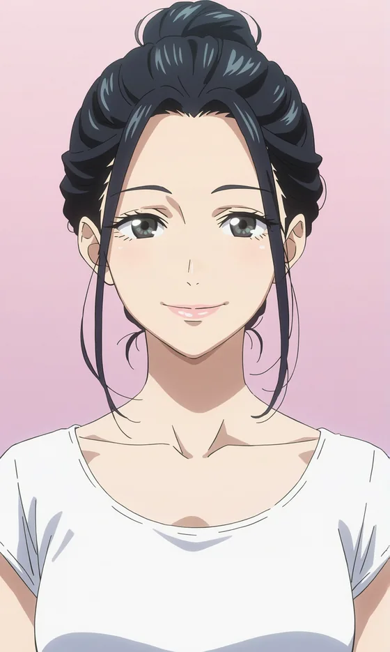
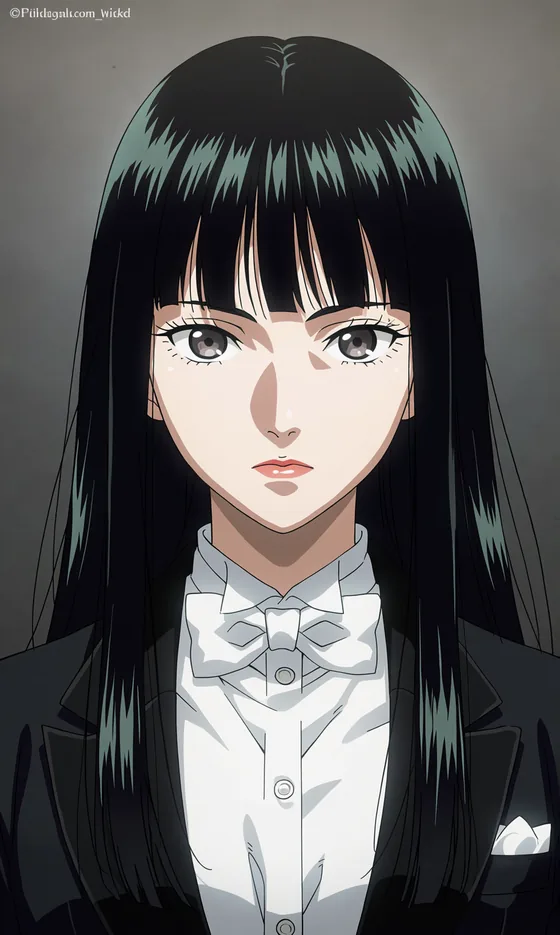
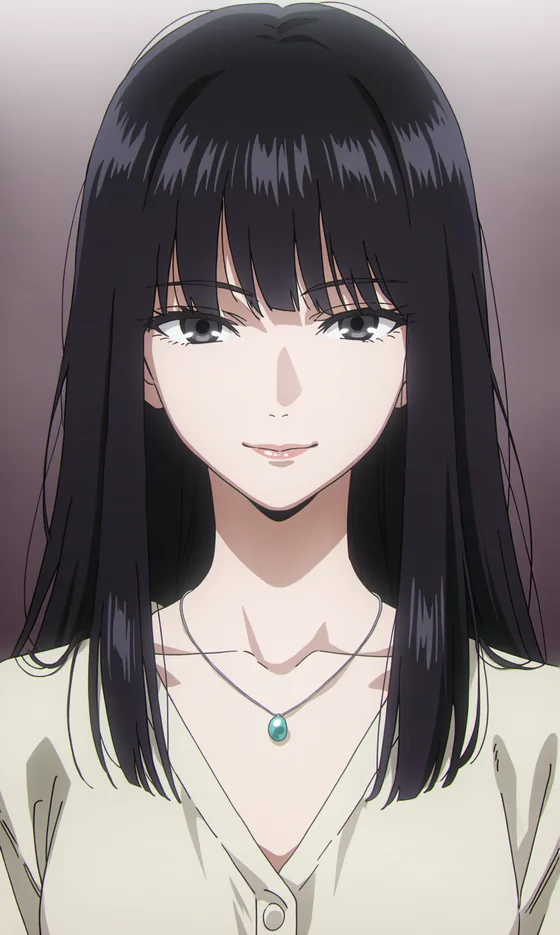
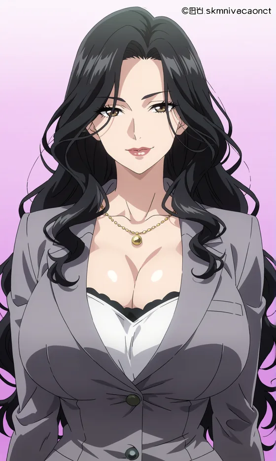
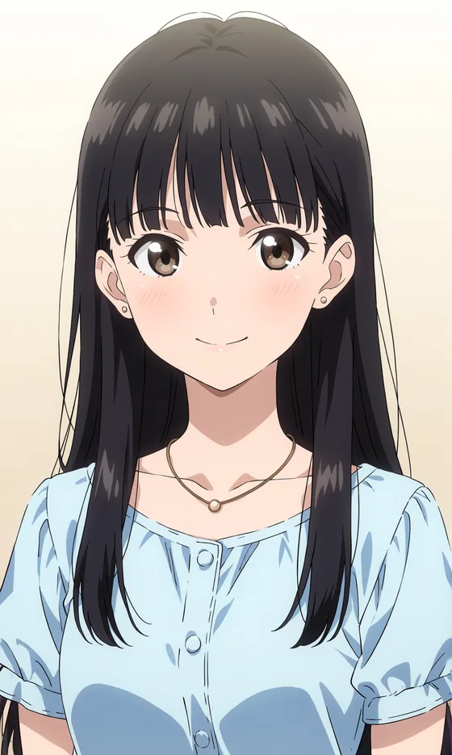
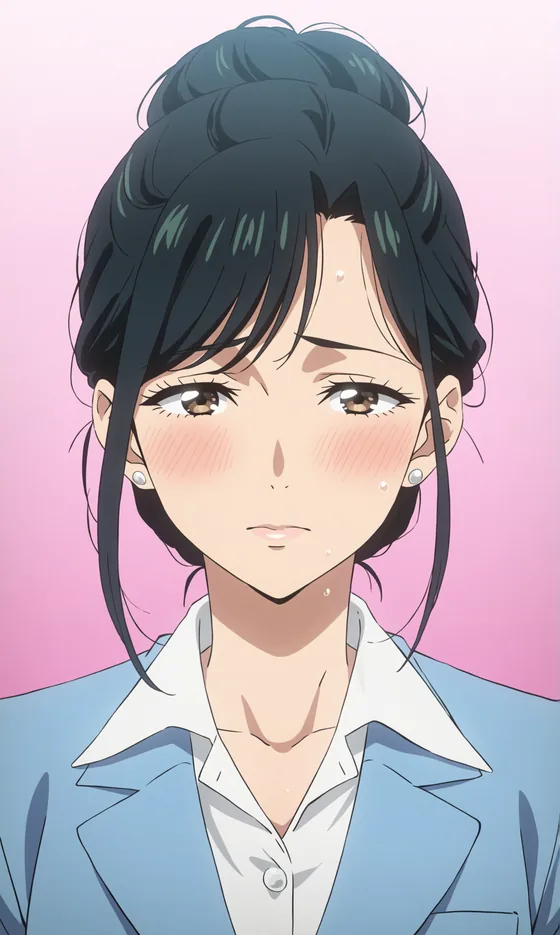
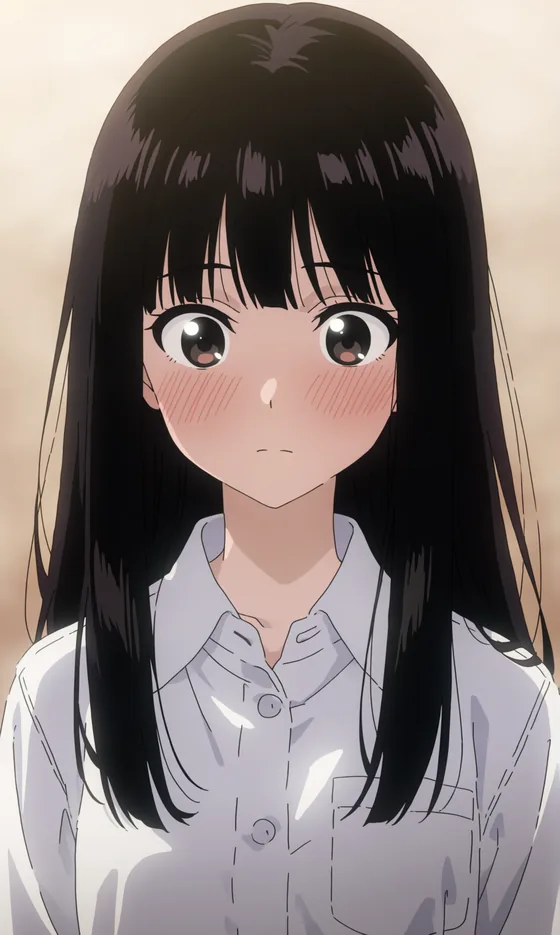

# 都市良人行 · 人物卡

> 来源：都市良人行_禹岩_20261118_164915.txt ｜ 生成：2026-11-18 23:47 ｜ 12 角色 ｜ 雷点 1 条 ｜ 郁闷点 24 条 ｜ 全部事实经原文核验

## 男主：禹言
- **别名**：一号、圣主、师叔、玉面郎、禹一招、阿言、熊兵
- **身份**：云门十五代弟子，猎鹰大队最年轻的小队长；十八岁因任务失败强制退伍，回青山一中读高三。后为魔门（圣门）中兴圣主、圣龙保全体外场保镖、创力世纪幕后东家
- **外貌**：黑发黑瞳，脸白如玉，眉目清俊近书生；身形匀称不显肌肉，笑起来嘴角微撇带点坏。常穿西装打领带，退伍后头发留长。作者未写疤痣
- **性格**：外表温雅，行事蔫坏：跟师兄称兄道弟却顺走他一条特供烟；对女孩先斩后奏，一句“两个我都要”把姐妹一并定下；护短到给战友父母下跪叫爹娘
- **成长线**：十八岁的禹言是猎鹰最年轻的小队长，一次跨境伏击被雇佣兵反包围，他留下断后，与猴子一同沉入沼泽，却在山腹古洞得到云门《天心诀》全诀、魔门龙欲功，服下翠玉竹乳脱胎换骨。退伍后他回青山一中读高三，靠一袋夜明珠的本钱和一身武功闯进天京：先在圣龙保全当外场保镖，被圣龙集团总裁关敏晴认出是失踪数百年的圣主，接手风雨飘摇的圣门，血洗叛党、废掉圣女旧制；又与于紫彤把一家小贸易公司做成造车民企创力世纪，借圣龙与政商两界站稳脚跟。他与陈家树、暗魔及R国右翼一路缠斗，为换一纸能光明正大娶九个女人的批文，接下十死无生的潜入爆破任务，炸毁秘密试验室后与关雅妮坠海，昏迷十七个月，被许念欣救回，两年后才重返天京。终局是春节团圆、集体登记，四年后带着一屋子妻儿在公海小岛上晒太阳
  > 外貌依据：「他的脸似白玉般纯净空明，隐隐似有莹光闪现，深邃的眼睛黝黑而有神」 / 「黑瞳似的眼珠如此深邃，就像是秋天里一汪平静的湖水」 / 「整个人优雅而自然，透出一种无比亲切的感觉」

- **名场面**：「中国不行，就去国外，地球不行，就去火星，反正我是打定主意了，两个我都要」 —— 向曾柔摊牌，要连她姐姐曾倩一起娶进门
- **关键事件**：
  1. 跨境伏击遭雇佣兵反包围，留下降后沉入沼泽
  2. 古洞得《天心诀》全诀、龙欲功与翠玉竹乳
  3. 强制退伍，回青山一中读高三与杜宛若同桌
  4. 到天京打工，入职圣龙保全当外场保镖
  5. 港岛拍卖夜明珠，得三千八百万启动资金
  6. 被关敏晴以圣玉认出，继任圣门圣主
  7. 血洗叛党，当众废除圣女制度
  8. 助创力世纪造国产车，正面硬撼安凯集团
  9. 与陈家树、暗魔及R国右翼连番交手
  10. 接十死无生任务，炸试验室后坠海失踪
  11. 昏迷十七个月，两年后重返天京
  12. 春节率众登记，四年后岛上团圆
- **原文摘录**：
  > 「队长，别开枪，是我！」
  > 「我禹言对天发誓，以后谁也不能欺负我妹子，我一定要让她成为天下最幸福的人」
  > 「你和倩倩，我都要」
  > 「三个，一个也不能少」

## 全书雷点汇总
- `背叛` **许念欣**：荒岛求生的头几天，许念欣随身带着卫星电话却主动藏进登岛的树林，想留禹言陪满三年再送他走；风暴连树林带电话一起卷走，禹言与关雅妮因此困岛近两年。她事后哭着承认“是我当初自私”。属知情故藏，非巧合误会 「所以，到了小岛之后，我就把电话藏在登岛那个地方的树林中」

## 全书郁闷点汇总
- `拒女` **曾倩**：禹言当着曾倩的面把她推给相亲对象陈家树，她当场落泪离去 「你们真的很相配的」
- `虐心` **曾倩**：曾倩撞见禹言与于紫彤挽手同行，误以为他有女友，强撑说完这句便几乎站不住 「你女朋友来了——」
- `虐心` **曾倩**：接到绝密任务后曾倩以“出长差”为名向妹妹交代后事，把禹言让给妹妹 「感觉就像是在安排后事」
- `擦边` **曾倩**：温泉中一男三女同池嬉闹，曾倩先起身邀禹言下水 「一号，忙了一年到头了，你也来泡泡吧——」
- `百合` **关敏晴**：与陪嫁丫头李晚玉早有同性亲密举动，李晚玉自述圣女爱打她屁股 「圣女以前和奴婢在一起时，就喜欢打奴婢的屁股」
- `拉皮条` **关敏晴**：自幼把李晚玉当陪嫁丫头养，认主后直接推给禹言暖床 「关敏晴自幼就把李晚玉当作了自己的陪嫁丫头，是专门给圣主暖床的」
- `虐心` **曾柔**：得知所爱之人正是姐姐苦恋的“一号”，崩溃痛哭、欲退出成全姐姐，后又在门前苦守一夜染上风寒 「你为什么要告诉我这些，为什么？我宁愿当作什么都没听到，宁愿你隐瞒我一辈子」
- `虐主` **曾柔**：多次对男主掐胳膊、拧耳朵、咬肩膀、罚站军姿，属打闹式相处 「曾柔死死掐住他的胳膊」
- `虐心` **杜宛若**：天生心脏瓣膜闭塞，随时可能停跳；不肯告知病情独自等死，被找到后治疗成功却沉睡两年，除夕才苏醒 「我每天都在等，却又怕你找到我的时候，我已经是一具冰冷的尸体了」
- `拒女` **王影扉**：两人因关雅妮之事在电话里争执，禹言放狠话，明言绝不会打她的主意，随后直接挂断电话 「我在地球上也不会打你的主意的」
- `虐心` **王影扉**：禹言坠海失踪，王影扉放弃另一个身份，在公海漂流搜寻两年多，从希望到失望反复煎熬 「已经在这公海上漂流了两年有余了」
- `虐心` **关雅妮**：禹言失约未去抢亲，关雅妮月圆夜赌气立为圣女、纵身跳入圣池；出关后形如石花，冷战近两年才解开心结 「从我跳下圣池的那一刻起，过去那个关雅妮就已经死了」
- `拒女` **关雅妮**：圣主当众还关雅妮自由，她平静地自请废去圣女身份，等于当面放弃做他的女人 「我——愿意！」
- `擦边` **关雅妮**：为留在关雅妮身边，她当面扯掉外衣只剩内衣，以脱衣相逼，逼他收回赶她走的决定 「我喜欢啊，你可以阻止我杀了自己，难道也能阻止我脱衣服嘛」
- `虐主` **许念欣**：禹言耗尽全部功力把许念欣从方以南师祖手里救活，她谎称有东西要还，骗他坐到床边，一匕首刺进他左肋，血透衣衫 「这就是我要还给你的东西，我相信，你一辈子都忘不了我了吧」
- `虐心` **许念欣**：从大青山起许念欣一直隐瞒伊藤念子的真实身份，禹言识破时才发现少年情谊全在骗局里；此前她还多次语带诀别 「原来她一直都在欺骗自己，从大青山开始，她就一直在欺骗自己」
- `神雕` **许念欣**：重逢时许念欣已是方以南公开追求并接受的女友，全校皆知；禹言只能以“故人”“朋友”相称，少年旧梦看似已属他人 「现在整个天京大学都知道她是方以南的女朋友了」
- `虐心` **于紫彤**：父亲年底过世，公司濒临破产，三天内要凑一千万 「我只有三天时间了，三天里筹集一千万」
- `擦边` **于紫彤**：作者反复写于紫彤的身段与睡裙，被男主与旁人多次打量 「丰满的酥胸颤颤巍巍抖动着，形成一道香艳的波浪」
- `漏女` **叶子**：全书末发证时叶子当众求嫁，首长只给两本空白证件；四年后岛上仍无证件，未被纳入禹家名册 「不管等多少年，我一定要嫁给你」
- `百合` **李晚玉**：与关敏晴早有同性亲密举动，第一次侍寝时自述圣女爱打她屁股 「圣女以前和奴婢在一起时，就喜欢打奴婢的屁股」
- `拉皮条` **李晚玉**：关敏晴自幼把李晚玉当陪嫁丫头养，认主后直接推给禹言暖床，禹言自认对她欲大于情 「关敏晴自幼就把李晚玉当作了自己的陪嫁丫头，是专门给圣主暖床的」
- `漏女` **候芸**：于紫彤以做伴为名把候芸接去同住，切断她与禹言同住的机会 「小芸，你以后要到公司那边上班，就住到我那去吧」
- `拒女` **候芸**：候芸表白后被禹言以战友之妹的身份推拒，此后多年只能以工作自处 「我是个乡下来的穷丫头，哪里配的上言大哥」

## 角色卡片

### #1 曾倩 —— 先是他手下的兵、师侄女，只肯叫他“一号”；暗恋多年后表白，历经费边、诀别与重逢，成为他最看重、也最先领证的妻子
- **别名**：九号、小倩、倩倩、大丫头
- **身份**：曾天元（老曾）的长女，曾柔的双胞胎姐姐；猎鹰特战队员，后任云北边防站指导员、军官。禹言的师侄兼旧部，暗恋多年后成为其领证妻子之一
- **外貌**：齐耳短发，发色乌黑；清丽脸庞，皮肤白皙；身段玲珑丰满，着军装时更显英姿，惯穿绿色军装、戴军帽。瞳色与身高作者未正面写
- **性格**：平日羞涩腼腆，上了战场却果断利落；认死理，爱一个人多年不改；惯于把话咽回去，宁可自己退让也要成全别人，甚至替情敌说好话；对禹言近乎无条件信任
- **成长线**：她到猎鹰分队报到时忘带作战手表，被小她两岁的禹言训斥，从此只叫他“一号”，暗恋多年却不敢开口。禹言退伍后，她到青山过年，与杜宛若暗自较劲；又到天京撞见他与于紫彤挽手，心碎离场。当夜她在山顶表白献吻，随后申请调往云北边防站，贴树叶计数等他。舒乐把她调回禹言身边，误会解开后二人和好。云北哨所当众定情后，她随队赴r国突入实验室录像取证，与重伤的禹言隔火网分离。禹言失踪两年，她守在禹家；团圆后她首个领取结婚证件，四年后升少校并怀上身孕
  > 外貌依据：「军帽下随风轻轻摆动的齐耳短发更显出她的勃勃英姿」 / 「齐耳的短发，清丽的脸庞，丰满的身躯」 / 「轻轻摆动的齐耳短发，色彩闪动的美丽脸颊」
- **性格标签**：羞涩腼腆、死心眼、自我牺牲、善良大度、外柔内刚、默默守望

- **名场面**：「你知不知道，这一辈子，我只为你舞蹈」 —— 山顶月下为他独舞后力竭，倒进他怀里说
- **纯洁度**：处 ✅ ｜ 精神初 ✅ ｜ 初婚 ✅ ｜ 初摸 ✅ —— **全初**
  - 依据：特别是经过昨夜的那名心刻骨的痛之后；一号，这是我的第一个吻，也是我的最后一个吻了；将禹言和曾倩的照片贴在上面，加盖了钢印
- **郁闷点**：
  - `拒女` 禹言当着她的面把她推给相亲对象陈家树，她当场落泪离去 「你们真的很相配的」
  - `虐心` 她撞见禹言与于紫彤挽手同行，误以为他有女友，强撑说完这句便几乎站不住 「你女朋友来了——」
  - `虐心` 接到绝密任务后她以“出长差”为名向妹妹交代后事，把禹言让给妹妹 「感觉就像是在安排后事」
  - `擦边` 温泉中一男三女同池嬉闹，她先起身邀禹言下水 「一号，忙了一年到头了，你也来泡泡吧——」
- **关键事件**：
  1. 到猎鹰分队报到忘带作战手表，被禹言训斥
  2. 到青山过年，与杜宛若为禹言暗自较劲
  3. 天京街头撞见禹言与于紫彤挽手，心碎离开
  4. 山顶月下为他独舞，表白献出初吻
  5. 申请调往云北军区边防站，临别登车
  6. 任边防站指导员，贴树叶计数等他来
  7. 被舒乐调回天京，误会解开后与他和好
  8. 云北哨所当众定情，随后随队赴r国
  9. 突入实验室录像取证，隔火网与重伤的他分离
  10. 他失踪两年，她守在禹家照顾昏迷的杜宛若
  11. 为杜宛若读诗，将她唤醒
  12. 正月初八第一个领取结婚证件
  13. 四年后升少校，怀上身孕
- **原文摘录**：
  > 「你知不知道，这一辈子，我只为你舞蹈」
  > 「一号，我等你，我永远等着你！」
  > 「一号，我是个军人，我不怕牺牲」
  > 「老公，你吃了那么多的苦，我心里难受——」
- **置信度**：高

### #2 关敏晴 —— 先以圣门圣女身份跪认禹言为圣主，再以身相许；替他管产业、管后院，是他最倚重的妻室之一
- **别名**：敏晴、关总、关姑姑、三十九代圣女、敏晴姐
- **身份**：圣世天堂、圣龙保全、圣龙地产等产业的掌权者，圣龙集团实际主事人；圣门第三十九代圣女，关雅妮的姑姑，三十五岁。认禹言为圣主后成为他的女人，后为禹成之母、禹家掌家人
- **外貌**：三十五岁却看不出年纪，可当少女也可当少妇；脸形与关雅妮有几分相像，淡施薄粉，长秀发，颈项洁白如玉；隆胸丰臀细腰，媚艳入骨。发色、瞳色作者未写
- **性格**：商场上是公认的钢铁女强人，喜怒极少上脸；对圣门规矩却极传统，认主后自称奴家、事事以禹言为先；掌家时有主张，主动向曾倩示弱以安众女，也会娇嗔算账
- **成长线**：港岛拍卖会上她为追查师门夜明珠举牌，凤引诀被禹言的龙欲真气引得失控，两人隔场相认。当夜禹言爬窗入房、出示圣玉，她跪称三十九代圣女恭迎圣主，把守了三十五年的清白与二十年的等待一并交出去，双修助他破功。回天京后她交出圣龙股权、平定殷能成叛乱，又把秘书李晚玉许给他；随后收服于紫彤、献计结盟林氏、以金针参与救治杜宛若，并接纳曾柔、曾倩入门。禹言失踪两年间她怀着身孕主持禹家，生下禹成；最终与众人一同领证，四年后在海岛一大家同住，仍掌家中规矩
  > 外貌依据：「她脸上淡施薄粉，隆胸丰臀细腰，行走间如风吹柳絮」 / 「长长的秀发从椅背上垂了下来，露出洁白如玉的颈项」 / 「论身材，她是诸女之冠，婀娜身段该凸得凸该翘的翘」
- **性格标签**：钢铁女强人、外媚内传统、痴等二十年、掌家主母、心思缜密、爱娇嗔

- **名场面**：「圣门第三十九代圣女关敏晴恭迎圣主驾前」 —— 禹言夜入酒店房间出示圣玉，她双肩颤抖跪倒认主
- **纯洁度**：处 ✅ ｜ 精神初 ✅ ｜ 初婚 ✅ ｜ 初摸 ✅ —— **全初**
  - 依据：关敏晴虽已三十五岁，却仍是一个洁身自好的处子；平时别说与男人这样搂搂抱抱，便连手都没有牵过；可是我到民政局去查过，根本就没有她的结婚记录
- **郁闷点**：
  - `百合` 与陪嫁丫头李晚玉早有同性亲密举动，李晚玉自述圣女爱打她屁股 「圣女以前和奴婢在一起时，就喜欢打奴婢的屁股」
  - `拉皮条` 自幼把李晚玉当陪嫁丫头养，认主后直接推给禹言暖床 「关敏晴自幼就把李晚玉当作了自己的陪嫁丫头，是专门给圣主暖床的」
- **关键事件**：
  1. 港岛拍卖会举牌竞夜明珠，与禹言真气相引
  2. 禹言夜访出示圣玉，她跪认圣主
  3. 以身相许，双修助禹言破龙欲诀
  4. 殷能成叛乱，她站到禹言一边
  5. 交出圣龙股权，安排李晚玉随侍
  6. 收服于紫彤，献计结盟林氏企业
  7. 告知金针过穴之法，参与救治杜宛若
  8. 接纳曾柔、曾倩等众女，主持禹家
  9. 禹言失踪两年间怀孕，生下禹成
  10. 与八人一同领证，四年后海岛同住
- **原文摘录**：
  > 「圣女，就是圣主的女人！」
  > 「你这风流种子，让我们受的委屈还少了么？」
  > 「要进我家门，先听我来讲讲家规」
  > 「君生我未生，我生君已老，但愿生同时，日日与君好——」
- **置信度**：高

### #3 曾柔 —— 师兄曾天元的次女、九号曾倩的双胞胎妹妹。初为斗嘴的“师侄女”，酒后意外成为他第一个女人，后同居、结婚
- **别名**：柔柔、二丫头、小辣椒、曾柔姐姐、曾大嫂
- **身份**：天京大学外语学院学生，部队大院长大的军人家庭次女，曾倩（九号）的双胞胎妹妹，人称“小辣椒”。与男主禹言从师侄斗嘴到酒后发生关系，成为其同居女友并最终登记结婚
- **外貌**：作者未写发色瞳色。脸酷似姐姐曾倩，皮肤更白；长发柔顺、长睫毛、小鼻子；身材丰满。常穿粉红条纹短袖、淡蓝七分裤、银灰凉鞋，也穿白连衣裙或牛仔裤。无疤痣饰品
- **性格**：嘴硬心软：一口一个“熊兵”，生气就掐人咬人，转头给他留饭、守门一夜；爱吃醋、说话直，认定的人绝不放手；对姐姐肯退让，甚至想成全她和男主
- **成长线**：餐厅里她把禹言当成登徒子，骂他变态、被扣住手腕，从此结下斗嘴的师侄缘分；助学募捐她指挥他干活，他醉酒那夜她守着照顾，被吻后成了他的第一个男人，随后搬进小屋同居。他坦白自己正是姐姐苦恋的“一号”，她崩溃痛哭、想抽身成全姐姐，跑去边防站找姐姐，又在他捧花等候时不理他、答应陈家洛去KTV。深秋她在他门口守了一夜染上风寒，父亲撞破恋情把她带回家，她求他带自己私奔。他失踪两年，她抱着禹成守在禹家等他，他归来时她哭昏过去，最终与姐姐一同和他照了登记照、登记结婚
  > 外貌依据：「曾柔穿着一件粉红色条纹短袖，一条淡蓝色的七分裤，脚上蹬着一双银灰色的小凉鞋」 / 「曾柔戴着副大大的墨镜，浅红色的无底小凉鞋，淡蓝色的牛仔裤，雪白的真丝小袖」 / 「长长的秀发遮住了脸庞」
- **性格标签**：嘴硬心软、爱吃醋、说话直、认死理

- **名场面**：「你坏蛋，你混蛋，我恨死你了，我想你，我想你——」 —— 他失踪两年后回家，她扑上去又咬又哭
- **纯洁度**：处 ✅ ｜ 精神初 ✅ ｜ 初婚 ✅ ｜ 初摸 ✅ —— **全初**
  - 依据：无奈曾柔初度花开难堪征伐；看着那片鲜红，轻轻咬了一阵牙；自己的初恋，自己的第一个男人也是唯一一个男人
- **郁闷点**：
  - `虐心` 得知所爱之人正是姐姐苦恋的“一号”，崩溃痛哭、欲退出成全姐姐，后又在门前苦守一夜染上风寒 「你为什么要告诉我这些，为什么？我宁愿当作什么都没听到，宁愿你隐瞒我一辈子」
  - `虐主` 多次对男主掐胳膊、拧耳朵、咬肩膀、罚站军姿，属打闹式相处 「曾柔死死掐住他的胳膊」
- **关键事件**：
  1. 餐厅误认她是九号，她骂他变态，被他扣住手腕制服
  2. 助学募捐时指挥他干活，对追求者陈家洛不留情面
  3. 他醉酒，她照顾时被吻，两人发生关系
  4. 她搬进他的小屋同居，与于紫彤暗中较劲
  5. 他坦白自己就是姐姐爱的“一号”，她崩溃走到门口
  6. 她跑去边防站找姐姐，数日不见踪影
  7. 见他捧花等候仍不理会，答应陈家洛去KTV
  8. 深秋在他门口守了一夜染风寒，流露共侍念头
  9. 父亲撞破恋情把她带回家，她求他带自己私奔
  10. 他失踪两年，她留在禹家抱着禹成坚持等他
  11. 他归来她哭昏；最终与姐姐一同和他登记结婚
- **原文摘录**：
  > 「熊兵，你一定要好好对我——」
  > 「你为什么要告诉我这些，为什么？我宁愿当作什么都没听到，宁愿你隐瞒我一辈子」
  > 「如果姐姐也和我们在一起了，那会是个什么样子呢？」
  > 「我要一直等，等阿言回来，我要永远和他在一起」
- **置信度**：高

### #4 杜宛若 —— 高中同桌，最早暗恋他的人；被他从大青山雪夜追回、治好绝症，最终成为他的妻子之一
- **别名**：宛若、小杜、小杜同学、杜同学、宛若姐姐、小宛若、杜小姐
- **身份**：青山一中校长杜校长的独生女，全市统考连年第一的尖子生，禹言的高中同桌。患先天性心脏瓣膜闭塞，被禹言追回并治好，后成为他的妻子之一
- **外貌**：长发（发色作者未明写）、细眉、眼神清澈、脸色常年苍白、笑起来两个浅浅酒窝；身形纤弱娇小，惯穿白色长裙或一身白衣，脚踩小皮靴；随身带一把军用匕首
- **性格**：安静爱看书，做完习题就趴窗台看人打球；被叫“小杜同学”就挥拳砸人、举匕首比划；心事全藏心里，病危仍笑着说没事，还劝禹言别辜负曾柔
- **成长线**：校长办公室初见，她被安排成禹言的同桌，安静得只低头看书，考场上却回回压他一分；植物园里被逼着发泄，她收下他送的军用匕首，也第一次承认自己有心脏病。毕业那年她不辞而别，独自去天京住院等死，只在大学树干的心形里添上“言若”二字；大青山雪夜被禹言找到，她才答应回去治病。手术成功她却陷入沉睡，两年后大年三十才睁眼，最后与他一同领到红色结婚证
  > 外貌依据：「长长的头发，细细的眉，清澈的眼神，红润的小嘴，娇嫩的脸上略有丝苍白的颜色」 / 「柳眉杏眼，琼鼻樱唇，雪白肌肤，如玉的脸上有一丝苍白」 / 「一身白衣的杜宛若沐浴在晨晖中，宛如一朵晨露沐浴过的百合花」
- **性格标签**：安静内敛、外柔内刚、痴情隐忍、倔强好胜

- **名场面**：「我每天都在等，却又怕你找到我的时候，我已经是一具冰冷的尸体了」 —— 大青山雪夜，她被禹言找到、抱在怀里时哽咽说出
- **纯洁度**：处 ✅ ｜ 精神初 ✅ ｜ 初婚 ✅ ｜ 初摸 ✅ —— **全初**
  - 依据：我收了刘远民的信就代表我会和他怎么样吗？要不是他通过你的手转交，我根本就不会收；这还是第一次有人给我送花呢，虽然不是红玫瑰；我是一个快要死去的人，根本就没资格喜欢你，我没有资格啊——
- **郁闷点**：
  - `虐心` 天生心脏瓣膜闭塞，随时可能停跳；不肯告知病情独自等死，被找到后治疗成功却沉睡两年，除夕才苏醒 「我每天都在等，却又怕你找到我的时候，我已经是一具冰冷的尸体了」
- **关键事件**：
  1. 校长办公室初识禹言，被安排成同桌
  2. 摸底考第一，此后每次考试都压禹言一分
  3. 植物园被逼着发泄，收下禹言的军用匕首
  4. 扑蝶走神昏倒，向禹言承认自己有心脏病
  5. 带禹言上大青山，除夕前一天被送回家
  6. 高中毕业不辞而别，独自到天京住院
  7. 在天京大学树林刻下“言若”心形与禹言重逢
  8. 大青山雪夜被禹言找到，答应回去治病
  9. 治疗成功却陷入沉睡，两年后除夕苏醒
  10. 与众女一起领到红色结婚证
- **原文摘录**：
  > 「你怎么总是欺负我？」
  > 「姓禹的小子，你又招惹本姑娘了」
  > 「我收了刘远民的信就代表我会和他怎么样吗？要不是他通过你的手转交，我根本就不会收」
  > 「我不想告诉你，是因为我不愿意你为我担心。你看到的应该是那个开朗的小杜同学，而不是一个形容缟瘦的宛若」
- **置信度**：高

### #5 王影扉 —— 从校园误搭讪结怨的冤家，到主动道歉的随船联络员，再到公海寻他两年的妻子；九人中唯一由爷爷001亲自点头的一位
- **别名**：影扉、王老师、小扉、扉扉
- **身份**：天京大学英语教师，特一组心灵异能者，001首长的孙女；与妹妹舒乐共用一具身体（一体双神），清醒时是温静的姐姐人格。后为禹言任务的联络员，九位领证妻子之一
- **外貌**：黑色长发，或盘起或披散；肌肤雪白晶莹，眼睛大而明亮，柳眉，面容艳绝；惯穿洁白的连衣裙，军训时着墨绿作训服，安静时气质恬静
- **性格**：表面骄傲自信、嘴上不饶人，实则心软；被冤枉时不争辩，只默默去做——替他疏通曾柔、在窗外守一夜、海上搜寻两年；吃醋时还要嘴硬
- **成长线**：赴r国航班上，妹妹舒乐向禹言坦白一体双神，她这个姐姐人格由此进入他的世界。天京大学晨读时长凳上的误搭讪让两人正式结怨，她以舒乐的强势刁难他，又常以姐姐身份出面缓和。查出陈家树与r国右翼勾结后，她带禹言去见爷爷001，使他接下摧毁r国实验室的任务，自己以联络员身份随重庆号出海，在船上向他道歉示好。禹言重伤坠海，她放弃明星身份，率船在公海搜寻两年，靠摩尔斯电码接回他与关雅妮。回京后她向爷爷表明非他不嫁，最终领取结婚证件，四年后生下儿子
  > 外貌依据：「王影扉静静的立在船头，任海风轻轻的吹拂着自己的秀发」 / 「宽广的作训服包不住她美好的身段，再加上她美艳绝伦的面孔」 / 「看着她身上的那身洁白的连衣裙，安静的王影扉就像是池塘正中的那朵盛开的荷花」
- **性格标签**：骄傲自信、嘴硬心软、爱吃醋、倔强、默默付出

- **名场面**：「是的，爷爷，我这辈子都不想离开他了」 —— 海上搜寻九个月后，爷爷001问她是否真离不开禹言
- **纯洁度**：处 ✅ ｜ 精神初 ✅ ｜ 初婚 ✅ ｜ 初摸 ✅ —— **全初**
  - 依据：王影扉果然是第一次和男生跳舞，更是第一次和男生接触；王影扉轻轻嗯了一声，搂住禹言的胳膊，坚定的将那照片交了上去；是的，爷爷，我这辈子都不想离开他了
- **郁闷点**：
  - `拒女` 两人因关雅妮之事在电话里争执，禹言放狠话，明言绝不会打她的主意，随后直接挂断电话 「我在地球上也不会打你的主意的」
  - `虐心` 禹言坠海失踪，她放弃另一个身份，在公海漂流搜寻两年多，从希望到失望反复煎熬 「已经在这公海上漂流了两年有余了」
- **关键事件**：
  1. 赴r国航班上，舒乐向他坦白一体双神
  2. 校园晨读长凳误搭讪，两人正式结怨
  3. 军训场被他扛走，在他颈上留下牙印
  4. 英语课堂授课，迎新舞会与他共舞
  5. 带禹言见001，使他接下绝密任务
  6. 参与为杜宛若打通心脏瓣膜的手术
  7. 以联络员身份随重庆号出海
  8. 甲板陪他看日出，放家中女孩录音
  9. 禹言坠海，她率船出海搜寻
  10. 九个月后向爷爷表明非他不嫁
  11. 两年后接回禹言与关雅妮
  12. 领取结婚证件，成为九人之一
  13. 四年后生下儿子，被接回娘家省亲
- **原文摘录**：
  > 「为什么不能是我？你就一直是这样调戏女孩子的吗？手段也不怎么高明嘛」
  > 「除了你之外，所有的人都把我们当成一个人的」
  > 「其实我也知道我不该来的，可是除了这样，我不知道我还能做些什么。对不起——」
  > 「你想的倒美，人家，顶多和你生一个篮球队了」
- **置信度**：高

### #6 关雅妮 —— 先是他的顶头上司、圣龙保全副经理；后成圣门第四十代圣女、他的贴身护卫，最终成为他的妻子之一
- **别名**：雅妮、关小姐、关领班、关经理、关圣女、四十代圣女、雅妮夫人
- **身份**：圣龙集团关家独女，天京大学外语学院学生，圣世天堂西餐厅领班、圣龙保全特别保卫部副经理；实为圣门中人，后立为第四十代圣女，是禹言的上司、贴身护卫与妻子之一
- **外貌**：二十岁左右，长发常披散，眸如秋水、眉淡鼻秀、肤白唇红，身段婀娜；工作穿黑燕尾服配白领结，训练着白色训练服，脚踩高跟鞋。瞳色作者未写
- **性格**：冷脸冷话，开口先呛人、动辄翻白眼；被逗急了会脸红挥拳，嘴上骂“臭流氓”，心里却记着对方的好；认死理，一旦动情就以命相搏，敢当众宽衣逼他留下自己
- **成长线**：圣世天堂西餐厅里，她以领班身份因一句英语和禹言顶了起来，冷脸白眼，却被他一再逗得脸红。后来她把他招进圣龙保全，亲自做背景审查，又在地下室以四成功力试他身手。中秋前她托他抢亲，他失约未到；月圆夜她赌气立为第四十代圣女、纵身跳下圣池，出关后冷得像石花，冷战近两年。得知圣主就是他时她急怒昏厥，当众自请废去圣女身份，又扯掉外衣以死相逼求做他的贴身护卫。两年相伴后，她与诸女同领了那本红色结婚证
  > 外貌依据：「这是个非常漂亮的女孩子，二十岁左右，如水的眸子」 / 「长长的秀发披在肩上，湿淋淋的滴着水珠」 / 「关雅妮此时已经换上了一身白色训练服，冰肌雪肤」
- **性格标签**：冷面毒舌、外冷内热、认死理、刚烈决绝

- **名场面**：「从我跳下圣池的那一刻起，过去那个关雅妮就已经死了」 —— 出关后独坐池边，对赶来相劝的姑姑关敏晴冷声说出
- **纯洁度**：处 ✅ ｜ 精神初 ✅ ｜ 初婚 ✅ ｜ 初摸 ✅ —— **全初**
  - 依据：她个性冰冷，又是未经人道的处子；过去的那个关雅妮真的很笨，她喜欢上一个人，却因为这个人的失约，愤而走了极端；每个女孩都拿到了一个红色小本
- **郁闷点**：
  - `虐心` 禹言失约未去抢亲，她月圆夜赌气立为圣女、纵身跳入圣池；出关后形如石花，冷战近两年才解开心结 「从我跳下圣池的那一刻起，过去那个关雅妮就已经死了」
  - `拒女` 圣主当众还她自由，她平静地自请废去圣女身份，等于当面放弃做他的女人 「我——愿意！」
  - `擦边` 为留在他身边，她当面扯掉外衣只剩内衣，以脱衣相逼，逼他收回赶她走的决定 「我喜欢啊，你可以阻止我杀了自己，难道也能阻止我脱衣服嘛」
- **关键事件**：
  1. 圣世天堂初遇，因上班讲英语起争执
  2. 地下室比武，四成功力仍拿不下他
  3. 夜探办公室，见她拒殷一平送花逼婚
  4. 招他进圣龙保全，亲自做背景审查
  5. 赴日护舒乐，他重伤后与舒乐日夜照料
  6. 中秋前托他抢亲，他却失约未到
  7. 月圆夜立为四十代圣女，纵身跳入圣池
  8. 得知圣主就是他，急怒攻心昏厥
  9. 当众自请废去圣女身份，交还自由
  10. 自请做他贴身护卫，脱衣以死相逼
  11. 两年相伴后，与诸女同领结婚证
- **原文摘录**：
  > 「和你是一类人并不会让我引以为荣，禹先生」
  > 「男人，没有一个好东西」
  > 「你又不喜欢我，你为什么要对我这么好，为什么？」
  > 「我——愿意！」
- **置信度**：高

### #7 许念欣 —— 十二岁起的邻家玩伴与少年初恋，重逢后历经欺瞒、行刺与舍命相护，最终成为他的妻子之一
- **别名**：念欣、许学姐、许师姐、伊藤念子、念子、念子小姐
- **身份**：大青山山脚吊楼的邻家女孩，禹言十二岁起的玩伴与少年初恋；真身是r国第一望族伊藤家独女伊藤念子，天京大学经济学院学生，后接掌伊藤家族，最终为禹言妻子之一
- **外貌**：披肩黑发，脸色常年苍白，眸子明亮清澈，红唇娇俏，颈项雪白；少年时身形单薄，成年后丰润，惯穿淡色长裙，薄施脂粉。瞳色作者未写明
- **性格**：外表文静寡言，心事极深，笑的时候眼睛很纯；感情上偏执到近乎自毁——为多留住他敢藏起求救电话，为让他永远记住自己敢捅他一刀，得手后又扑在伤口上哭
- **成长线**：十二岁在吊楼下相识，她是他吹笛时唯一的听众，也是他少年梦里的人。禹言从军、她迁天京，音讯断绝。天京大学舞会重逢，她已是方以南公开追求的女友，只以故人相待；深夜长谈时借他胸膛痛哭，说过诀别的话。真身揭开——她是r国伊藤家独女伊藤念子，被父亲逼着杀他、逼着献身。禹言耗尽功力救她，她却一刀刺进他左肋，只为让他永远记住自己。后来她拒做山本帮凶，护他坠海，与关雅妮陪他在荒岛漂流近两年，并坦白自己藏起卫星电话。归来获众女谅解，领证为九人之一，四年后生女，接掌伊藤家族
  > 外貌依据：「披肩黑发，一袭淡色长裙将她完美的身体掩盖其中」 / 「许念欣轻凝着淡眉，脸上画了些薄妆，却难以掩饰苍白之色」 / 「许念欣将美丽的眸子抬起，出神的凝望着星光璀璨的夜空」
- **性格标签**：外柔内刚、心事重、偏执、痴情、病弱、文静

- **名场面**：「你再也不会忘记我了，再也不会忘记我了，是不是？」 —— 一刀刺进禹言左肋后，扑在渗血的伤口上痴痴追问
- **纯洁度**：处 ✅ ｜ 精神初 ✅ ｜ 初婚 ✅ ｜ 初摸 ✅ —— **全初**
  - 依据：两个从没有经过人道的女孩子，为自己做出了这样的牺牲；许念欣对方以南的感情似乎还不算深厚；每个女孩都拿到了一个红色小本
- **雷点**：
  - `背叛` 荒岛求生的头几天，她随身带着卫星电话却主动藏进登岛的树林，想留禹言陪满三年再送他走；风暴连树林带电话一起卷走，禹言与关雅妮因此困岛近两年。她事后哭着承认“是我当初自私”。属知情故藏，非巧合误会 「所以，到了小岛之后，我就把电话藏在登岛那个地方的树林中」
- **郁闷点**：
  - `虐主` 禹言耗尽全部功力把她从方以南师祖手里救活，她谎称有东西要还，骗他坐到床边，一匕首刺进他左肋，血透衣衫 「这就是我要还给你的东西，我相信，你一辈子都忘不了我了吧」
  - `虐心` 从大青山起她一直隐瞒伊藤念子的真实身份，禹言识破时才发现少年情谊全在骗局里；此前她还多次语带诀别 「原来她一直都在欺骗自己，从大青山开始，她就一直在欺骗自己」
  - `神雕` 重逢时她已是方以南公开追求并接受的女友，全校皆知；禹言只能以“故人”“朋友”相称，少年旧梦看似已属他人 「现在整个天京大学都知道她是方以南的女朋友了」
- **关键事件**：
  1. 十二岁在吊楼下相识，听禹言吹笛讲蝶双飞
  2. 禹言从军、她随父母迁天京，两人断了联系
  3. 天京大学舞会重逢，已是方以南公开女友
  4. 深夜约见，借他胸膛痛哭并说出诀别的话
  5. 身份揭穿：她即r国伊藤家独女伊藤念子
  6. 禹言耗尽功力救她，反被她一刀刺入左肋
  7. 拒与山本佐树合作，枪杀山本，护禹言坠海
  8. 与关雅妮陪重伤的禹言漂流荒岛近两年
  9. 坦白藏起卫星电话，获禹言原谅
  10. 归国获众女谅解，领证成为九人之一
  11. 四年后生下女儿，接掌伊藤家族
- **原文摘录**：
  > 「禹言，你能不能，抱抱我？」
  > 「其实每个人都是天上的一颗星辰，如果在地上找不到的人，你一定可以在天上找到的」
  > 「你放心吧，以后，你再也不会看到我来了」
  > 「女人靠征服男人来征服世界。这句话你听过没有」
- **置信度**：中

### #8 于紫彤 —— 被禹言从安子峰的纠缠里救下，之后既是他的女人，也是他做生意最信得过的搭档与出资人
- **别名**：紫彤、于总、于经理、紫彤姐
- **身份**：创力世纪公司总经理，二十四五岁，父亲积劳成疾过世后独自撑着公司；被安凯集团太子安子峰纠缠，被禹言救下后成为他的女人与事业伙伴
- **外貌**：长卷发常披散、不时撩起额角一缕；桃脸柳眉、艳光逼人、目光如水；身材高挑丰满；惯穿暗灰职业装，居家是粉红连体睡裙。瞳色作者未写
- **性格**：商场上是能扛事的总经理：三天凑一千万、合同毁约双倍赔偿也硬顶；私下黏人爱哭，遇事先红眼圈，认定一个人就无条件支持
- **成长线**：圣世天堂里被安凯太子安子峰缠住，禹言出手替她解围，两人就此相识；车上她把四大集团与黑帮的底细一一讲给他听，信任从那时起。父亲过世、公司又被安凯设局，三天内要凑一千万，她硬扛着不肯低头，是禹言帮她迈过这道坎，两人的关系也就此挑明。此后她把创力世纪整个交给他打理，自己退到身后做他的后盾。最大的转折是他重伤进了手术室，他醒来时她扑上去抱着他哭，说没有他，她真的活不下去
  > 外貌依据：「那个女子二十四五的年纪，一身暗灰职业装，身材高挑丰满，桃脸柳眉，艳光逼人，目光如水般盈盈流转」 / 「于紫彤身着一件粉红色的连体睡裙，隐藏在薄薄的衣下那如雪的肌肤」 / 「于紫彤妩媚一笑，轻轻撩起额角的一绿秀发」
- **性格标签**：能扛事、爱哭黏人、死心塌地、干练

- **名场面**：「阿言，你以后再也不要去做什么危险的事情了，好不好？你不知道，没有你，我真的会活不下去的」 —— 禹言重伤手术醒来后，她扑上去抱着他哭
- **纯洁度**：处 ❓ ｜ 精神初 ❓ ｜ 初婚 ❓ ｜ 初摸 ❓ —— **未知**
  - 依据：本次抽查窗口内未见作者交代其感情史与身体经历的明文；能确认的是她把第一次交出去的场景未写明，只有「这事你又不吃亏，我只想和你在一起」这类对话
- **郁闷点**：
  - `虐心` 父亲年底过世，公司濒临破产，三天内要凑一千万 「我只有三天时间了，三天里筹集一千万」
  - `擦边` 作者反复写她的身段与睡裙，被男主与旁人多次打量 「丰满的酥胸颤颤巍巍抖动着，形成一道香艳的波浪」
- **关键事件**：
  1. 在圣世天堂被安子峰纠缠，禹言出手解围
  2. 车上向禹言讲四大集团与黑帮的底细
  3. 父亲过世、公司被安凯集团设局，三天内要凑一千万
  4. 禹言帮她渡过危机，两人关系挑明
  5. 把创力世纪交给禹言打理，自己做他的后盾
  6. 禹言重伤手术后，抱着他哭说没有他活不下去
- **原文摘录**：
  > 「你今天为了我得罪了安凯集团的太子，真不值得」
  > 「这事你又不吃亏，我只想和你在一起，我都不在乎了，你还担心什么？」
- **置信度**：中

### #9 叶子 —— 禹言收养的妹妹，一口一个「哥」，生活上全然依赖他；末段由兄妹之情转为公开求嫁，被搁置
- **别名**：苏叶、小妹、小丫头
- **身份**：孤儿，自述只知姓苏，被禹言收留抚养、以兄妹相称，无血缘说明。初登场为青山一中高一学生，后转学天京并考入天京大学，全书末为求嫁未成的边缘女性角色
- **外貌**：作者未正面描写发色、瞳色与身高体态，只反复写她一张清秀小脸、神情多变；常穿连衣裙，被形容为「一朵清水芙蓉」
- **性格**：爱撒娇、爱闹小脾气：把碗里的排骨夹给哥哥又说「这个赏你」，考大学也要赌一口气。嘴硬心软，被哥哥一句重话就吓哭，反复保证听话、只求别被丢下
- **成长线**：禹言退伍回青山，她从竹楼跳下来扑进他怀里，此后以「哥」相随：做饭、跟九号斗嘴、在食堂为一句话赌气。她当众编排杜宛若有男友，被哥哥训哭，哭着保证不再胡闹、只求别被丢下。禹言赴天京，她含泪答应转学；高三立志考天京大学。禹言失踪两年，她坚信哥哥一定回来；重逢时她已是大二学生。全书末首长给九女发证，她当众喊要嫁，只换来两本空白证件；四年后岛上证件被禹成拿去擦屁股，她始终未被纳入，只留下等下去的一句
  > 外貌依据：「叶子一样一样翻着，美丽的小脸洋溢着幸福的笑容」 / 「禹言见她穿着连衣裙，如一朵清水芙蓉」 / 「叶子的小脸笑成了一朵花」
- **性格标签**：爱撒娇、嘴硬心软、孩子气、依赖哥哥、怕被丢下、记仇又易哄

- **名场面**：「阿言，哥，我爱你！不管等多少年，我一定要嫁给你」 —— 四年后岛上，证件被禹成拿去擦屁股，她当着众人喊出这句话后追着禹成跑走
- **纯洁度**：处 ❓ ｜ 精神初 ❓ ｜ 初婚 ❓ ｜ 初摸 ❓ —— **未知**
- **郁闷点**：
  - `漏女` 全书末发证时她当众求嫁，首长只给两本空白证件；四年后岛上仍无证件，未被纳入禹家名册 「不管等多少年，我一定要嫁给你」
- **关键事件**：
  1. 禹言退伍回青山，叶子从竹楼跳下迎接
  2. 自述是孤儿、只知姓苏，被哥哥收留
  3. 在青山一中读高一，食堂里向哥哥撒娇
  4. 编排刘远民是杜宛若男友，被训哭认错
  5. 禹言赴天京，她含泪答应转学
  6. 高三立志考天京大学，与哥哥赌气
  7. 禹言失踪两年，她坚信哥哥会回来
  8. 重逢时已是天京大学大二学生
  9. 领证现场喊要嫁，只拿到两本空白证件
  10. 四年后岛上仍无证件，喊等多少年都嫁
- **原文摘录**：
  > 「既然在外面没有受欺负，那回来就要受我欺负了」
  > 「哥是我这一辈子最重要的人！」
  > 「哥，我不再瞎胡闹了，你不要丢下我，好不好？」
  > 「哥，我是跟你开玩笑的，你一定会凯旋而归，再给我带几个嫂子回来的」
- **置信度**：中

### #10 李晚玉 —— 由关敏晴许给禹言的填房丫头，欲多于情起步，日久生出依恋，最终领证成为妻子之一，长年代管圣龙集团
- **别名**：小玉、晚玉、李秘
- **身份**：圣龙集团总裁关敏晴的贴身秘书，哈佛MBA，自小由关敏晴送出留学、一手提拔，圣门内以「奴婢」自居；被关敏晴定为给圣主暖床的陪嫁丫头，后成为禹言的女人、圣龙集团的实际管理者之一
- **外貌**：作者未正面写五官与发色，只反复写「长得漂亮」「身材一级棒」「媚到骨子里」。惯常造型是淡蓝色职业套装或粉红衬衣，雪白颈脖，一说话就满脸通红
- **性格**：办公时守规矩、不苟言笑，连老板奖金也照章扣；到禹言面前立刻羞得低头红脸，自称奴婢，把服侍他和关敏晴当成天职；对关敏晴的提拔感恩到无条件顺从，床下极羞、床上极放
- **成长线**：禹言初到圣龙集团时，她以秘书「李秘」的身份领他上楼，关敏晴当面点破禹言才是真老板，命她保密并协助整顿圣龙地产；关敏晴又以历代圣主广纳妻妾为由，把她许给禹言填房。当夜三人同宿，她由处子变成禹言的女人，次日仍羞得不敢抬头。此后她在关敏晴办公室外间当助手，屡被禹言逗得满脸通红；禹言出征前嘱她多帮关敏晴，她第一次抬头直视，承诺打理好圣龙、等他凯旋。禹言坠海失踪两年，关敏晴养胎，圣龙集团交她打理。禹言归来，她一声不吭钻进他怀里落泪；随后与众女一同领到红色结婚证，成为九人之一
  > 外貌依据：「一身淡蓝色职业装的李晚玉正好从办公室里出来」 / 「看着她粉红衬衣掩映下的雪白颈脖和鲜红的小脸」 / 「李秘不仅长得漂亮，身材也是一级棒」
- **性格标签**：羞涩、忠仆型、外冷内羞、顺从、反差、感恩图报

- **名场面**：「请圣主放心，奴婢一定全力协助圣女，打理好圣龙集团，等待圣主凯旋归来」 —— 禹言出征前嘱她多帮关敏晴，她第一次抬头直视他说完又低头
- **纯洁度**：处 ✅ ｜ 精神初 ✅ ｜ 初婚 ✅ ｜ 初摸 ✅ —— **全初**
  - 依据：对李晚玉这种黄花处子的毫不留情的征伐；只有床单上那朵盛开的鲜红小花；奴婢能够受到圣主一夕宠爱就已经完全知足了；每个女孩都拿到了一个红色小本
- **郁闷点**：
  - `百合` 与关敏晴早有同性亲密举动，第一次侍寝时自述圣女爱打她屁股 「圣女以前和奴婢在一起时，就喜欢打奴婢的屁股」
  - `拉皮条` 关敏晴自幼把她当陪嫁丫头养，认主后直接推给禹言暖床，禹言自认对她欲大于情 「关敏晴自幼就把李晚玉当作了自己的陪嫁丫头，是专门给圣主暖床的」
- **关键事件**：
  1. 以秘书「李秘」身份领禹言上楼见关敏晴
  2. 关敏晴告知禹言是真老板，命她保密协调整顿
  3. 被关敏晴许给禹言作填房丫头
  4. 三人首次同宿，床单落红
  5. 办公室送资料被禹言逗弄，关敏晴撞门
  6. 随众女同浴温泉，被关敏晴当众调笑
  7. 禹言出征前承诺打理圣龙、等他归来
  8. 禹言失踪两年间代管圣龙集团
  9. 禹言归来，钻怀痛哭
  10. 与众女一同领到结婚证
- **原文摘录**：
  > 「圣女，圣主都是奴婢的主人，奴婢可是一个都不敢得罪」
  > 「圣主，这都是奴婢愿意的，跟圣女没有关系」
  > 「是，奴知道了，也没有别的，奴就是每天都有些想圣主」
  > 「请圣主放心，奴婢一定全力协助圣女，打理好圣龙集团，等待圣主凯旋归来」
- **置信度**：中

### #11 候芸 —— 已故战友猴子之妹，禹言认作义妹、资助读书，后成为其公司下属，长期暗恋他
- **别名**：小芸
- **身份**：陕夕省人，已故猎鹰队员「猴子」的妹妹，父母双亡的孤儿；高考生，靠禹言按月寄钱和猴子抚恤金读书，后被禹言认作义妹，大学毕业后任创力世纪常务副总裁
- **外貌**：作者写她清秀瘦弱、眼睛大、脸色因营养不良泛黄；常穿白衬衣配洗得发白的牛仔裤，干净朴素。发型发色未正面描写
- **性格**：怕生寡言，说话先脸红低头；能吃苦到近乎自虐，为省车费几天只啃杂粮馒头；要强，灯下提前预习微积分；受助必道谢，被安排搬走也只说一句让对方保重
- **成长线**：高考后独自坐几天火车到天京打工，在校园餐厅与禹言重逢，被接去同住、认作义妹，禹言发现她靠杂粮馒头省钱，从此下决心挣钱供她读完大学。她高烧时禹言以内力为她驱寒。考上大学后，于紫彤安排她做秘书并搬去同住，她自认乡下穷丫头配不上禹言，只能把心思藏着。大学期间她到创力世纪帮忙，曾被人利用送茶下毒。表白被禹言以战友之妹为由拒绝后，她拼命工作，升到常务副总裁；四年后关敏晴以「要进我家门，先听我来讲讲家规」将她接入禹家
  > 外貌依据：「这是个很清秀的女孩子，身体瘦弱，眼睛大大的，脸色有些营养不良的泛黄」 / 「一件白色衬衣，一条洗得发白的牛仔裤，干净而朴素」 / 「候芸生性羞涩，水汪汪的大眼睛望着禹言」
- **性格标签**：羞怯内向、自卑、能吃苦、知恩、要强、痴情

- **名场面**：「火车上吃饭太贵，我就带上这个了」 —— 禹言发现她行李里全是杂粮馒头，追问之下她小声解释
- **纯洁度**：处 ❓ ｜ 精神初 ❓ ｜ 初婚 ❓ ｜ 初摸 ❓ —— **未知**
- **郁闷点**：
  - `漏女` 于紫彤以做伴为名把候芸接去同住，切断她与禹言同住的机会 「小芸，你以后要到公司那边上班，就住到我那去吧」
  - `拒女` 候芸表白后被禹言以战友之妹的身份推拒，此后多年只能以工作自处 「我是个乡下来的穷丫头，哪里配的上言大哥」
- **关键事件**：
  1. 高考后独自赴天京打工，在校园餐厅与禹言重逢
  2. 禹言接她同住并认作义妹，发现她靠杂粮馒头省钱
  3. 高烧卧床，禹言以内力为她驱寒
  4. 高考分数过线，考入天京大学
  5. 于紫彤安排她任秘书，并搬去于紫彤处同住
  6. 大学期间周日到创力世纪帮忙
  7. 表白被禹言拒绝，此后一心扑在工作上
  8. 四年后升任常务副总裁，被接入禹家
- **原文摘录**：
  > 「谢谢你，言大哥，谢谢你！我哥虽然不在了，但是我很高兴还有你这样一个大哥」
  > 「言大哥，你放心，我一定会照顾好自己的，你在那边上班也要当心」
  > 「言大哥很厉害的，他肯定能上天京大学的」
- **置信度**：高